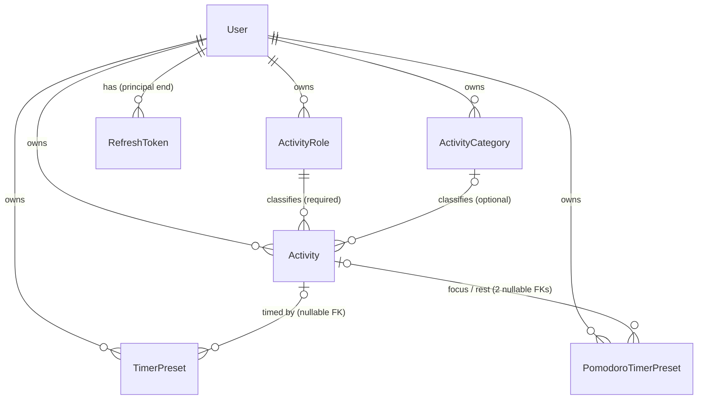

# AdhdTimeOrganizer.Core — Domain Map

Navigation index. Open only what you need; `summary.md` is the orientation.

## Model

Every FK above is `DeleteBehavior.Cascade`. That is the fact the archive feature and the merge
endpoint both exist around: deleting an `Activity` destroys the referencing rows rather than orphaning
them, in **every** slice — the one exception in the solution is
`TodoListItem.PairedLeisureActivityId`, which is `SetNull`.

## Entities — `domain/model/entity/`

| Type | Path | Notes |
|---|---|---|
| `User` | `user/User.cs` | `BaseUser` + `IBaseTableEntity`. Google OAuth id + calendar refresh token (encrypted), `HasExtensionAccess`, `FirstDayOfWeek`, `WeatherLocation` (free text, nullable — the leisure weather signal's only input; personal data, never log it). Setting `Email` also sets `UserName`. |
| `BaseEntityWithUser` | `user/BaseEntityWithUser.cs` | The portal's closing type over `BaseEntityWithUser<User>`. C# can't infer `TUser` from a constraint, so every user-scoped entity names this shim. |
| `BaseLookupWithUser` | `base/BaseLookupWithUser.cs` | Same idea for `BaseLookupWithUser<User>`. |
| `BaseEntityWithIsDone` | `base/BaseEntityWithIsDone.cs` | `BaseEntityWithActivity` + `IsDone`. Base for the done markers the slices build on. |
| `Activity` | `activity/Activity.cs` | The second hub. Required `Role`, optional `Category`, `IsUnavoidable`, `IsArchived`. `Clone()` is a `MemberwiseClone` that resets `Id` only. |
| `ActivityRole` | `activity/ActivityRole.cs` | Per-user lookup, two unique keys — see the invariants below. `SystemKey` is the stable identity the name is not. |
| `ActivityCategory` | `activity/ActivityCategory.cs` | Per-user lookup, unique on `(user_id, name)`. |
| `BaseEntityWithActivity` | `activity/BaseEntityWithActivity.cs` | `BaseEntityWithUser` + required `ActivityId`/`Activity`. Base for anything hanging off an activity, in any slice. |
| `TimerPreset` | `timer/TimerPreset.cs` | Duration + one nullable `ActivityId`. |
| `PomodoroTimerPreset` | `timer/PomodoroTimerPreset.cs` | Name, four durations, cycle counts, and **two** nullable activity FKs (`FocusActivityId`, `RestActivityId`). Timers fold into Core; there is no `AdhdTimeOrganizer.Timers` project. |

`domain/model/entityInterface/` holds the two portal markers `IEntityWithIsDone` and
`IEntityWithDoneAndTotalCount`. The `IBase*Entity` family is Framework's.

`domain/model/enum/` holds exactly **three** enums — `DayType`, `Location`, `SystemActivityRole` —
each with two consumers that cannot see each other. Every other enum belongs to the slice that owns
it; do not park a new one here to avoid a reference.

## Configuration — `infrastructure/persistence/configuration/`

| File | Covers |
|---|---|
| `extensions/EntityWithUserBuilderExtensions.cs` | `IsManyWithOneUser<TEntity>(nav?, deleteBehavior = Cascade)`, `IsOneWithOneUser<TEntity>(…)`. Here because they name the concrete `User`. **The navigation argument is optional** — that is what let the inverse collections go. Behaviour lives in Framework. |
| `extensions/EntityWithActivityBuilderExtensions.cs` | `IsManyWithOneActivity` / `IsOneWithOneActivity`, both `IsRequired()` + `Cascade` by default. |
| `activity/ActivityConfiguration.cs` | Unique `(UserId, Name)`; `(UserId, IsArchived)` leads the composite because the pickers and the grid's default view all filter on it; FK indexes for role/category. |
| `activity/RoleConfiguration.cs` | The two unique keys, and `SystemKey` stored as the C# member name (`HasConversion<string>`, max 30) rather than the camelCase wire spelling. |
| `activity/CategoryConfiguration.cs` | Unique `(UserId, Name)`. |
| `timer/*Configuration.cs` | Nullable activity FKs, all `Cascade`. |
| `user/UserEntityConfiguration.cs` | `EncryptedColumnNullable` on the Google refresh token; `TimeZoneInfo` ↔ id conversion; the `IsActive` default that stops a migration deactivating every user. |
| `user/RefreshTokenConfiguration.cs` | Configures the FK from the **principal** end, so `User.RefreshTokens` is the navigation. `AppDbContext.ConfigureRefreshTokenUserFk` is a no-op because of this. |

`infrastructure/persistence/AppQueryFilters.cs` names this host's three non-user global filters —
`ActivityArchived`, `PartitionDate`, `RoutinePeriodCompletionUserScope`. It lives in this project but
deliberately keeps the **host's** namespace. The filters themselves are declared in `AppDbContext`;
this file is only the names, and **one name per concern, never per entity**.

Everything general (`BaseEntityConfigure`, `EnumColumn`, `EncryptedColumn`, the name/text/colour
helpers, `IsPartitionedByRange`) comes from `Sydowwe.Framework` — Core adds nothing to that set.

## Invariants

DB-enforced:

1. `Activity` is unique per `(UserId, Name)`; so are `ActivityRole` and `ActivityCategory`.
2. `ActivityRole` is unique per `(UserId, SystemKey)` **filtered to `system_key IS NOT NULL`** — a user
   holds at most one role per system key, which is what makes `GetBySystemKeyActivityRoleEndpoint`'s
   `FirstOrDefault` deterministic, while user-created roles (all `null`) do not collide.
3. `Activity.RoleId` is required and **cascades**; `CategoryId` is optional and is **`SetNull`**. The
   asymmetry is the point, and the blast radius is why: an activity cascade does not stop at the
   activity — it continues through all 17 FKs into `Activity` (history rows, planner tasks in three
   shapes, to-do items, routine to-do lists, tracker mappings, all three profiles, memory anchors,
   leisure suggestion records, timer presets). So deleting a lookup could destroy a year of history
   behind a `204`. `CategoryId` being optional means `SetNull` says what was meant — losing a category
   is losing a classification. `RoleId` cannot go null, so the equivalent refusal lives in the endpoint
   instead (invariant 5 below). Both directions are frozen by
   `ActivityForeignKeyInventoryTests`, which now carries a second inventory for the FKs **out of**
   `Activity` — the first one only ever saw those whose principal is `Activity`, which is exactly how
   this went unnoticed.

App-enforced only:

4. **`IsArchived` is written by `PATCH /activity/{id}/archived` and nothing else.** No DB constraint
   stops another endpoint touching it, and `ActivityRequest` deliberately does not carry it.
   `ActivityArchivingTests.Update_DoesNotUnarchive` is the guard.
5. **A role cannot be deleted while it carries a `SystemKey` or still has activities under it**
   (`DeleteActivityRoleEndpoint`, 409 for both). Renaming, recolouring and re-iconing stay allowed. No
   API path can set or clear a key — only the seeder writes it. The activity count deliberately lifts
   `AppQueryFilters.ActivityArchived`: an archived activity cascades exactly like an active one and is
   the row a user has forgotten owning.
6. **Per-user scoping of *reads* is the DbContext's job**, via Framework's global filter on
   `IEntityWithUser` — not the endpoints (`ApplyUserScoping` is a no-op virtual). Core entities must
   stay `IEntityWithUser` and keep their FKs and cascades. `UserTimeZoneResolver` is the one
   deliberate `IgnoreQueryFilters` read, because it is what everything else's scoping is resolved
   *from*.
   **Reads only — any caller-supplied FK id is the endpoint's responsibility.** Writing a raw `long`
   into an FK column satisfies the constraint whoever owns the target row, so the filter never sees
   it: that is how a preset used to be able to point at another user's activity and be destroyed by
   *their* delete, while their `usageCount` read 0. `CallerVisibleReferenceExtensions`
   (`AllVisibleAsync<T>` / `AllActivitiesVisibleAsync`) is the check, wired into the create/update
   hooks of the activity and both preset endpoints plus quick-edit and clone; it answers **404, never
   403**, so a foreign id stays indistinguishable from a missing one. Pinned by
   `CoreForeignKeyOwnershipTests`.
7. **A seam's `IQueryable` must stay composable.** `IActivityMembershipSource.ActivityIds`,
   `IActivityReferenceSource.ReferencingActivityIds` and `IActivityReferenceService` are all composed
   into an outer query as subqueries. A `ToList()` in an implementation turns one query into twelve
   plus a client-side group-by, and silently breaks `usageCount` sorting.
   **And it must be explicit about which ambient filters it runs under.** Only the per-user filter is
   safe to lean on. `IActivityReferenceSource` counts references *regardless of archival state*, so a
   source whose tables mirror `AppQueryFilters.ActivityArchived` — the three `Activity*Profile` ones —
   lifts it in both `ReferencingActivityIds` and `RepointAsync`. Left filtered, an archived activity
   reports `usageCount: 0` while its profiles exist, and the delete row action `canDelete` exists to
   withhold is offered on the one surface that lifts the filter for the delete itself.
8. **A seam that writes must not call `SaveChanges`.** `IActivityTimeAttributionSink` and
   `IActivityReferenceSource.RepointAsync` both mutate the caller's context and leave the commit to
   it. For the merge this is load-bearing, not tidiness: it is what makes the operation atomic.
9. **No reference to `AdhdTimeOrganizer` or to any slice.** Enforced by the csproj having none, and
   pinned from the other side by `ActivityProfilesRouteSmokeTests.Core_DoesNotReferenceActivityProfiles`.
10. **Class names are table names.** Renaming a Core type is a migration; moving it is not — but
    moving it between Core's three entity namespaces changes its **schema**.

## Business rules

**Archiving vs. deleting an activity.** Archiving retires an activity from every picker while keeping
every referencing row and keeping its name rendered on those rows. It is not `ISoftDeletable`: a
soft-delete filter would make the row vanish from the history entries, planner tasks and to-do items
that still point at it, which is the opposite of the point. Deleting, by contrast, cascades through
every slice. That asymmetry is why the grid computes `canDelete`. Enforced across
`SetArchivedActivityEndpoint`, `GridActivityEndpoint.ApplyBaseFiltering`,
`BaseActivityFormSelectOptionsEndpoint` and the `ActivityArchived` filter in `AppDbContext`.

**Deleting a role or a category.** A lookup is a classification, not an owner, so losing one must never
destroy what it classified — and until this was fixed both cascaded straight into `Activity` and from
there through every slice, behind a `204 No Content`. The two answers differ only because the columns
do:

- **Category** — the FK is optional, so `DeleteBehavior.SetNull`. `DELETE /activity-category/{id}` and
  `POST /activity-category/batch-delete` still answer 204 and still remove the lookup; the activities
  survive, uncategorised, with their history intact. `usageCount` / `canDelete` on the category is
  therefore *advisory* — it exists so the confirmation dialog can say how many activities the delete
  will reclassify, not to predict a refusal.
- **Role** — the FK is required, so `SetNull` is unavailable and refusing is the only non-destructive
  answer. `DeleteActivityRoleEndpoint` counts dependent activities (archived included) and answers 409,
  reusing the branch the `SystemKey` refusal already established. `canDelete` on the role really is a
  prediction of that 409, and it is false for a keyed role however empty it is.

Deleting an **unused** lookup keeps working in both cases — that half is pinned by
`ActivityLookupDeleteCascadeTests` alongside the destructive ones, so the rule cannot over-correct into
"lookups can never be deleted".

**The unfiltered grid view means "active only", not "everything".** `BaseGridEndpoint` skips
`ApplyCustomFiltering` entirely when `useFilter` is false, so a default on
`ActivityFilterRequest.IsArchived` would never be read and every archived row would come back into the
one view most users never leave — with no error anywhere. Hence `ApplyBaseFiltering` captures whether
a filter object was sent at all. With a filter, `IsArchived` is **tri-state**: `false` = active only,
`true` = archived only, `null` = both (what the merge dialog's All view needs).

**`includeArchived` on form-select-options.** Creation forms exclude archived activities; **filter**
surfaces pass `?includeArchived=true`. `/activity-history/form-select-options` is the case that forced
the parameter — excluding archived activities from a *filter over history* would silently remove the
user's ability to filter by an activity whose rows they can still see.

**`usageCount` / `canDelete` are computed in SQL, inside the page's projection.** Not in
`PostProcessItemsAsync`, which would be cheaper and wrong: `BaseGridEndpoint` applies `SortByMany` to
the projected queryable, so a post-filled field sorts every row on `0` and returns an arbitrary page
in the right-looking order. The cost is one correlated count over a `UNION ALL` of the referencing
tables per row, bounded by the 200-row page cap and the global user filter. The agreed fallback if
that stops being affordable: `canDelete` everywhere, `usageCount` on `GET /activity/{id}` only — and
the column loses its sort.

The same pair now rides `ActivityRoleResponse` and `ActivityCategoryResponse`, on the grid and the
get-by-id of each — the two surfaces that draw a delete button. Their counts are a plain correlated
count of activities rather than a twelve-table union, and both **lift `ActivityArchived`**, so the role
and category grids override `ApplyBaseFiltering` to do it. That is why
`ActivityCategoryGridResponse.Role` spells out `!a.IsArchived` by hand instead of leaning on the
filter: the display column wants active activities and the count wants every one a delete would touch,
off the same navigation. Everywhere else — `GetAll`, select-options, and the role/category nested
inside every `ActivityResponse` — the fields stay at their defaults and mean "not asked for", the same
contract `ActivityResponse` documents.

**Merge is all-or-nothing, and order is load-bearing.** `POST /activity/merge` repoints every
referencing row onto the survivor, saves, *then* deletes the merged activities, all inside one
explicit transaction. Deleting first would cascade the rows away silently — no exception, no log line,
and a plausible-looking count in the response. Cross-role and cross-category merges are permitted and
the survivor's placement wins; **archived activities may be merged in both directions** — into an
archived survivor (which stays archived) and away as a merged id — because the dialog draws its
candidates from the grid's All view and offers exactly those; a single unknown id fails the whole
merge; a cross-user id is a **404, never a 403**, so existence is never confirmable across accounts.
Both queries lift only `AppQueryFilters.ActivityArchived`; the per-user filter is what keeps the
foreign id a 404.

**Quick-create resolves its role by `SystemKey`, not by name.** The client used to look the role up by
its seeded English display name, so renaming it — which the Slovak UI must do — 404'd the lookup and
silently killed quick-create. The enum member names are the wire contract (camelCase via
`JsonStringEnumMemberName`, sent verbatim as a path segment, and doubling as i18n sub-keys
client-side): **never rename one**. The persisted column holds the C# member name instead, so the two
spellings are independent.

**A missing user's time zone resolves to UTC, not `TimeZoneInfo.Local`** — the answer must not depend
on which machine the server happens to be running on.

## Glossary

| Term | Meaning | Code |
|---|---|---|
| Activity | The thing you spend time on — the noun the whole product hangs off | `Activity` |
| Role | The life area an activity belongs to (required, per-user, user-renameable) | `ActivityRole` |
| Category | Optional secondary classification of an activity | `ActivityCategory` |
| System role | One of the three roles the app itself looks up for quick-create | `ActivityRole.SystemKey` / `SystemActivityRole` |
| Archived | Retired from pickers, kept everywhere else | `Activity.IsArchived` |
| Usage count | Rows across every slice that would break if the activity were deleted | `ActivityResponse.UsageCount` |
| Seam | A contract declared in Core so one slice can reach another's rows | `ISeam` / `ISeamEvent` |
| Preset | A saved timer duration, optionally pointed at an activity | `TimerPreset`, `PomodoroTimerPreset` |

## Navigation index

### Seams — `application/seam/`

`README.md` in that folder is the full registry (implementer, consumer, resolution style, and how each
one fails). Summary:

| Name | Kind | Responsibility | Path |
|---|---|---|---|
| `ISeam` / `ISeamEvent` | Marker | Makes the whole seam surface findable by type hierarchy; `ISeamEvent : IEvent` | `ISeam.cs` |
| `IActivityMembershipSource` | Seam (read, keyed) | "Which activities appear in your area?" — TodoLists/Routines implement, History consumes | `IActivityMembershipSource.cs` |
| `IActivityReferenceSource` | Seam (read + write, keyed) | "Which of your rows point at an activity" + "repoint them" — every slice implements, Core consumes | `IActivityReferenceSource.cs` |
| `IActivityTimeAttributionSink` | Seam (write, single) | Records observed time into the activity ledger — History implements, Tracking consumes | `IActivityTimeAttributionSink.cs` |
| `ICalendarDayLookup` | Seam (read, single) | Calendar-day metadata for a range — Planning implements, History consumes | `ICalendarDayLookup.cs` |
| `ITodoListItemLoggedTimeSource` | Seam (read, single) | Seconds logged per to-do item on a day, keyed on `ActivityHistory.TodoListItemId` **only** | `ITodoListItemLoggedTimeSource.cs` |
| `TimerPresetActivityReferenceSource` | Implementation | Core's own reference source: the three nullable activity columns on the two preset entities | `TimerPresetActivityReferenceSource.cs` |
| `ActivityMembershipSourceKeys` / `ActivityReferenceSourceKeys` | Constants | The known keys. Read the constant, never retype the literal — a typo is a silent no-op | `*SourceKeys.cs` |

### Seam events — `application/event/`

| Name | Published by | Handled by | Path |
|---|---|---|---|
| `ActivityTimeRecordedEvent` (+ `ActivityDayTotal`) | Tracking | host `ActivityTimeRecordedEventHandler` (Planning + TodoLists + Routines; enforces an **exclusive** rule) | `ActivityTimeRecordedEvent.cs` |
| `PlannerTaskIsDoneChangedEvent` | Planning, and the host handler above | host (TodoLists + Routines in one `SaveChanges`) | `PlannerTaskIsDoneChangedEvent.cs` |
| `TodoListItemIsDoneChangedEvent` | TodoLists | Planning | `TodoListItemIsDoneChangedEvent.cs` |
| `RoutineTodoListIsDoneChangedEvent` | Routines | Planning | `RoutineTodoListIsDoneChangedEvent.cs` |

All four publish `Mode.WaitForAll` — synchronous in-process, after the publisher's own commit, in
their own scope, logging and swallowing rather than failing the request. **A handler belongs to the
slice it writes into**; the two host-side ones stay there because they write into several slices at
once. An event with no handler is completely inert — `SeamWiringTests.SeamEvents_AllHaveAHandler` is
what keeps that from recurring.

### Services — `application/service/` (contracts in `domain/serviceContract/`)

| Name | Kind | Responsibility | Path |
|---|---|---|---|
| `ActivityReferenceService` | Service | Folds every `IActivityReferenceSource` into one composable `UNION ALL` + an atomic repoint. Sources run sequentially — they share one `DbContext` | `service/ActivityReferenceService.cs` |
| `UserDefaultsService` | Service | Runs every per-user default seeder for a new account (`IUserDefaultsService`) | `service/UserDefaultsService.cs` |
| `UserTimeZoneResolver` | Service | A user's zone for resolving wall-clock times; memoised per request, keyed by user id | `service/UserTimeZoneResolver.cs` |

### HTTP surface — `application/endpoint/` (40 endpoints)

| Name | Kind | Responsibility | Path |
|---|---|---|---|
| `GridActivityEndpoint` | Endpoint | Settings grid; projects `usageCount`/`canDelete` in SQL, tri-state archive filter | `activity/activity/query/GridActivityEndpoint.cs` |
| `GetAllActivityEndpoint` · `GetByIdActivityEndpoint` · `GetSelectOptionsActivityEndpoint` | Endpoint | Reads; `GetById` carries `usageCount`/`canDelete` | `activity/activity/query/` |
| `ActivityFormSelectOptionsEndpoint` | Endpoint | Activity-side form options; subclass of the shared base below | `activity/activity/query/` |
| `CreateActivityEndpoint` · `UpdateActivityEndpoint` · `DeleteActivityEndpoint` | Endpoint | CRUD. Delete lifts `ActivityArchived` so the archive view's row action works | `activity/activity/command/` |
| `QuickEditActivityEndpoint` | Endpoint | `PUT /activity/{id}/quick-edit` — the overwrite half of quick-create | `activity/activity/command/` |
| `CloneActivityEndpoint` | Endpoint | `POST /activity/{id}/clone`; names the copy `"{name} (copy)"` when unchanged | `activity/activity/command/` |
| `SetArchivedActivityEndpoint` | Endpoint | `PATCH /activity/{id}/archived` — the **only** writer of `IsArchived`; idempotent 204 | `activity/activity/command/` |
| `MergeActivityEndpoint` | Endpoint | `POST /activity/merge` — repoint-then-delete in one transaction | `activity/activity/command/` |
| Role: `Create` · `Update` · `Delete` | Endpoint | CRUD. Delete refuses a `SystemKey` role with 409 | `activity/role/command/` |
| Role: `GetAll` · `GetById` · `GetByName` · `GetBySystemKey` · `GetSelectOptions` · `Grid` | Endpoint | Reads. `GetBySystemKey` is the identity-based replacement for `GetByName` | `activity/role/query/` |
| Category: `Create` · `Update` · `Delete` · `BatchDelete` | Endpoint | CRUD | `activity/category/command/` |
| Category: `GetAll` · `GetById` · `GetSelectOptions` · `Grid` | Endpoint | Reads | `activity/category/query/` |
| `TimerPreset` · `PomodoroTimerPreset` (5 each) | Endpoint | Create/Update/Delete + GetAll/GetById | `timer/**` |
| `BaseActivityFormSelectOptionsEndpoint<TEntity>` | Endpoint base | `GET /{route}/form-select-options` with the `?includeArchived=` opt-in. Subclassed from **three** places — here, plus History's and Planning's | `base/BaseActivityFormSelectOptionsEndpoint.cs` |

DTOs sit under `application/dto/` — `request/activity`, `request/timer`, `request/extendable`
(`IActivityIdRequest`, `WithIsDoneRequest`), `request/generic` (`ValueRequest`,
`ToggleIsDoneRequest`), the matching `response/*` folders including `IEntityWithActivityResponse` /
`WithActivityResponse` / `WithIsDoneResponse`, three filters, `DateRangeDto` and
`ActivityDateRangeType`. Mapping lives on the DTOs (`ICreateRequest` / `IUpdateRequest` /
`IProjectionResponse`), not a mapper generic.

`application/validator/` holds 10: the four activity-side ones (`Activity`, `ActivityRole`,
`ActivityCategory`, `QuickEditActivity`), `MergeActivityValidator`, the two timer ones, the two shared
validators (`NameTextColorIconValidator`, `ValueRequestValidator`), and `TimeDtoRules` — a static rule
helper, **not** a validator. `TimeDto` (Framework's) is only ever a member of a request, never a request
itself, and FastEndpoints resolves validators by exact request type, so the `Validator<TimeDto>` that
used to sit here was never instantiated. Call `RuleFor(x => x.SomeTime).ApplyTimeOfDayRules()` from the
concrete request validator instead; `IsBefore` orders two `TimeDto`s without `ToTimeOnly()`, which throws
on the very values the range rule is there to reject.

### Seeding — `infrastructure/persistence/seeder/`

`SeederOrderBands.md` is the contract — read it first. Core owns band **010–099**, shared with
ActivityProfiles because the dev chain interleaves.

| Name | Kind | Responsibility | Path |
|---|---|---|---|
| `SeedUserIdProvider` | Service | Implements both `ISeedUserProvider` (Framework) and `ISeedUserIdProvider` (Contracts), so framework and module seeding code can find users without referencing `User` | `SeedUserIdProvider.cs` |
| `DefaultUsersSeeder` (20) | App-wide default | Creates the root admin, assigns `PortalRoleCatalog.Root`, then calls `IUserDefaultsService.CreateDefaultsAsync`. Must run after Framework's `UserRoleSeeder` (4) | `default/DefaultUsersSeeder.cs` |
| `DefaultActivityRoleSeeder` (10) | Per-user default | Seeds the three `SystemKey`-carrying roles; matches on the key so a renamed role is not duplicated | `userDefault/DefaultActivityRoleSeeder.cs` |
| `TimerPresetSeeder` (30) · `PomodoroTimerPresetSeeder` (31) | Per-user default | `BasePerUserDefaultSeeder<T>`; key off `Collides`, never row counts | `userDefault/` |
| `ActivityRoleSeeder` (20) · `ActivityCategorySeeder` (30) · `ActivitySeeder` (40) | Per-user **dev** | Fixtures, in FK order. **Only dev seeders truncate** (`TruncateTableCascadeAsync`) | `dev/` |

### Security — `infrastructure/security/`

| Name | Kind | Responsibility | Path |
|---|---|---|---|
| `PortalRoleCatalog` | Catalog | The three role names + tiers, read by both endpoint gating and `UserRoleSeeder`. Installed in `Program.ConfigureServices` **before** `AddFastEndpoints()`. Default endpoint tier is `User`, deliberately | `PortalRoleCatalog.cs` |
| `PortalAuthorizationPolicies` | Constants | The `ActivityTracking` policy **name** only — what it requires stays host-side. Core holds the key both sides must agree on, same as the role names | `PortalAuthorizationPolicies.cs` |
