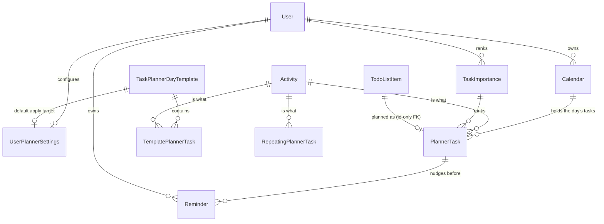

# AdhdTimeOrganizer.Planning — Domain Map

Read [`summary.md`](summary.md) first. This file is the deep reference: the model, what is actually
enforced, the rules behind the two derived numbers, and the navigation index.

## Model

`User` and `Activity` are Core's. `TodoListItem` is TodoLists' and is **not referenced by this
project** — see [the one cross-slice relationship](#the-one-cross-slice-relationship).

| Type | File |
|---|---|
| `Calendar` | `domain/model/entity/Calendar.cs` |
| `BasePlannerTask` | `domain/model/entity/activityPlanning/BasePlannerTask.cs` |
| `PlannerTask` | `domain/model/entity/activityPlanning/PlannerTask.cs` |
| `RepeatingPlannerTask` | `domain/model/entity/activityPlanning/RepeatingPlannerTask.cs` |
| `TemplatePlannerTask` | `domain/model/entity/activityPlanning/TemplatePlannerTask.cs` |
| `TaskPlannerDayTemplate` | `domain/model/entity/activityPlanning/TaskPlannerDayTemplate.cs` |
| `TaskImportance` | `domain/model/entity/activityPlanning/TaskImportance.cs` |
| `UserPlannerSettings` | `domain/model/entity/activityPlanning/UserPlannerSettings.cs` |
| `Reminder` | `domain/model/entity/reminder/Reminder.cs` |
| `PlannerSuggestionFromPlannerTask` / `…FromActivityHistory` / `…FromDayTemplate` | `domain/model/entity/suggestion/` |
| `PlannerTaskStatus` · `RecurrenceType` · `ReminderRecurrence` · `SuggestionSourceType` | `domain/model/enum/` |

**Three task tables, one C# base.** `PlannerTask`, `RepeatingPlannerTask` and `TemplatePlannerTask`
share `BasePlannerTask` in code but each has its own configuration and its own table — there is no
TPH/TPT hierarchy in the model. Anything that must cover "every planner task" needs three clauses,
not one; `PlannerTaskActivityReferenceSource` is the example to copy.

### The one cross-slice relationship

`PlannerTask.TodolistItemId` → `todo_list_item.id`, `ON DELETE SET NULL`, constraint name pinned to
`fk_planner_task_todo_list_items_todolist_item_id`.

**Declared in the host**, at `AdhdTimeOrganizer/infrastructure/persistence/AppDbContext.cs` →
`ConfigureCrossSliceRelationships`, because that is the only place both entity types are in scope.
There is no navigation property on either end; do not add one back.

The name is pinned verbatim from the original configuration: EF derives a relationship's constraint
name from whether the principal's `ToTable` has already run when the FK is named, so the generated
name shifts every time a new slice changes the `ApplyConfigurationsFromAssembly` order. Naming it
explicitly makes it immune.

### Suggestion read-models

Three keyless entities mapped over materialized views. The views themselves — SQL, installer, refresh
interceptor and refresh job — are **host-side**; only the mappings live here, because the two
suggestion endpoints are their only consumers.

| Entity | View | Consumed by |
|---|---|---|
| `PlannerSuggestionFromPlannerTask` | `mv_planner_task_pattern` | `GetSuggestionsRepeatingPlannerTaskEndpoint` |
| `PlannerSuggestionFromActivityHistory` | `mv_activity_history_pattern` | `GetSuggestionsRepeatingPlannerTaskEndpoint` |
| `PlannerSuggestionFromDayTemplate` | `mv_template_suggestion_pattern` | `GetSuggestionsTaskPlannerDayTemplateEndpoint` |

The names carry both halves on purpose: `PlannerSuggestion…` is who consumes the rows, `…From<Source>`
is which table they were aggregated from. **The class names are decoupled from the view names** —
every configuration pins its view with an explicit `ToView(...)`, so renaming an entity never touches
the schema.

## Invariants

| Invariant | Enforced by |
|---|---|
| One calendar row per (user, day) | **DB** — unique index `(user_id, date)` on `calendar` |
| One importance rank per (user, value) | **DB** — unique index `(user_id, importance)` on `task_importance`. Text is free to repeat |
| One `UserPlannerSettings` row per user | **DB** — 1:1 mapping (`IsOneWithOneUser`). The read endpoint is get-or-create on top of it |
| A calendar with tasks cannot be deleted | **DB** — `planner_task.calendar_id` is `Restrict` |
| Deleting a planner task deletes its reminders | **DB** — `reminder.planner_task_id` is `Cascade`. It does **not** reach the module's `ReminderDefinition` |
| Deleting a template deletes its lines | **DB** — `template_planner_task.template_id` is `Cascade` |
| Deleting an importance level does not delete the tasks that used it | **DB** — `SetNull` on all three task tables and on `user_planner_settings.default_apply_template_id` |
| Deleting a to-do item does not delete the task planned from it | **DB** — `SetNull`, declared host-side |
| `Reminder.LeadOffsetsMinutes` are all `<= 0` and unique | **App, twice** — `ReminderValidator` gives the user a friendly 400; the property setter throws as a backstop for write paths that skip the DTO validator |
| `EndTime > StartTime` on a planner task | **App only** — every planner-task validator rejects it. There is no CHECK constraint, and `TaskPlannerHelper.TasksOverlap` assumes it |
| `DayType.Weekend` only on Sat/Sun, `DayType.Workday` never on a weekend | **App only** — `CalendarDayTypeRule`, called from two endpoints. Not a constraint: neither caller has the date in its request, so it cannot live in a validator |
| A planner task names its day by **exactly one** of `CalendarId` / `Date` | **App only** — the two request validators. Both or neither is a 400, deliberately, rather than a precedence rule |
| A batched request's calendar ids are distinct and within `PlannerBatchLimits` | **App only** — `CalendarBatchValidators`, `PlanVsActualTrendValidator` |
| `TaskImportance.OptionalMarkerValue` = 666 identifies the "optional" level | **App only, by value** — `BasePlannerTask.IsOptional` compares against the number. Nothing stops a user editing that row's rank; the guard is a test |
| `Reminder.RemindAt` matches its task's instant | **App only** — recomputed by `ReminderRegistrationService` on every sync. Nothing detects drift |
| Every entity's schema is `planning` | **Model build** — `ModuleSchemas.Resolve` throws for an unmapped assembly |

## Business rules

### Day-plan completion streak

The flame chip on the home page. **Derived, never stored** — no entity, no column, no migration and
no repair path; recomputed from `planner_task` rows on every read. That is the opposite of the
Routines slice's `Streak` / `BestStreak` columns, and the difference is not taste: a routine period
*wipes its items* on reset, so its counter has to be the record, while planner days keep every task
row forever. Deriving it makes un-ticking an exact inverse (there is no increment to undo), makes
editing a past day recompute across the gap it opens, and makes drift unrepresentable.

| Question | Answer |
|---|---|
| What makes a day count? | Every **qualifying** task is `Completed`. Qualifying = not `IsBackground`, not `IsOptional`, not `Cancelled` |
| Does a skip break the day? | **No.** `Cancelled` leaves the denominator entirely — the app already presents skipping as a legitimate way to close a task |
| Does skipping everything earn a day? | **No.** Zero denominator ⇒ the day is *empty*, not complete |
| Does an unplanned day break the streak? | **No** — and it does not extend it either. The number means "days I completed" |
| Does a background-only day count? | No — it is empty, exactly like an unplanned one |
| Optional tasks? | Excluded, same as background |
| Grace days? | **None.** The three rules above are already lenient; grace on top would make the number unaccountable. If one is ever wanted it goes in `Walk`, not `Evaluate` |
| Day boundary? | The user's own `User.Timezone`. The response returns `Today` + `Timezone` so the client can stop computing dates |
| Retroactive edits? | Recomputed, including across the gap. Free, given the above |

Two rules exist for the client's sake rather than the domain's, and both are load-bearing:

- **Today can never break the streak, only extend it.** An unfinished today is unfinished, not
  failed. Without this the chip reads 0 every morning and climbs back by evening.
- **`CurrentStreak` is the value to display, already zeroed when dead.** The client owns no "is it
  still alive" decision — that judgement depends on the skip and empty-day rules, which live here.

⚠ **The streak's denominator is narrower than the progress ring's.** The ring counts every
non-background task; the streak also drops optional and cancelled ones. A day can read 4/5 on the
ring and still be complete. Clients must read `IsTodayComplete` rather than comparing counts.

⚠ **It rides on `CalendarResponse.Streak` and is null on every calendar read except
`GetByDateCalendarEndpoint`**, which fills it in after the projection — `Projection` runs per row and
cannot walk days. Nothing breaks if that line is dropped; the field just goes null and the chip
sticks at zero.

⚠ The read is deliberately **uncapped**: a lookback window would turn `BestStreak` into a rolling
maximum, so a record the user really set could quietly shrink.

| Type | File |
|---|---|
| `PlannerStreakService` | `domain/service/PlannerStreakService.cs` — the rules (`Evaluate` one day, `Walk` the history) |
| `IPlannerStreakReader` | `domain/serviceContract/IPlannerStreakReader.cs` |
| `PlannerStreakReader` | `application/service/taskPlanner/PlannerStreakReader.cs` — the qualifying-task predicate + the day boundary |
| `PlannerStreakResponse` | `application/dto/response/taskPlanner/PlannerStreakResponse.cs` |

### Plan-vs-actual trend

`POST /planner-task/plan-vs-actual-trend` — six numbers describing how the user's planned time
compared with their logged time over an inclusive date range. **Derived, never stored**, like the
streak.

The *single-day* version of this needs no server at all — the day view already holds
`ActualStartTime`/`ActualEndTime` beside `StartTime`/`EndTime`. The trend cannot be answered that way:
`planner-task/filter` takes one calendar id, so thirty days of it is thirty requests. Nor can the
history dashboards answer it — they aggregate `ActivityHistory` (free-standing tracking), which has
no plan to drift from.

| Question | Answer |
|---|---|
| Which tasks count? | Not `IsBackground`, not `Cancelled`, on a day in the range that is **over**. Optional tasks *do* count — unlike the streak, this describes estimation, and an optional task was still estimated |
| When is a day "over"? | **Strictly before the user's own today**, however late the request arrives. Today's untouched tasks have not been missed, they have not come around yet — and every one would land in `neverHappenedCount` and drag the trend |
| Does a skip count as a task that never happened? | **No.** `Cancelled` leaves the population entirely — the same call the streak makes, and the two must not diverge |
| Do the two sums cover the same tasks? | **No, and this is the trap.** `plannedMinutes` spans every counted task, including ones that never happened; `actualMinutes` spans only those `Completed` **and** carrying both actual times. `actual / planned` alone therefore understates the person's pace whenever `neverHappenedCount` is non-zero — which is why that count is in the response rather than left to be inferred |
| A `Completed` task with no actual times? | Counted, its plan summed, **no** actual minutes, and **not** a "never happened" — it is unmeasurable, and inferring the missing end from the plan would fabricate exactly the zero drift the number exists to measure |
| Nothing eligible? | `200` with six zeroes, never a 404. `taskCount: 0` is the client's signal to render nothing. A range entirely in the future answers this way |
| Midnight? | Every span and every comparison wraps. A 23:00–00:30 task is 90 minutes; a task planned for 23:50 and started at 00:10 is twenty minutes late, not twenty-three hours early (the near reading wins — see `DriftMinutes`) |

⚠ **The range is the only thing bounding the scan**, so it is capped at
`PlannerBatchLimits.MaxSummaryRangeDays` and a backwards one is a 400 — the same two rules
`CalendarTaskSummariesValidator` applies, sharing the same ceiling.

| Type | File |
|---|---|
| `PlanVsActualTrendService` | `domain/service/PlanVsActualTrendService.cs` — `Aggregate` over rows; `SpanMinutes` / `DriftMinutes` handle midnight |
| `GetPlanVsActualTrendPlannerTaskEndpoint` | `application/endpoint/plannerTask/query/` — the eligibility predicate + the day boundary |
| `PlanVsActualTrendRequest` / `…Response` | `application/dto/{request,response}/taskPlanner/` |
| `PlanVsActualTrendValidator` | `application/validator/PlanVsActualTrendValidator.cs` |

### The one-request day plan

`GET /calendar/day-plan/{date}` returns the calendar row, its planner tasks ordered by start time,
and the streak. It exists because the home page could not ask for a day's tasks in one hop:
`PlannerTaskFilter` is keyed on `CalendarId`, and the only source of that id was `by-Date`.

| Question | Answer |
|---|---|
| What does a date with no calendar return? | **200 with `Calendar: null`, `Tasks: []`** — never 404. `by-Date` keeps its 404; it is a lookup, this is a page load, and a rejected promise there renders a retry button over a day that is merely unplanned |
| Is a calendar created lazily on first task? | Yes — see [lazy day creation](#lazy-day-creation) |
| Is the `From`/`Until` window meaningful for a whole-day read? | **No.** Home only ever passed 00:00–23:59, so this route has no window at all |
| Can a task belong to a date but not a calendar? | **No.** `PlannerTask.CalendarId` is non-nullable, so the calendar id is an implementation detail the client never holds |

⚠ **The streak is hoisted to the top level here** (`DayPlanResponse.Streak`), and the copy nested on
`Calendar.Streak` is nulled out. It has to survive a null calendar — it is a fact about the user, not
about the day — and two copies would eventually be filled by different code paths and disagree.

⚠ An empty state reads `DayPlanResponse.HasPlan` (`Tasks.Count > 0`), **not** the presence of a
calendar row: the seeder fills whole years, so presence means almost nothing.

The day-planner view still filters by calendar id and time window, which is the shape it genuinely
needs; only home stopped using it.

### The four batched calendar entry points

The month grid had the same problem the home page had, one dimension wider: every endpoint it needed
was keyed on **one** calendar id, so the view fanned out over the visible days. Four routes collapse
that, and **none of them replaces the per-day route it batches** — the day view still wants one day
at a time.

| Route | Replaces | Fan-out it removes |
|---|---|---|
| `POST /calendar/task-summaries` | `POST /planner-task/filter` per day | up to 31 reads per navigation |
| `POST /calendar/apply-planner-template/batch` | `POST /calendar/apply-planner-template` per day | one per selected day |
| `POST /planner-task/copy-to-days` | `POST /planner-task` per (target day × source task) | 12 tasks onto 10 days was 120 writes |
| `PATCH /calendar/day-type/batch` | `PUT /calendar/{id}` per day | one per selected day |

| Question | Answer |
|---|---|
| Is a batch transactional? | **No, and deliberately.** Each day is applied and committed on its own, in request order — the per-day fan-out was not atomic either, and conflict resolution is a per-day decision against that day's own tasks. All three writes answer `200` with `results[]`, one `{calendarId, succeeded}` per requested id (`CalendarBatchResultResponse`) |
| What happens to a day the caller does not own? | It comes back `succeeded: false`, not 403. These endpoints scope through the host's global `IEntityWithUser` filter alone, so another user's id simply does not resolve — indistinguishable from a stale id, which is the same thing to the client |
| May the id list repeat an id? | **No — 400.** The response promises one result per requested id *in order*; a duplicate makes that mapping ambiguous either way it is resolved. Lists are also capped (`PlannerBatchLimits`), because batching removed the browser connection limit that used to bound these |
| Does a copy carry the source day's execution state? | **No.** Span, lane, location, notes, activity and importance travel; `Status` resets to `NotStarted`, and actual times / skip reason / Google event id / the to-do link do not travel at all. A day copied onto next Tuesday would otherwise arrive already completed, and a copied `TodolistItemId` would point several tasks at one item and fan every done-toggle across all of them |

⚠ `POST /calendar/task-summaries` answers a **reduced** shape (id, span, lane, colour, activity name)
and **omits days with no tasks**. Reusing `PlannerTaskResponse` would ship a nested
activity/role/category object per task for every day in the month, which is most of what the route
exists to stop sending.

### Applying a day template

`PlannerTemplateApplier` (`application/helper/`) is the **only** implementation of the stamp and the
four conflict-resolution modes, shared by the single-day and batched apply endpoints. It only
*stages* — adds and removes on the passed `DbContext`, never saves — and the caller must read
`StagedTaskDeletions` off the ChangeTracker *before* saving, which is where the reminder ids of
cascaded-away tasks are captured.

| Mode | What happens to the overlap |
|---|---|
| `Ignore` | The conflicting **new** task is dropped whole; existing tasks are untouched |
| `Overwrite` | The conflicting **existing** tasks are deleted whole; all new tasks are added |
| `MergeIgnore` | New tasks are **carved** around existing ones — split when an existing task sits in the middle, shortened when it overlaps an edge |
| `MergeOverwrite` | Existing tasks are carved around the new ones (removed and re-added as segments) |

The stamp itself always runs: `Calendar.AppliedTemplateId` / `AppliedTemplateName`, the template's
`DefaultWakeUpTime` / `DefaultBedTime` when it has them, and `LastUsedAt` / `UsageCount++` on the
template.

### Lazy day creation

**A planner task may name its day by `Date` instead of `CalendarId`, and the calendar row is created
if the user has none.** Exactly one of the two is required, on `PlannerTaskRequest` and on
`ApplyTemplateToTaskPlannerRequest`; sending both is a 400 rather than a precedence rule, because the
two can disagree and the loser is a task filed on a day nobody asked for.

The defect it fixes: `CalendarSeeder` filled a hard-coded `{ 2025, 2026 }` at user setup and there is
**no create-calendar endpoint** — only `UpdateCalendarEndpoint`. Past the last seeded year every date
resolved to no row, so the planner rendered an ordinary empty day that silently refused every task,
and nothing in the app could make the row it needed. No exception, no log line, an expiry date on the
product.

| Type | Role |
|---|---|
| `HolidayCalendar` (`domain/service/`) | The holiday tables + Computus |
| `CalendarDayFactory` (`domain/service/`) | What an unplanned day *is* — day type, holiday name, default sleep window (08:00 / 00:00) |
| `ICalendarProvisioner` / `CalendarProvisioner` | Read-or-create for one (user, date) |

Both creators go through `CalendarDayFactory`, and that is the point of it: a day filled in a year
ahead and the same day created on its first task have to be the same day. Holidays do **not** override
the day type — a holiday on a Tuesday is a `Workday` row with a `HolidayName`.

The three callers of the provisioner are `CreatePlannerTaskEndpoint`, `UpdatePlannerTaskEndpoint` (a
task dragged onto an unplanned day) and `ApplyTemplatePlannerTaskEndpoint` (**by date**; by id it
still 404s, because an id resolving to nothing is a stale client rather than an unplanned day).

⚠ `EnsureForDateAsync` **commits**, and it scopes by hand. `(user_id, date)` is unique and the race is
real — a phone and a desktop starting the same morning's first task; the loser catches
`DbUpdateException`, **detaches** its failed insert and reads the winner's row.

`CalendarSeeder`'s year list is now `{ this year, next year }`, resolved when it runs. That is
hygiene, not the fix — it only helps users created from now on.

### Reminders

`Reminder` owns **user intent** only: the title, the instant, the lead offsets, the recurrence, and
the optional planner task it is attached to. Scheduler state — status, next occurrence, dispatch
history — belongs to the module's `ReminderDefinition` and must never be mirrored onto this row; two
sources of truth for "did it fire yet" drift the first time a scan and a request interleave.

| Rule | Why |
|---|---|
| **The absence of a row is the "no reminder" state** | That is what makes reminders opt-in per task rather than automatic for every task, and why this is an entity rather than two columns on `PlannerTask` — columns would cap the user at one reminder per task and have nowhere to put a standalone one |
| `RemindAt` is an **instant**, not a `CalendarId` | A recurring reminder belongs to no single day, and calendar rows only exist for days the user has planned. The day view filters this column by the user's local-day range instead |
| For a task-linked reminder, `RemindAt` is **derived** | Recomputed from `Calendar.Date` + `StartTime` in the user's own zone on every sync. The task stays authoritative — that bidirectional coupling is why reminders are in this slice rather than a project of their own |
| Lead offsets are `<= 0` and unique | `[-10, 0]` means "ten minutes before, and again at the time". Never write `[10]` meaning "ten minutes before" |
| A **recurring** reminder carries exactly one offset | The contracts layer's recurring schedule has no lead-offset concept, so the single offset is folded into the recurrence anchor at registration |
| A past **one-shot** is rejected; a past **recurring anchor** is accepted | The second is a birthday — the occurrence calculator walks forward from it |
| `RemindersEnabled = false` suppresses the **prefill**, never the reminder | It is a preference about being *offered* reminders, not a kill switch over ones the user explicitly created. Without a lead default the reminder simply fires at the moment itself |
| `ReminderRecurrence` is a portal enum, not the contracts one | The portal must be free to expose a different set to users. The mapping lives in exactly one place — `ReminderRegistrationService.ToPreset` |
| **Always sync after the portal row is saved** | The registry writes through the same scoped `DbContext` and commits; registering first would publish a schedule for a row that may never exist |

## Glossary

| Term | Meaning | Code |
|---|---|---|
| Day / calendar day | One user's one date, with its metadata and sleep window | `Calendar` |
| Planner task | A planned block on a day: start, end, activity, importance | `PlannerTask` |
| Repeating task | A recurrence the user wants on matching days — **not** materialised into planner tasks by anything today | `RepeatingPlannerTask` |
| Day template | A named plan the user stamps onto days ("Office day") | `TaskPlannerDayTemplate` |
| Template task | One line inside a day template | `TemplatePlannerTask` |
| Background task | Scaffolding, not work — excluded from the streak, the trend and the ring | `BasePlannerTask.IsBackground` |
| Optional task | A task the user has said must not hold them to anything | `BasePlannerTask.IsOptional` (importance == 666) |
| Skip / cancel | Closing a task without doing it — a legitimate outcome, not a failure | `PlannerTaskStatus.Cancelled` |
| Span | A task's planned start→end, wrapping midnight | `PlanVsActualTrendService.SpanMinutes` |
| Drift | Actual start vs. planned start, near-reading wins | `PlanVsActualTrendService.DriftMinutes` |
| Never happened | Counted in the trend, plan summed, no actual minutes | `PlanVsActualTrendResponse.NeverHappenedCount` |
| Streak | Consecutive days where every qualifying task was completed | `PlannerStreakResponse.CurrentStreak` |
| Stamp | Writing a template's identity and defaults onto a day | `PlannerTemplateApplier.StampTemplate` |
| Carve | Splitting a task around an overlapping one instead of dropping either | `PlannerTemplateApplier.CarveTaskAroundBlockers` |
| Reminder (portal) | The user's intent: title + instant + what it's attached to | `Reminder` |
| Reminder definition (module) | The schedule and its dispatch history | `Sydowwe.Reminders.ReminderDefinition` |

## Navigation index

### Endpoints — calendar (`application/endpoint/calendar/`)

| Name | Kind | Responsibility | Path |
|---|---|---|---|
| `GetByIdCalendarEndpoint` | Query (`BaseGetByIdEndpoint`) | One day by id | `GetByIdCalendarEndpoint.cs` |
| `GetByDateCalendarEndpoint` | Query (`BaseGetByFieldEndpoint`) | One day by date; **404s** when absent. Fills `CalendarResponse.Streak` after the projection | `GetByDateCalendarEndpoint.cs` |
| `GetDayPlanCalendarEndpoint` | Query (custom) | `GET /calendar/day-plan/{date}` — calendar + tasks + streak in one hop; **200** on an unplanned day | `GetDayPlanCalendarEndpoint.cs` |
| `FilterCalendarEndpoint` | Query (`BaseFilterEndpoint`) | Filter/sort over days | `GetFilteredSortedCalendar.cs` |
| `GetTaskSummariesCalendarEndpoint` | Query (custom) | `POST /calendar/task-summaries` — a date range grouped by day, reduced shape, empty days omitted | `GetTaskSummariesCalendarEndpoint.cs` |
| `UpdateCalendarEndpoint` | Command (`BaseUpdateEndpoint`) | Edit a day; turns a `CalendarDayTypeRule` violation into a 400 | `UpdateCalendarEndpoint.cs` |
| `BatchUpdateDayTypeCalendarEndpoint` | Command (custom) | `PATCH /calendar/day-type/batch` — day type on N days, per-day results | `BatchUpdateDayTypeCalendarEndpoint.cs` |

### Endpoints — planner tasks (`application/endpoint/plannerTask/`)

| Name | Kind | Responsibility | Path |
|---|---|---|---|
| `CreatePlannerTaskEndpoint` | Command (`BaseCreateEndpoint`) | Create; resolves the day via `ICalendarProvisioner` in `BeforeMapping`. **No reminder wiring** — reminders are opt-in | `command/CreatePlannerTaskEndpoint.cs` |
| `UpdatePlannerTaskEndpoint` | Command (`BaseUpdateEndpoint`) | Edit; a task moved onto an unplanned day creates it | `command/UpdatePlannerTaskEndpoint.cs` |
| `DeletePlannerTaskEndpoint` | Command (`BaseDeleteEndpoint`) | Delete; captures reminder ids **before** the cascade, cancels after | `command/DeletePlannerTaskEndpoint.cs` |
| `BatchDeletePlannerTaskEndpoint` | Command (`BaseBatchDeleteEndpoint`) | Delete several | `command/BatchDeletePlannerTaskEndpoint.cs` |
| `PatchPlannerTaskSpanEndpoint` | Command (`BasePatchEndpoint`) | Drag/resize; re-registers the reminders whose instant just moved | `command/PatchPlannerTaskSpanEndpoint.cs` |
| `PatchPlannerTaskStatusEndpoint` | Command (custom) | Status + actual times via `ApplyStatus`; re-syncs reminders | `command/PatchPlannerTaskStatusEndpoint.cs` |
| `CopyToDaysPlannerTaskEndpoint` | Command (custom) | `POST /planner-task/copy-to-days` — one day's plan onto N days, without execution state | `command/CopyToDaysPlannerTaskEndpoint.cs` |
| `ApplyTemplatePlannerTaskEndpoint` | Command (custom) | One template onto one day (by id **or** by date), through `PlannerTemplateApplier` | `command/ApplyTemplatePlannerTaskEndpoint.cs` |
| `ApplyTemplateBatchPlannerTaskEndpoint` | Command (custom) | `POST /calendar/apply-planner-template/batch` — the same template onto N days | `command/ApplyTemplateBatchPlannerTaskEndpoint.cs` |
| `GetByIdPlannerTaskEndpoint` | Query (`BaseGetByIdEndpoint`) | One task | `query/GetByIdPlannerTaskEndpoint.cs` |
| `FilterPlannerTaskEndpoint` | Query (`BaseFilterEndpoint`) | The day-planner view's read — keyed on calendar id + time window | `query/GetFilteredSortedPlannerTask.cs` |
| `FormSelectOptionsPlannerTaskEndpoint` | Query (`BaseActivityFormSelectOptionsEndpoint`) | Activity/role/category options for the task form | `query/FormSelectOptionsPlannerTaskEndpoint.cs` |
| `GetPlanVsActualTrendPlannerTaskEndpoint` | Query (custom) | `POST /planner-task/plan-vs-actual-trend`; owns the eligibility predicate | `query/GetPlanVsActualTrendPlannerTaskEndpoint.cs` |

### Endpoints — repeating tasks, template tasks, day templates, importance, settings

| Name | Kind | Responsibility | Path |
|---|---|---|---|
| `Create/Update/Delete/GetById/GetAllRepeatingPlannerTaskEndpoint` | CRUD (Framework bases) | Recurrence CRUD | `repeatingPlannerTask/{command,query}/` |
| `GetSuggestionsRepeatingPlannerTaskEndpoint` | Query (custom) | `/repeating-planner-task/suggestions/{calendarId}` — tiered suggestions over the planner-task and activity-history views | `repeatingPlannerTask/query/` |
| `Create/Update/Delete/BatchDelete/GetByIdTemplatePlannerTaskEndpoint` | CRUD (Framework bases) | Template-line CRUD | `templatePlannerTask/{command,query}/` |
| `TemplatePlannerTaskChangeSpanEndpoint` | Command (`BasePatchEndpoint`) | Drag/resize a template line | `templatePlannerTask/command/` |
| `FilterTemplatePlannerTaskEndpoint` | Query (`BaseFilterEndpoint`) | Lines of a template | `templatePlannerTask/query/GetFilteredSortedTemplatePlannerTask.cs` |
| `Create/Update/Delete/GetByIdTaskPlannerDayTemplateEndpoint` | CRUD (Framework bases) | Day-template CRUD. `IsPinned` is **not** in the request DTO | `taskPlannerDayTemplate/{command,query}/` |
| `GetAllTaskPlannerDayTemplateEndpoint` | Query (`BaseGetAllEndpoint`) | Pinned first, then last-used/name | `taskPlannerDayTemplate/query/` |
| `GetSelectOptionsTaskPlannerDayTemplateEndpoint` | Query (`BaseGetSelectOptionsEndpoint`) | Template picker options | `taskPlannerDayTemplate/query/` |
| `SetPinnedTaskPlannerDayTemplateEndpoint` | Command (`BasePatchEndpoint`) | `PATCH /task-planner-day-template/{id}/pinned` — **absolute**, not a toggle, so two devices converge. Suffixed route leaves the base's generic `/{id}` patch free | `taskPlannerDayTemplate/command/` |
| `GetSuggestionsTaskPlannerDayTemplateEndpoint` | Query (custom) | `/task-planner-day-template/suggestions/{calendarId}` over `mv_template_suggestion_pattern` | `taskPlannerDayTemplate/query/` |
| `Create/Update/Delete/GetById/GetAllTaskImportanceEndpoint` | CRUD (Framework bases) | Importance-level CRUD; `(user_id, importance)` is unique | `taskImportance/{command,query}/` |
| `GridTaskImportanceEndpoint` | Query (`BaseGridEndpoint`) | The importance admin grid | `taskImportance/query/GridTaskImportanceEndpoint.cs` |
| `GetSelectOptionsTaskImportanceEndpoint` | Query (`BaseGetSelectOptionsEndpoint`) | Importance picker options | `taskImportance/query/` |
| `GetPlannerSettingsEndpoint` | Query (custom) | `GET /planner/settings` — **get-or-create**, one row per user | `plannerSettings/GetPlannerSettingsEndpoint.cs` |
| `UpdatePlannerSettingsEndpoint` | Command (custom) | `PUT /planner/settings` — creates the row if the user has none | `plannerSettings/UpdatePlannerSettingsEndpoint.cs` |

### Endpoints — reminders (`application/endpoint/reminder/`)

| Name | Kind | Responsibility | Path |
|---|---|---|---|
| `CreateReminderEndpoint` | Command (`BaseCreateEndpoint`) | Create; checks ownership of the optional planner-task link, applies lead-offset defaults, then registers | `command/CreateReminderEndpoint.cs` |
| `UpdateReminderEndpoint` | Command (`BaseUpdateEndpoint`) | Edit, then re-register (the registry upserts by key) | `command/UpdateReminderEndpoint.cs` |
| `DeleteReminderEndpoint` | Command (`BaseDeleteEndpoint`) | Delete, then cancel the module definition | `command/DeleteReminderEndpoint.cs` |
| `GetByIdReminderEndpoint` | Query (`BaseGetByIdEndpoint`) | One reminder | `query/GetByIdReminderEndpoint.cs` |
| `GetByDateReminderEndpoint` | Query (custom) | `GET /reminder/by-date/{date}` — the day view's list, one-shot and recurring alike, over the user's local-day instant range | `query/GetByDateReminderEndpoint.cs` |

### Services, helpers, seams, handlers

| Name | Kind | Responsibility | Path |
|---|---|---|---|
| `PlannerStreakService` | Domain service (static, pure) | `Evaluate` one day, `Walk` the history. Owns the rules, no SQL | `domain/service/PlannerStreakService.cs` |
| `PlanVsActualTrendService` | Domain service (static, pure) | `Aggregate`, `SpanMinutes`, `DriftMinutes`. Owns the arithmetic, no SQL | `domain/service/PlanVsActualTrendService.cs` |
| `CalendarDayFactory` | Domain service (static) | What an unplanned day *is*. The single definition, shared by both creators | `domain/service/CalendarDayFactory.cs` |
| `HolidayCalendar` | Domain service (static) | Holiday tables + Computus, by country code | `domain/service/HolidayCalendar.cs` |
| `PlannerStreakReader` | Application service | The grouped read + qualifying predicate + day boundary | `application/service/taskPlanner/PlannerStreakReader.cs` |
| `CalendarProvisioner` | Application service | Read-or-create one day; **commits**, scopes by hand, survives the unique-index race | `application/service/taskPlanner/CalendarProvisioner.cs` |
| `ReminderRegistrationService` | Application service | The **only** seam to `Sydowwe.Reminders`: key format, schedule mapping, cancel-vs-register, user defaults | `application/service/ReminderRegistrationService.cs` |
| `PlannerTemplateApplier` | Helper (static) | The template stamp and the four conflict modes. Stages only, never saves | `application/helper/PlannerTemplateApplier.cs` |
| `CalendarDayTypeRule` | Helper (static) | The one weekday/day-type rule, returning a message rather than throwing | `application/helper/CalendarDayTypeRule.cs` |
| `PlannerBatchLimits` | Helper (constants) | `MaxCalendarIds` / `MaxSummaryRangeDays`, both 366 | `application/helper/PlannerBatchLimits.cs` |
| `TaskPlannerHelper` | Helper (extensions) | `WithIncludes` (importance + activity/role/category) and `TasksOverlap` (assumes non-wrapping spans) | `application/helper/TaskPlannerHelper.cs` |
| `PlannerTaskActivityReferenceSource` | Core seam (keyed) | Publishes and repoints `ActivityId` across **all three** task tables. The suggestion views are deliberately absent — they'd double-count | `application/seam/PlannerTaskActivityReferenceSource.cs` |
| `CalendarDayLookup` | Core seam (by type) | Day metadata for History's calendar dashboard. `DayIndex` is computed, so the projection happens in memory | `application/seam/CalendarDayLookup.cs` |
| `RoutineTodoListIsDoneChangedEventHandler` | Event handler | A routine's done state onto today's planner tasks for the same activity | `application/eventHandler/` |
| `TodoListItemIsDoneChangedEventHandler` | Event handler | A to-do item's done state onto today's linked tasks, then re-syncs their reminders. **Leaves `Cancelled` tasks alone**, and log-and-swallows so an unrelated endpoint never 500s | `application/eventHandler/` |
| `ICalendarProvisioner` · `IPlannerStreakReader` · `IReminderRegistrationService` | Contracts | | `domain/serviceContract/` |

### Seeders (Order band 400–499)

| Seeder | Kind | Order | Path |
|---|---|---|---|
| `TaskImportanceSeeder` | per-user default | 400 | `infrastructure/persistence/seeder/userDefault/` |
| `CalendarSeeder` | per-user default (hand-rolled; `ResetDefaults` is a logged no-op) | 410 | `infrastructure/persistence/seeder/userDefault/` |
| `UserPlannerSettingsSeeder` | per-user default | 420 | `infrastructure/persistence/seeder/userDefault/` |
| `TaskPlannerDayTemplateSeeder` | dev fixture | 400 | `infrastructure/persistence/seeder/dev/` |
| `TemplatePlannerTaskSeeder` | dev fixture | 410 | `infrastructure/persistence/seeder/dev/` |
| `PlannerTaskSeeder` | dev fixture — **host-side**, because it links to a seeded `TodoListItem` | 420 | `AdhdTimeOrganizer/infrastructure/persistence/seeder/dev/` |

### Validators (`application/validator/`)

`ApplyTemplateToTaskPlannerValidator` · `CalendarBatchValidators` · `CalendarRequestValidator` ·
`GetByDateCalendarValidator` · `PatchPlannerTaskStatusValidator` · `PlannerTaskChangeSpanValidator` ·
`PlannerTaskValidator` · `PlanVsActualTrendValidator` · `ReminderValidator` ·
`RepeatingPlannerTaskValidator` · `TaskImportanceValidator` · `TaskPlannerDayTemplateValidator` ·
`TemplatePlannerTaskValidator` · `UserPlannerSettingsValidator`
