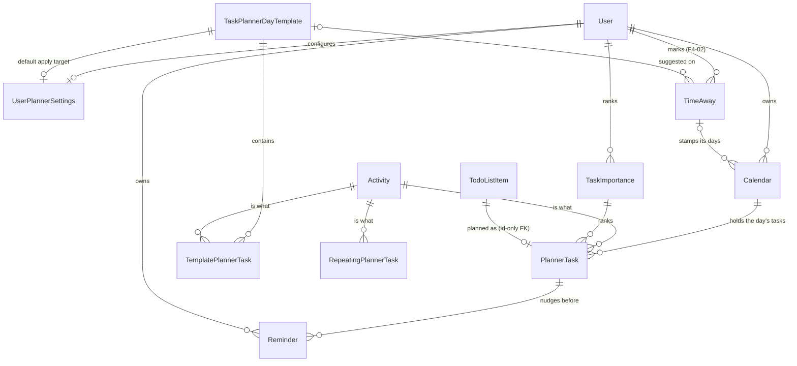

# AdhdTimeOrganizer.Planning — Domain Map

Read [`summary.md`](summary.md) first. This file is the deep reference: the model, what is actually
enforced, the rules behind the two derived numbers, and the navigation index.

## Model

`User` and `Activity` are Core's. `TodoListItem` is TodoLists' and is **not referenced by this
project** — see [the one cross-slice relationship](#the-one-cross-slice-relationship).

| Type | File |
|---|---|
| `Calendar` | `domain/model/entity/Calendar.cs` |
| `TimeAway` (F4-02) | `domain/model/entity/TimeAway.cs` |
| `BasePlannerTask` | `domain/model/entity/activityPlanning/BasePlannerTask.cs` |
| `PlannerTask` | `domain/model/entity/activityPlanning/PlannerTask.cs` |
| `RepeatingPlannerTask` | `domain/model/entity/activityPlanning/RepeatingPlannerTask.cs` |
| `TemplatePlannerTask` | `domain/model/entity/activityPlanning/TemplatePlannerTask.cs` |
| `TaskPlannerDayTemplate` | `domain/model/entity/activityPlanning/TaskPlannerDayTemplate.cs` |
| `TaskImportance` | `domain/model/entity/activityPlanning/TaskImportance.cs` |
| `UserPlannerSettings` | `domain/model/entity/activityPlanning/UserPlannerSettings.cs` |
| `Reminder` | `domain/model/entity/reminder/Reminder.cs` |
| `PlannerSuggestionFromPlannerTask` / `…FromActivityHistory` / `…FromDayTemplate` | `domain/model/entity/suggestion/` |
| `PlannerSuggestionDismissal` (FO11) | `domain/model/entity/suggestion/PlannerSuggestionDismissal.cs` |
| `PlannerTaskStatus` · `RecurrenceType` · `ReminderRecurrence` · `SuggestionSourceType` | `domain/model/enum/` |

**Three task tables, one C# base.** `PlannerTask`, `RepeatingPlannerTask` and `TemplatePlannerTask`
share `BasePlannerTask` in code but each has its own configuration and its own table — there is no
TPH/TPT hierarchy in the model. Anything that must cover "every planner task" needs three clauses,
not one; `PlannerTaskActivityReferenceSource` is the example to copy.

### The one cross-slice relationship

`PlannerTask.TodolistItemId` → `todo_list_item.id`, `ON DELETE SET NULL`, constraint name pinned to
`fk_planner_task_todo_list_items_todolist_item_id`.

**Declared in the host**, at `AdhdTimeOrganizer/infrastructure/persistence/AppDbContext.cs` →
`ConfigureCrossSliceRelationships`, because that is the only place both entity types are in scope.
There is no navigation property on either end; do not add one back.

The name is pinned verbatim from the original configuration: EF derives a relationship's constraint
name from whether the principal's `ToTable` has already run when the FK is named, so the generated
name shifts every time a new slice changes the `ApplyConfigurationsFromAssembly` order. Naming it
explicitly makes it immune.

### Suggestion read-models

Three keyless entities mapped over materialized views. The views themselves — SQL, installer, refresh
interceptor and refresh job — are **host-side**; only the mappings live here, because the two
suggestion endpoints are their only consumers.

| Entity | View | Consumed by |
|---|---|---|
| `PlannerSuggestionFromPlannerTask` | `mv_planner_task_pattern` | `GetSuggestionsRepeatingPlannerTaskEndpoint` |
| `PlannerSuggestionFromActivityHistory` | `mv_activity_history_pattern` | `GetSuggestionsRepeatingPlannerTaskEndpoint` |
| `PlannerSuggestionFromDayTemplate` | `mv_template_suggestion_pattern` | `GetSuggestionsTaskPlannerDayTemplateEndpoint` |

The names carry both halves on purpose: `PlannerSuggestion…` is who consumes the rows, `…From<Source>`
is which table they were aggregated from. **The class names are decoupled from the view names** —
every configuration pins its view with an explicit `ToView(...)`, so renaming an entity never touches
the schema.

**A view row may outlive its principal, and both endpoints must tolerate it.** The refresh is a
host-side job, so between runs the aggregate can still name a template or an activity the user has just
deleted — an activity delete even cascades its planner tasks away, leaving the row describing nothing.
Each query therefore filters `p.Template != null` / `p.Activity != null` before projecting; without it
the navigation is null and the read is a 500 on a page load, caused by the user's own last action.

**All three are plain POCOs carrying exactly the view's columns — never an entity base.**
`PlannerSuggestionFromDayTemplate` derived from `BaseEntityWithUser` until 2026-09-08, which made EF
select `id` / `created_timestamp` / `modified_timestamp` from an aggregate that has no such columns:
every call to its endpoint answered 500 (`42703`). The consequence to keep in mind is that none of the
three is `IEntityWithUser`, so **no global query filter covers them** and each endpoint's own
`p.UserId == userId` predicate is the whole of the scoping.

**The views record each past day by its stored `DayType`**, so a public holiday counts toward the `Workday`
statistics. That is accepted, not fixed. The reasons are in § *Holidays rank like a weekend*.

**The two weekday/day-of-month views count a recent window only (FO11).** A weekday pattern needs 3+
sittings in the last 12 weeks and one in the last 4; a day-of-month pattern 3+ in the last 12 months
and one in the last 3. The numbers live in `SuggestionPatternWindow` **and** literally in both SQL
scripts — a view takes no parameters, so change both together. The window is measured from
`current_date` at refresh time, which is why `SuggestionPatternRefreshQueue` reports both views dirty
on the first drain of each UTC date even if nothing was written.

**`PlannerSuggestionDismissal` is the one suggestion table that is a real entity** — the user's
"×, not any more" on a pattern row, written by `POST /repeating-planner-task/suggestions/dismiss`.
Unique per `(user, activity, pattern type, pattern value)`, keyed like the views, so one row hides the
planner-pattern and the history-pattern tier alike (never tier 1). It lapses after one window length
(`SuggestionPatternWindow.StillHolds`): by then every sitting the view still counts postdates it, so a
pattern that is back has re-formed. It is `BaseEntityWithActivity`, cascades with its activity,
survives archiving, and is carried by a merge (`PlannerTaskActivityReferenceSource` collapses duplicate
keys to the latest date).

## Invariants

| Invariant | Enforced by |
|---|---|
| One calendar row per (user, day) | **DB** — unique index `(user_id, date)` on `calendar` |
| One importance rank per (user, value) | **DB** — unique index `(user_id, importance)` on `task_importance`. Text is free to repeat |
| One `UserPlannerSettings` row per user | **DB** — unique index `(user_id)` on `user_planner_settings`, declared outright in `UserPlannerSettingsConfiguration` (`IsOneWithOneUser`'s own `HasIndex` is not unique; the 1:1 relationship made it so by convention, which is not something to lean on). Both endpoints are get-or-create on top of it and both handle losing the insert race — `GET` re-reads the winner's row, `PUT` writes onto it via `BaseUserSettingsUpsertEndpoint`. Pinned by `UserPlannerSettingsTests` |
| A calendar with tasks cannot be deleted | **DB** — `planner_task.calendar_id` is `Restrict`. Pinned by `PlannerDeleteBehaviorTests` |
| Deleting an activity **does** delete the tasks planned from it | **DB** — `planner_task.activity_id` is `Cascade` (`IsManyWithOneActivity`'s default, never overridden). The opposite of the calendar edge above, and it takes already-completed tasks with it. Pinned by `PlannerDeleteBehaviorTests` |
| Deleting a planner task deletes its reminders | **DB** — `reminder.planner_task_id` is `Cascade`. It does **not** reach the module's `ReminderDefinition` |
| Deleting a template deletes its lines | **DB** — `template_planner_task.template_id` is `Cascade` |
| Deleting an importance level does not delete the tasks that used it | **DB** — `SetNull` on all three task tables and on `user_planner_settings.default_apply_template_id` |
| Deleting a to-do item does not delete the task planned from it | **DB** — `SetNull`, declared host-side |
| `Reminder.LeadOffsetsMinutes` are all `<= 0` and unique | **App, twice** — `ReminderValidator` gives the user a friendly 400; the property setter throws as a backstop for write paths that skip the DTO validator |
| `EndTime > StartTime` on a planner task | **App only** — all six request validators reject it (`PlannerTaskValidator`, `RepeatingPlannerTaskValidator` and `TemplatePlannerTaskValidator` gained the rule on 2026-09-08; `PlannerTaskChangeSpanValidator`, `ApplyTemplateToTaskPlannerValidator` and `ApplyTemplateToCalendarsBatchValidator` always had it). There is no CHECK constraint, so **rows created before that date can still violate it**: `TaskPlannerHelper.TasksOverlap` reads such a row as a same-day negative span, and `PlannerTemplateApplier` refuses to carve one rather than deleting it (`IsCarvable`) |
| `DayType.Weekend` only on Sat/Sun, `DayType.Workday` never on a weekend | **App only** — `CalendarDayTypeRule`, called from two endpoints. Not a constraint: neither caller has the date in its request, so it cannot live in a validator |
| A planner task names its day by **exactly one** of `CalendarId` / `Date` | **App only** — the two request validators. Both or neither is a 400, deliberately, rather than a precedence rule |
| A batched request's calendar ids are distinct and within `PlannerBatchLimits` | **App only** — `CalendarBatchValidators`, `PlanVsActualTrendValidator` |
| `TaskImportance.OptionalMarkerValue` = 666 identifies the "optional" level | **App only, by value** — `BasePlannerTask.IsOptional` compares against the number. Nothing stops a user editing that row's rank; the guard is a test |
| `Reminder.RemindAt` matches its task's instant | **App only** — recomputed by `ReminderRegistrationService` on every sync. Nothing detects drift |
| A planner task's `Activity` / `TaskImportance` / `TodoListItem` belongs to the same user | **App only, per write endpoint** — `PlannerReferencedIdOwnershipExtensions`, called from `Create`/`UpdatePlannerTaskEndpoint`'s `BeforeMapping` and from both apply-template handlers. No FK spans the user column, so the database cannot express this. `TodolistItemId` is answered through Core's `IReferencedIdOwnershipService` over the `IUserOwnedReferenceVerifier` seam, which **fails closed** |
| A recurrence's / template line's `Activity` and `TaskImportance` belong to the same user | **App only, per write endpoint** — `EnsureOwnsBasePlannerTaskReferencesAsync` on `Create`/`Update` for `RepeatingPlannerTask` and `TemplatePlannerTask`. The same two ids as the row above, inherited from `BasePlannerTaskRequest` |
| A template line's `TemplateId` belongs to the same user | **App only** — the same two endpoints. Not integrity alone: unchecked, the line lands *inside* a stranger's day template and changes what applying it does to their day |
| `UserPlannerSettings.DefaultApplyTemplateId` belongs to the same user | **App only** — `UpdatePlannerSettingsEndpoint`. Integrity, not disclosure: the response returns the bare id |
| Every entity's schema is `planning` | **Model build** — `ModuleSchemas.Resolve` throws for an unmapped assembly |
| A user's stretches of time away do not overlap (so a day carries at most one `TimeAwayId`) | **App only** — `TimeAwayWriteRules` on create and update, a 400 on `startDate`. Not race-proof alone; two racing creates collide on the days they both stamp (`row_version` / `(user_id, date)`, a 409) |
| `TimeAway.Kind` is `Vacation` or `SickDay`; `StartDate ≤ EndDate`; at most 366 days | **App only** — `TimeAwayValidator` (`DayTypeExtensions.IsAway`, `PlannerBatchLimits.MaxCalendarIds`) |
| `TimeAway.TemplateId` belongs to the same user | **App only** — `TimeAwayWriteRules`, through `EnsureOwnsDayTemplateAsync` (404) |
| A stretch and its stamp commit together | **App** — `TimeAwayStamper` only stages; each write endpoint makes one `SaveChanges` |
| Deleting a template leaves the stretches that named it; deleting a stretch leaves its days | **DB** — `time_away.template_id` and `calendar.time_away_id` are both `SetNull` |

## Business rules

### Which "today" — the user's, everywhere

**Every path in this slice that needs the current date resolves it in the user's own
`User.Timezone`**, through `TaskPlannerHelper.TodayIn`. A `Calendar.Date` is a wall-clock date the user
chose, so a `DateOnly.FromDateTime(DateTime.UtcNow)` picks the wrong row for anyone east or west of
Greenwich: a Bratislava user ticking something at 01:15 would have it applied to yesterday's plan while
today's stayed open, with nothing in the logs.

The reads have always done this (streak, plan-vs-actual trend, `ReminderRegistrationService`'s instant
composition); since `CQ-5` the three write paths do too — the two `*IsDoneChangedEventHandler`s and
`PatchPlannerTaskStatusEndpoint`, where "today" also decides whether the fan-out event is published at
all. The handlers resolve the zone from the event's `UserId` via `IUserTimeZoneResolver`, which works
under a background dispatch where there is no `HttpContext` to read.

The tracker-driven path follows the same rule from outside the slice: Tracking's desktop heartbeat
resolves the user's zone before it publishes `ActivityTimeRecordedEvent`, so the event's `Day` and window
times are on the user's clock, and the day total it carries is summed between the user's own midnights.
Until 2026-10 it took the date straight off the UTC `WindowStart`, and time tracked between a Bratislava
user's midnight and 01:00/02:00 moved yesterday's task. The host handler that consumes it now also goes
through `ApplyStatus`, records actual times and re-syncs the task's reminder, like
`PatchPlannerTaskStatusEndpoint`.

Pinned by `CompletionFanOutTests.TogglingTodoItem_UsesTheUsersOwnDayBoundary` /
`.PatchingStatus_PublishesOnTheUsersToday`,
`RoutineCompletionFanOutTests.TickingRoutineList_UsesTheUsersOwnDayBoundary` and
`ExtensionActivityTrackingTests.Heartbeat_AfterTheUsersMidnight_DrivesTheUsersTodayNotUtcs`, each moving
the test user onto a zone that is on a different date than UTC.

### Day-plan completion streak

The flame chip on the home page. **Derived, never stored** — no entity, no column, no migration and
no repair path; recomputed from `planner_task` rows on every read. That is the opposite of the
Routines slice's `Streak` / `BestStreak` columns, and the difference is not taste: a routine period
*wipes its items* on reset, so its counter has to be the record, while planner days keep every task
row forever. Deriving it makes un-ticking an exact inverse (there is no increment to undo), makes
editing a past day recompute across the gap it opens, and makes drift unrepresentable.

| Question | Answer |
|---|---|
| What makes a day count? | Every **qualifying** task is `Completed`. Qualifying = not `IsBackground`, not `IsOptional`, not `Cancelled` |
| Does a skip break the day? | **No.** `Cancelled` leaves the denominator entirely — the app already presents skipping as a legitimate way to close a task |
| Does skipping everything earn a day? | **No.** Zero denominator ⇒ the day is *empty*, not complete |
| Does an unplanned day break the streak? | **No** — and it does not extend it either. The number means "days I completed" |
| Does a background-only day count? | No — it is empty, exactly like an unplanned one |
| Optional tasks? | Excluded, same as background |
| Grace days? | **None.** The three rules above are already lenient; grace on top would make the number unaccountable. If one is ever wanted it goes in `Walk`, not `Evaluate` |
| Day boundary? | The user's own `User.Timezone`. The response returns `Today` + `Timezone` so the client can stop computing dates |
| Retroactive edits? | Recomputed, including across the gap. Free, given the above |

Two rules exist for the client's sake rather than the domain's, and both are load-bearing:

- **Today can never break the streak, only extend it.** An unfinished today is unfinished, not
  failed. Without this the chip reads 0 every morning and climbs back by evening.
- **`CurrentStreak` is the value to display, already zeroed when dead.** The client owns no "is it
  still alive" decision — that judgement depends on the skip and empty-day rules, which live here.

⚠ **The streak's denominator is narrower than the progress ring's.** The ring counts every
non-background task; the streak also drops optional and cancelled ones. A day can read 4/5 on the
ring and still be complete. Clients must read `IsTodayComplete` rather than comparing counts.
`TodayOutcome` splits its `false`: `Incomplete` (today still to earn, breaks the run at midnight)
versus `Empty` (nothing qualifying today, so the run is safe either way).

⚠ **It rides on `CalendarResponse.Streak` and is null on every calendar read except
`GetByDateCalendarEndpoint`**, which fills it in after the projection — `Projection` runs per row and
cannot walk days. Nothing breaks if that line is dropped; the field just goes null and the chip
sticks at zero.

⚠ The read is deliberately **uncapped**: a lookback window would turn `BestStreak` into a rolling
maximum, so a record the user really set could quietly shrink.

| Type | File |
|---|---|
| `PlannerStreakService` | `domain/service/PlannerStreakService.cs` — the rules (`Evaluate` one day, `Walk` the history) |
| `IPlannerStreakReader` | `domain/serviceContract/IPlannerStreakReader.cs` |
| `PlannerStreakReader` | `application/service/taskPlanner/PlannerStreakReader.cs` — the qualifying-task predicate + the day boundary |
| `PlannerStreakResponse` | `application/dto/response/taskPlanner/PlannerStreakResponse.cs` |

### Plan-vs-actual trend

`POST /planner-task/plan-vs-actual-trend` — six numbers describing how the user's planned time
compared with their logged time over an inclusive date range. **Derived, never stored**, like the
streak.

The *single-day* version of this needs no server at all — the day view already holds
`ActualStartTime`/`ActualEndTime` beside `StartTime`/`EndTime`. The trend cannot be answered that way:
`planner-task/filter` takes one calendar id, so thirty days of it is thirty requests. Nor can the
history dashboards answer it — they aggregate `ActivityHistory` (free-standing tracking), which has
no plan to drift from.

| Question | Answer |
|---|---|
| Which tasks count? | Not `IsBackground`, not `Cancelled`, on a day in the range that is **over**. Optional tasks *do* count — unlike the streak, this describes estimation, and an optional task was still estimated |
| When is a day "over"? | **Strictly before the user's own today**, however late the request arrives. Today's untouched tasks have not been missed, they have not come around yet — and every one would land in `neverHappenedCount` and drag the trend |
| Does a skip count as a task that never happened? | **No.** `Cancelled` leaves the population entirely — the same call the streak makes, and the two must not diverge |
| Do the two sums cover the same tasks? | **No, and this is the trap.** `plannedMinutes` spans every counted task, including ones that never happened; `actualMinutes` spans only those `Completed` **and** carrying both actual times. `actual / planned` alone therefore understates the person's pace whenever `neverHappenedCount` is non-zero — which is why that count is in the response rather than left to be inferred |
| A `Completed` task with no actual times? | Counted, its plan summed, **no** actual minutes, and **not** a "never happened" — it is unmeasurable, and inferring the missing end from the plan would fabricate exactly the zero drift the number exists to measure |
| Nothing eligible? | `200` with six zeroes, never a 404. `taskCount: 0` is the client's signal to render nothing. A range entirely in the future answers this way |
| Midnight? | Every span and every comparison wraps. A 23:00–00:30 task is 90 minutes; a task planned for 23:50 and started at 00:10 is twenty minutes late, not twenty-three hours early (the near reading wins — see `DriftMinutes`) |
| A carried-over task? | Counted on the day it is on **now** — it left its original day, so that day never sees it. Slips are reported separately as `carriedOverCount`: the sum of `CarryOverCount` over tasks whose `OriginalDate` is in the range. Never folded into `neverHappenedCount`, which would count one slip twice |
| A snoozed task — late from which start? | From the start it was **first planned for**, while it is still on that day (`PlannerTaskPostponeRule.DriftAnchor`, FO3). Snoozed 09:00 → 11:00 and started at 11:00 is two hours late; measuring from the snoozed start made the trend understate exactly what it measures. A task carried to a later day is a fresh attempt and is measured from its current start. The **span** is always the current plan — the snooze moves lateness only |

⚠ **The range is the only thing bounding the scan**, so it is capped at
`PlannerBatchLimits.MaxSummaryRangeDays` and a backwards one is a 400 — the same two rules
`CalendarTaskSummariesValidator` applies, sharing the same ceiling.

| Type | File |
|---|---|
| `PlanVsActualTrendService` | `domain/service/PlanVsActualTrendService.cs` — `Aggregate` over rows; `SpanMinutes` / `DriftMinutes` handle midnight |
| `GetPlanVsActualTrendPlannerTaskEndpoint` | `application/endpoint/plannerTask/query/` — the eligibility predicate + the day boundary |
| `PlanVsActualTrendRequest` / `…Response` | `application/dto/{request,response}/taskPlanner/` |
| `PlanVsActualTrendValidator` | `application/validator/PlanVsActualTrendValidator.cs` |

### Carrying a task over (F1-03)

`POST /planner-task/{id}/carry-over { date }` moves an **open** task (not `Completed`, not `Cancelled`) to a
**later** day and keeps the record that it slipped: the original slot (`OriginalDate` + `OriginalStartTime`) is
set on the first slip and never again, `CarryOverCount` goes up every time. The task arrives `NotStarted` with
its actual times cleared — a fresh attempt — at the same time of day, and its reminder is re-synced. A day with
no calendar row is created.

| Question | Answer |
|---|---|
| Why not a copy? | The original stayed open on its day — that day could never count for the streak, and the trend logged it as never happened, so carrying a task over scored worse than skipping it |
| Why not a plain move (PUT)? | It loses the slip, and "pushed four times" is the cue to split or drop a task. A PUT/drag is recorded as a **postponement** instead when it is one (below), and never touches `CarryOverCount` |

### Postponing a task (FO3 phase 2)

Every other way of pushing a task later — home's *Move later* and the day view's reschedule (both the PUT) and a
drag (the span patch) — goes through `PlannerTaskMoveRecorder`, which reads the old slot and status off the
change tracker and hands them to `PlannerTaskPostponeRule`, the one place that decides.

| Question | Answer |
|---|---|
| What is a postponement? | The task was `NotStarted`, the new slot (day + start) is later, and the **original** slot has passed on the user's clock. Before the first slip the original slot is the one it is moving from; after it, `OriginalDate` + `OriginalStartTime` |
| What does it record? | `PostponeCount += 1`; on the first slip, the original slot as a pair. A row carried over before `OriginalStartTime` existed keeps its date and gains no invented time |
| An early tidy-up of tomorrow? | A re-plan. Nothing is recorded, because the slot has not come yet |
| Once a task has slipped? | Every later push counts, even one made hours before the new slot — its original slot is behind the user |
| A running or paused task moved later? | Not a postponement: that is re-arranging work already begun |
| Carry-over and postponement both? | **Disjoint.** The carry command counts `CarryOverCount` only; the rule counts `PostponeCount` only. A task's slips are the sum, and the to-do seam (`PlanHistory.Postponed` beside `CarriedOver`) relies on never counting one twice |
| Shown anywhere? | No. Like the carry count on the to-do side, it decides which help an item is offered (`TodoListItemPlanHelp`) and nothing else |
| A new path that moves a task? | Must call `PlannerTaskMoveRecorder.RecordPostponementAsync` from its mapping step, before the save, or its moves leave no trace — nothing fails. FO4's re-plan apply does, for every block it moves (the `utcNow` overload, so the whole set is judged against the request's one injected clock) |

`SourceRepeatingTaskId` (FK to `repeating_planner_task`, `SET NULL`) and `RepeatingPlannerTask.AutoPlace` arrived
in the same migration for FO6, so `planner_task` is altered once. `RepeatingTaskMaterialiser` writes them (see
§ *Applying a day template* for how it places beside existing blocks).
| Streak? | The task leaves its old day, so that day no longer counts it — the same neutral outcome a skip has |
| Which tasks does the client offer? | `GET /planner-task/carry-over-candidates`: `NotStarted` / `InProgress`, non-background tasks on the user's previous seven days (their zone), newest day first, each with its date. The rule is `PlannerTaskCarryOverRule` (`domain/service/`), which the host's morning briefing and welcome-back pile read too — change it there, not in the endpoint |

### Re-planning the rest of today (FO4)

At 11:30, with the 10:00 and 11:00 blocks slipped, one tap packs what slipped into the time that is left. Three
routes off `/calendar/day-plan/{date}`, one rule (`DayPacking`, fed by `DayReplanPlanner`), and one definition of
**missed** (`PlannerTaskMissedRule`): `NotStarted`, not background, end passed on the user's clock — derived, never
stored, and what audit N5's nudge reads too (§ *Slip nudges* below).

| Route | What it does |
|---|---|
| `POST …/replan` | The preview. Writes no planner task. Only the user's today (their zone, `TimeProvider`'s clock); any other date is a 400 |
| `POST …/replan/apply` `{ previewToken, wontFit: [{ taskId, resolution: "Tomorrow" \| "Skip" }] }` | Recomputes and applies in one `SaveChanges`, then one `SyncForPlannerTasksAsync` for every touched task |
| `GET …/next-free-slot?minutes=&notBeforeMinute=&excludeTaskId=` | The same rule for one block, with nothing moving — snooze, leisure "do it now", the to-do handoff. Today or later; a past day is a 400 |

| Question | Answer |
|---|---|
| What moves? | Every `NotStarted` foreground block whose activity is not `IsUnavoidable` — missed, **late** (start passed, end not) or upcoming. An upcoming block starting at or past the window's end is left alone |
| What stays and holds its time? | `InProgress`, `OnHold`, `Completed`, and any unavoidable block (missed or not), at their planned slots |
| Background blocks? | Neither move nor hold time — they run alongside the day, the reading the day view's own conflict check takes (`checkConflict` skips them) |
| The window? | From *packed-from* (the user's now, rounded up to the minute) to bed time. The bed time is the day's own, which since FO10 starts as the user's default (`User.DefaultBedTime`). 00:00 — that default's own default — or any bed time at or before wake-up means the end of the day, **23:59**: a block cannot cross midnight and a `TimeDto` cannot say 24:00 |
| The order? | The blocks' current one (start, end, id), as a priority. **First fit**: each takes the earliest free stretch long enough, so a short later block may back-fill a gap a longer earlier one could not use. Missed/late blocks may start from packed-from; an upcoming one never earlier than it is planned, and it may keep its own slot past bed time. Lengths are kept; nothing is split |
| When time runs out? | If a required block misses out, the day is packed again with required blocks ahead of optional ones (importance = `OptionalMarkerValue`), and that wins if it places more required blocks. What still has no room is `wontFit`, optional first, then in order |
| Nothing slipped? | An empty 200 (`hasChanges: false`), even if upcoming blocks overlap — a re-plan answers a slip, it does not tidy the day |
| Why recompute rather than accept the client's placements? | The client never sends any. The preview's `previewToken` is `{packedFrom}.{hash}`, the hash over every fact the packing reads (calendar id + sleep window; per task id, status, span, background, optional, unavoidable). The apply recomputes from the token's packed-from against the day as it now stands: a different token is a **409 `Conflict`**, nothing written. Validating posted slots instead would re-prove every packing rule at a second site |
| Other ways it fails safely | A token older than `PreviewLifetime` (10 min) is a 409 `Conflict`. The tasks are loaded tracked, so a write landing between recompute and save loses the `row_version` race as a 409 `DbConcurrencyError` and the one `SaveChanges` rolls back. A double submit no longer matches its token: 409, counted once |
| `wontFit` resolutions? | Must decide exactly the recomputed `wontFit` set (400 otherwise). `Tomorrow` moves the block to the next day at the same time of day (creating the day before anything is loaded — it commits); `Skip` is `Cancelled` with `SkipReasonKey.NoTime` and publishes no completion fan-out (it was not done before or after) |
| Postponements? | Every move, within today and to tomorrow, goes through `PlannerTaskMoveRecorder` — exactly as a manual move. A move to tomorrow is a postponement, never a carry-over. An upcoming block pushed before its slot came is a re-plan and counts nothing |
| Repeating blocks? | The preview and the next-free-slot read let FO6's materialiser place today's auto-placing blocks first, like `GET /calendar/day-plan`. The apply does not: the token already says whether the day changed |
| Archived activities? | A block whose activity is archived is absent from the day-plan read (the archived filter reaches it through the required navigation), and absent here too — the re-plan sees the day the user sees |

### Tasks that close themselves

`PlannerTask.AutoCompleteAtEnd` (create-only) marks a block that does not need a tick to have happened —
rest booked from the leisure picker's "do it now". `CompleteFinishedPlannerTasksJobHandler` (every five
minutes, registered by `PlanningScheduledJobsRegistrar`) completes such a task once it is `InProgress` and its
`EndTime` has passed **on the owner's clock**, recording `ActualEndTime = EndTime`; it re-syncs reminders and
fans out for tasks on the user's today, like `PatchPlannerTaskStatusEndpoint`. A `NotStarted` task is never
closed — nothing said it began.

### Slip nudges (audit N5, P1-04)

`PlannerSlipNudgeJobHandler` (every five minutes, `PlanningScheduledJobsRegistrar`) **only notifies** — it never writes a
status, which is why it is not folded into the auto-complete job above. Two kinds, through `IPlannerNotificationService`:

| Question | Missed — `PlannedBlocksMissed` | Overrun — `PlannedBlockOverrun` |
|---|---|---|
| Which blocks? | `PlannerTaskMissedRule.IsMissed` on the user's clock: `NotStarted`, foreground, end passed | `InProgress`, not `AutoCompleteAtEnd` (that one is the other job's), foreground, end passed by ≥ `OverrunGrace` (5 min) |
| Which day? | The user's **today** only (calendar date in their zone) — a block left open on an earlier day never pings | Same |
| How many notifications? | **One per user per sweep**, `Count` = the blocks newly found, linked to the earliest. At most `MissedNotificationsPerDay` (2) a day; after that, nothing | One per block end |
| Also skipped | An away day (`DayType.IsAway`). A block **created after its own end** — a template applied at noon, a block logged after the fact — was never an attempt | While the user has a timer running (`IRunningTimerLookup`, History's pending alarms): the timer rings on its own. Left unmarked, so it comes on the first sweep after the timer stops |
| The mark | `PlannerTask.MissedNotifiedAt` | `PlannerTask.OverrunNotifiedAt` |

**A mark covers one slot, not the task.** Both are the sweep's UTC instant, stamped (`ExecuteUpdate` — not an edit, so no
timestamp or `row_version` bump) only after the notification went out, and a block counts as announced only while its mark
is at or after its **current** end. Re-plan a missed block later, or extend an overrunning one, and the new slot can be
announced again. Every block in one missed notification shares one stamp, so the **distinct** stamps on the user's today are
the count the daily cap reads — no ledger table. A deleted block takes its stamp with it, which can only loosen the cap.

Both kinds are held while away (`HeldWhileAwayTypes`) and deferred by quiet hours, downstream in Notifications. The query
reads the three calendar dates around UTC today for every user (`ix_calendar_date`) and keeps each user's own today in
memory.

### Skip summary (B1)

`POST /planner-task/skip-summary` — skipped tasks over an inclusive date range, grouped by reason and
by planned start hour, rendered under the trend. **Derived, never stored**: an un-skip simply leaves
the next read. The single-day half is client-only (the day view holds every `status`/`skipReason`).

A **sibling** of the trend, not more fields on it: the trend's population drops `Cancelled`, this one
is built from it, and the client fetches the two independently so a failed skip aggregate never costs
the month its trend. What they share is the **range** — the same `PlanVsActualTrendRequest` and
validator, and the same last eligible day via `TaskPlannerHelper.LastDayThatIsOver`.

| Question | Answer |
|---|---|
| Which tasks count? | Not `IsBackground`, on a day **strictly before the user's today** — every status. `Cancelled` is the numerator; the rest are the per-hour base rate |
| Is a skip made today counted? | **No**, though it is final: today's not-yet-reached tasks would inflate the per-hour denominator, and "this period" must mean the same days as the trend |
| How are reasons grouped? | By **key** when the skip has one (`reasonKey`), otherwise by **exact stored text**, ordinal; neither is its own group. No folding and no cap — the client folds once more (`skipReasonGroups.ts`), in one place for both the single-day and range lines, and truncating could hide the group that folding would have made largest |
| Which hour? | `StartTime.Hour` as stored; a task wrapping midnight counts where it starts. Hours with nothing planned are omitted |
| Nothing eligible? | `200` with `skippedCount: 0` and empty lists — the client renders nothing |

| Type | File |
|---|---|
| `SkipSummaryService` | `domain/service/SkipSummaryService.cs` — `Aggregate` over rows, no SQL |
| `GetSkipSummaryPlannerTaskEndpoint` | `application/endpoint/plannerTask/query/` — the eligibility predicate |
| `SkipSummaryResponse` | `application/dto/response/taskPlanner/SkipSummaryResponse.cs` |

### Skip reasons — text or key

A skipped task carries **at most one** of `SkipReason` (free text, ≤ 500) and `SkipReasonKey`
(`NoTime` / `NotRelevant` / `NoEnergy` — the home widget's three built-in reasons). Both are written
only by `PATCH …/status` through `PlannerTask.ApplyStatus`, and both are cleared on any transition out
of `Cancelled` (the PUT clears them too, and never writes either).

| Question | Answer |
|---|---|
| Wire format? | camelCase tokens — `"noTime"`, `"notRelevant"`, `"noEnergy"` — mapped explicitly in `SkipReasonKeyTokens`, **not** by the serializer (the host's bare `JsonStringEnumConverter` would write `"NoTime"`). Stored as the member name (`EnumColumn`) |
| What if the label arrives as text? | Text equal to one of the six shipped labels (EN + SK, `SkipReasonKeyLabels`) **exactly** is stored as its key. The contract is that those six never come back as text, whichever client sent them. Near-misses stay text |
| Rows written before keys? | Converted by the `SkipReasonKeys` migration with the same table. Rewording a label or adding a locale means a new row in `SkipReasonKeyLabels` **and** a data migration |
| Invalid requests? | An unknown or mis-cased key, a key beside a non-blank `skipReason`, or a key beside any status but `Cancelled` — all 400 |
| `UserPlannerSettings.PredefinedSkipReasons`? | User-defined presets stay free text. Keys are only for the three built-ins |

### The one-request day plan

`GET /calendar/day-plan/{date}` returns the calendar row, its planner tasks ordered by start time,
and the streak. It exists because the home page could not ask for a day's tasks in one hop:
`PlannerTaskFilter` is keyed on `CalendarId`, and the only source of that id was `by-Date`.

| Question | Answer |
|---|---|
| What does a date with no calendar return? | **200 with `Calendar: null`, `Tasks: []`** — never 404. `by-Date` keeps its 404; it is a lookup, this is a page load, and a rejected promise there renders a retry button over a day that is merely unplanned |
| Is a calendar created lazily on first task? | Yes — see [lazy day creation](#lazy-day-creation) |
| Is the `From`/`Until` window meaningful for a whole-day read? | **No.** Home only ever passed 00:00–23:59, so this route has no window at all |
| Can a task belong to a date but not a calendar? | **No.** `PlannerTask.CalendarId` is non-nullable, so the calendar id is an implementation detail the client never holds |

⚠ **The streak is hoisted to the top level here** (`DayPlanResponse.Streak`), and the copy nested on
`Calendar.Streak` is nulled out. It has to survive a null calendar — it is a fact about the user, not
about the day — and two copies would eventually be filled by different code paths and disagree.

⚠ An empty state reads `DayPlanResponse.HasPlan` (`Tasks.Count > 0`), **not** the presence of a
calendar row: the seeder fills whole years, so presence means almost nothing.

The day-planner view still filters by calendar id and time window, which is the shape it genuinely
needs; only home stopped using it.

### The four batched calendar entry points

The month grid had the same problem the home page had, one dimension wider: every endpoint it needed
was keyed on **one** calendar id, so the view fanned out over the visible days. Four routes collapse
that, and **none of them replaces the per-day route it batches** — the day view still wants one day
at a time.

| Route | Replaces | Fan-out it removes |
|---|---|---|
| `POST /calendar/task-summaries` | `POST /planner-task/filter` per day | up to 31 reads per navigation |
| `POST /calendar/apply-planner-template/batch` | `POST /calendar/apply-planner-template` per day | one per selected day |
| `POST /planner-task/copy-to-days` | `POST /planner-task` per (target day × source task) | 12 tasks onto 10 days was 120 writes |
| `PATCH /calendar/day-type/batch` | `PUT /calendar/{id}` per day | one per selected day |

| Question | Answer |
|---|---|
| Is a batch transactional? | **No, and deliberately.** Each day is applied and committed on its own, in request order — the per-day fan-out was not atomic either, and conflict resolution is a per-day decision against that day's own tasks. All three writes answer `200` with `results[]`, one `{calendarId, succeeded}` per requested id (`CalendarBatchResultResponse`) |
| What happens to a day the caller does not own? | It comes back `succeeded: false`, not 403. These endpoints scope through the host's global `IEntityWithUser` filter alone, so another user's id simply does not resolve — indistinguishable from a stale id, which is the same thing to the client |
| May the id list repeat an id? | **No — 400.** The response promises one result per requested id *in order*; a duplicate makes that mapping ambiguous either way it is resolved. Lists are also capped (`PlannerBatchLimits`), because batching removed the browser connection limit that used to bound these |
| Does a copy carry the source day's execution state? | **No.** Span, lane, location, notes, activity and importance travel; `Status` resets to `NotStarted`, and actual times / skip reason / Google event id / the to-do link do not travel at all. A day copied onto next Tuesday would otherwise arrive already completed, and a copied `TodolistItemId` would point several tasks at one item and fan every done-toggle across all of them |

⚠ `POST /calendar/task-summaries` answers a **reduced** shape (id, span, lane, colour, activity name)
and **omits days with no tasks**. Reusing `PlannerTaskResponse` would ship a nested
activity/role/category object per task for every day in the month, which is most of what the route
exists to stop sending.

### Applying a day template

`PlannerTemplateApplier` (`application/helper/`) is the **only** implementation of the stamp and the
four conflict-resolution modes, shared by the single-day and batched apply endpoints. It only
*stages* — adds and removes on the passed `DbContext`, never saves — and the caller must read
`StagedTaskDeletions` off the ChangeTracker *before* saving, which is where the reminder ids of
cascaded-away tasks are captured.

| Mode | What happens to the overlap |
|---|---|
| `Ignore` | The conflicting **new** task is dropped whole; existing tasks are untouched |
| `Overwrite` | The conflicting **existing** tasks are deleted whole; all new tasks are added |
| `MergeIgnore` | New tasks are **carved** around existing ones — split when an existing task sits in the middle, shortened when it overlaps an edge |
| `MergeOverwrite` | Existing tasks are carved around the new ones (removed and re-added as segments) |
| *(both merge modes)* | **A carved segment carries the plan, not its execution.** Span, lane, location, notes, activity, importance and `SourceTemplateTaskId` come across; `Status` resets to `NotStarted`, and the actual times, skip reason, Google event id and **`TodolistItemId`** do not. Same ruling as `CopyToDaysPlannerTaskEndpoint.CopyOnto`, and forced by the same two facts: a segment that kept `Completed` would claim to be finished at times it never carried, and a to-do id on both halves of a split fans every done-toggle across both |

**FO6's materialiser does not use these four modes as they stand.** It places through `StageWithinLanes`, in the same
file, because the planner lanes (two blocks of a kind side by side, `PlannerTaskLaneRule`) changed what counts as a
conflict for a block nobody placed by hand:

| Occurrence would be… | What happens |
|---|---|
| at most a second block of **its own kind** at every minute | Placed **whole**, beside them, in every mode. A background block never stands in a foreground occurrence's way, nor the reverse |
| a **third** at some minute, mode `Ignore` (or `Overwrite`, read as it) | Not placed. The day is still decided |
| a **third** at some minute, mode `MergeIgnore` (or `MergeOverwrite`, read as it) | Cut down to the stretches where it would be a second: only the minutes where both lanes are taken are removed. The span is sliced at every same-kind start and end inside it and each slice asked `ExceedsLaneLimit`, so there is no second depth count. A segment is a new block, as in the merge modes above |

Occurrences placed in one run count against each other, in rule-id order (two rules and a user block at 18:00 are
three, and the newer rule gives way). The destructive modes are never honoured: this runs from a GET, so the user's
blocks are never deleted, moved or carved. A rule edit (`ReconcileAfterEditAsync`) follows the same rule: an
untouched occurrence whose **newly covered** minutes would make it a third block is replaced by what a fresh placement
would leave, and a newly matched day is placed the same way. Newly covered is `PlannerTaskLaneRule.NewlyCovered`, the
one the single-task writes use: the whole span on a change of kind, otherwise the new span minus the old. So an edit
that keeps, shrinks or moves the span inside itself is not judged, and one that extends it into free time follows
the rule even when the old span already sits among three.

Why the fallback carve removes only the full-lane minutes, not every overlapped block as `MergeIgnore` does for a
template: carving around a block that leaves a lane free would cut out time the lanes already allow, so a
one-block overlap would carve under the fallback and stay whole under the main rule. Cutting only the full-lane
minutes means every segment it keeps is something the main rule would have placed.

**Both merge modes refuse to carve a task whose `EndTime` is not after its `StartTime`.** The carving walk
assumes a strictly-forward same-day span; given a negative one it emits no segments at all, and the
`MergeOverwrite` branch had already staged the original for removal — so the task was deleted, nothing was
put back, its reminders cascaded away, and the endpoint answered 201. `PlannerTemplateApplier.IsCarvable`
now screens for that shape *before* the removal is staged, and the new task is simply added over the
survivor. No write path can create such a row any more (see the `EndTime > StartTime` invariant above), but
there is no CHECK constraint and older rows are not yet normalised, so the guard is load-bearing.

The stamp itself always runs: `Calendar.AppliedTemplateId` / `AppliedTemplateName`, the template's
`DefaultWakeUpTime` / `DefaultBedTime` when it has them, its `SuggestedLocation` **only onto a day with no
`Location`** (C3 — a location the user or a stretch of time away set is never overwritten), and `LastUsedAt` /
`UsageCount++` on the template. One interaction with F4-02's un-stamp: a location the template filled that equals
a stretch's `Location` is cleared with the stretch, since the un-stamp keys on equality, not on who wrote it.

**Each applied task records the template line it came from** (`PlannerTask.SourceTemplateTaskId`, OP15). The
client sends the lines, so the id arrives on each `TemplateAppliedTaskRequest`, and `BuildTasks` keeps it only
when it is a line of the template being applied (`LoadTemplateLineIdsAsync`). Anything else (a task added to the
preview by hand, another template's line, a stale id) lands as null rather than failing the apply: the column is
provenance with no FK, and nothing joins on it. Only an apply writes it. The plain create and the full-replace
PUT do not carry the field, so an edit cannot clear or forge it. Before OP15 nothing wrote it at all.

### Lazy day creation

**A planner task may name its day by `Date` instead of `CalendarId`, and the calendar row is created
if the user has none.** Exactly one of the two is required, on `PlannerTaskRequest` and on
`ApplyTemplateToTaskPlannerRequest`; sending both is a 400 rather than a precedence rule, because the
two can disagree and the loser is a task filed on a day nobody asked for.

The defect it fixes: `CalendarSeeder` filled a hard-coded `{ 2025, 2026 }` at user setup and there is
**no create-calendar endpoint** — only `UpdateCalendarEndpoint`. Past the last seeded year every date
resolved to no row, so the planner rendered an ordinary empty day that silently refused every task,
and nothing in the app could make the row it needed. No exception, no log line, an expiry date on the
product.

| Type | Role |
|---|---|
| `HolidayCalendar` (`domain/service/`) | The Slovak holiday table + Computus; each entry is a `Holiday(Key, Name)` |
| `CalendarDayFactory` (`domain/service/`) | What an unplanned day *is* — day type, holiday key + name, and the **user's** sleep window (FO10, Core's `UserSleepWindow`; 08:00 / 00:00 until they set one) |
| `ICalendarProvisioner` / `CalendarProvisioner` | Read-or-create for one (user, date) |
| `ICalendarSleepWindowSync` / `CalendarSleepWindowSync` | FO10: moves the user's days from their today on onto a changed default window, skipping days marked `HasCustomSleepWindow` |

**The sleep window (FO10).** `User.DefaultWakeUpTime` / `DefaultBedTime` (Core, written through
`PUT /user/preferences`) are what a new day starts with. Because the seeder fills two years ahead, a
changed default also has to reach the rows that already exist: `CalendarSleepWindowSync` rewrites every
day from the user's today on **unless** `Calendar.HasCustomSleepWindow` is set. That flag is set only by
`Calendar.MarkSleepWindow` — the day editor's PUT and a template apply carrying a window — and only when the
window actually differs, since the editor re-sends the inherited window with every save. It is never
cleared. Past days are never rewritten. Migration `UserDefaultSleepWindow` marked every pre-existing row
that held anything other than 08:00 / 00:00.

Both creators go through `CalendarDayFactory`, and that is the point of it: a day filled in a year
ahead and the same day created on its first task have to be the same day. Holidays do **not** override
the day type — a holiday on a Tuesday is a `Workday` row with a `HolidayName`. They do change how the planner
*matches* the day (§ *Holidays rank like a weekend* below), without writing anything.

Holidays are Slovak only, by decision (B19): `User` carries no country and there is no country
preference. A row stores the pair `HolidayKey` (`CHRISTMAS_DAY` — stable, what the client translates
through `calendar.holidays.<key>`) and `HolidayName` (the native Slovak name, the fallback for a reader
with no locale table). Both are written once, from the same table entry; never rename a key — rows
already carry it.

The three callers of the provisioner are `CreatePlannerTaskEndpoint`, `UpdatePlannerTaskEndpoint` (a
task dragged onto an unplanned day) and `ApplyTemplatePlannerTaskEndpoint` (**by date**; by id it
still 404s, because an id resolving to nothing is a stale client rather than an unplanned day).

⚠ `EnsureForDateAsync` **commits**, and it scopes by hand. `(user_id, date)` is unique and the race is
real — a phone and a desktop starting the same morning's first task; the loser catches
`DbUpdateException`, **detaches** its failed insert and reads the winner's row.

`CalendarSeeder`'s year list is now `{ this year, next year }`, resolved when it runs. That is
hygiene, not the fix — it only helps users created from now on.

### Time away (F4-02)

"Barcelona, 12–20 Aug", marked once across any month boundary, instead of a bulk day-type action per visible month.
Designed in the frontend repo's `docs/_done/feature-discovery/F4-day-type-periods.md`; the owner chose the full entity on
2026-10-12. **A stretch imposes its kind on its days; nothing reads the stretch to decide whether a day is away.**
Every away reader — FO1's routine excusal, FO6's withdrawal, both suggestion endpoints' ranking, the nudges — keeps
reading `Calendar.DayType`.

| Question | Answer |
|---|---|
| What does a stamp write? | Per day of the inclusive range: `TimeAwayId`; `DayType = Kind` if the day is `Workday`/`Weekend` or already `Kind`; `Location` if the day has none. Weekends included — a Saturday in Barcelona is away |
| A day with a type of the user's own? | Keeps it, and still belongs to the stretch. A sick day inside a vacation is that day's override, not a nested stretch (stretches never overlap). The response reports it as `keptOwnDayType` |
| Missing days? | Created in the same transaction, in bulk, through `CalendarDayFactory` |
| What does an un-stamp undo? | On days linked to the stretch: the link; the type, if it still equals the kind (back to `CalendarDayFactory.NaturalDayType`); the location, if it still equals the stretch's. A day that carried the kind or the location *before* the stretch arrived cannot be told apart and reverts too — accepted rather than storing a per-day "before" |
| A resize, rename or change of kind? | `PUT`: un-stamp the held days by what was written last time (`TimeAwayStamp`, captured before the mapping), stamp the new range by the new values. Released days come back in `releasedDates` |
| A delete? | Un-stamps in the same save as the row goes. **Touches no task**, and the routine cycles the stretch excused **stay excused** (F4 Q7) — Routines' excusal is one-way |
| How do Routines and FO6 hear of it? | `CalendarDayTypesChangedEvent` after each commit, for the dates whose type differs from before (a re-stamp with the same kind moves nothing; a created day counts from its natural type) |
| The template? | Suggested first on every day of the stretch — `TemplateSuggestionResponse.PatternType` 4, label = the stretch's name — if it is active. **Never applied** by the stretch (F4 Q8) |
| The list? | `POST /time-away/filter`, oldest first, optionally bounded by `from` / `until`. No count, no totals: a quiet record, never "12 sick days this year" |
| Day reads? | `CalendarResponse.TimeAwayId` / `TimeAwayName`, on every calendar read (filter, by-id, by-date, day-plan) |

| Type | Role |
|---|---|
| `TimeAwayStamper` (`application/helper/`) | The stamp and un-stamp; stages only. `StageAsync` (create / update), `StageRemovalAsync` (delete) |
| `TimeAwayWriteRules` (`application/endpoint/extensions/`) | No overlap (400), template ownership (404) |
| `TimeAwayValidator` / `TimeAwayFilterValidator` | Kind, range, cap; `from ≤ until` |

### Holidays rank like a weekend (F4 question 4)

The owner's answer (2026-10-15): a public holiday on a weekday is treated like a weekend **for matching**, and **not**
as time away. Most people do not work on one, so a weekend plan should be offered first. The stored row stays a
`Workday` with its `HolidayKey`, and every away reader keeps reading `DayType.IsAway()` on the stored type.

**One definition:** `DayTypeExtensions.PlanningDayTypes(storedType, holidayKey)` in Core, beside `IsAway`. It returns
`[Weekend, Workday]` for a `Workday` that has a holiday key, and otherwise `[storedType]`. It takes the key rather than
the row because `Calendar` is Planning's and Core cannot see it.

| Question | Answer |
|---|---|
| Day-template suggestions? | Before the usual tiers comes a holiday tier: weekend history (pattern type 1 = `Weekend`), then templates `SuggestedForDayType = Weekend` and location matches. They are reported as **pattern type 6**, with the label set to the day's `HolidayKey` (`"EASTER_MONDAY"`; the client translates it through `calendar.holidays.<key>`). A history entry keeps its count; a settings entry has 0. A location match is still type 5. The usual workday tiers follow unchanged, so they are demoted, not dropped |
| Why type 6, not "Weekend"? | The user sees a workday that is a holiday. "Suggested for weekends" on a Monday would explain nothing, while the holiday's name does. The contract is additive: a new value, no changed field |
| Repeating rules (tier 1)? | `RepeatingPlannerTaskSchedule.FallsOn(rule, day)` matches a `DayType` rule on **any** of the day's planning types. So on a holiday weekday a `Weekend` rule fires **as well as** a `Workday` one, in the suggestion panel **and** in FO6's auto-placing. The owner chose "everywhere" so that the two never disagree. `FallsOn` takes the `Calendar` row, not a date and a type, so no caller can drop the holiday |
| Pattern tiers (2 and 3)? | Kept, below every user-set rule, which on a holiday includes the weekend rules. An away day drops them; a holiday is not away |
| A holiday on a Saturday or Sunday? | Already `Weekend`. Nothing changes |
| A day the user set to `Vacation` / `SickDay` / `Special`? | Their own type wins; the holiday adds nothing |
| Streaks, excusal, nudges? | **Unchanged.** A holiday excuses no routine cycle (`RoutineAwayRule` counts `AwayTypes` only), and the slip / routine nudges still run |
| The pattern views? | They record past days by their **stored** type, so a holiday contributes to the `Workday` statistics (template `PatternType 1`) and to its weekday's counts. History is not rewritten. That is acceptable: it is about a dozen days a year against roughly 250 workdays, and the weekday views need 3+ sittings to form a pattern at all |

Pinned by `Services/HolidayPlanningDayTypesTests` (the rule and `FallsOn`, on days built by `CalendarDayFactory`), the
`F4 Q4` cases in `TaskPlannerDayTemplateSuggestionsTests` and `RepeatingPlannerTaskSuggestionsTests`, and Routines'
`RoutineAwayExcusalFlowTests.WeeklyCycleWithAHoliday_IsNotExcusedForTheHoliday`. The materialiser itself is not driven
onto a holiday by any test, because its today is the real clock. It shares `FallsOn`, which is what the pure test pins.

### Reminders

`Reminder` owns **user intent** only: the title, the instant, the lead offsets, the recurrence, and
the optional planner task it is attached to. Scheduler state — status, next occurrence, dispatch
history — belongs to the module's `ReminderDefinition` and must never be mirrored onto this row; two
sources of truth for "did it fire yet" drift the first time a scan and a request interleave.

| Rule | Why |
|---|---|
| **The absence of a row is the "no reminder" state** | Why this is an entity rather than two columns on `PlannerTask` — columns would cap the user at one reminder per task and have nowhere to put a standalone one. Automatic reminders (below) are rows too, so deleting one is how a user says "not for this block" |
| **Automatic reminders (audit N1) are created when a block is, and never after** | `PlannedBlockAutoReminders` gives a new block an `IsAuto` row under `UserPlannerSettings.AutoReminderMode` (`Off` / `ImportantOnly` — importance ≥ `AutoReminderMinImportance`, never Optional — / `All`; default `ImportantOnly` from Critical), if it is foreground, `NotStarted` and still ahead, at lead `ReminderMinutesBefore` (0 when that has passed). Every creation path calls it after its save: the create, both template applies (carved segments included), copy-to-days and the materialiser (read, rule edit, and the 15-min sweep). A move, status change or re-sync never does — so a deleted one stays deleted, and a settings change reaches only blocks created afterwards. Carry-over and the fresh start *move* tasks and so create nothing |
| **`IsAuto` picks the kind, and only ever goes true → false** | An automatic reminder registers as `PlannedBlockStarting` (its own settings row and `/reminder-preference` switch, held while the user is away) under kind `PlannedBlockStarting`; the one the user wrote stays `PersonalReminder`. The kind is part of the module key, so `IsAuto` must not flip silently: an edit through `PUT /reminder/{id}` makes the row the user's own and cancels the automatic key first. Every cancel by id withdraws both kinds' keys, because callers only hold ids of rows the cascade already took. An automatic reminder's title follows its block's activity on every sync; one the user wrote keeps their words |
| **An automatic reminder does not make an occurrence "touched"** | `RepeatingTaskMaterialiser.IsUntouched` ignores `IsAuto` rows; only a reminder the user wrote pins an occurrence against a rule edit. Moved occurrences re-sync their reminders after the save |
| `RemindAt` is an **instant**, not a `CalendarId` | A recurring reminder belongs to no single day, and calendar rows only exist for days the user has planned. The day view filters this column by the user's local-day range instead |
| For a task-linked reminder, `RemindAt` is **derived** | Recomputed from `Calendar.Date` + `StartTime` in the user's own zone on every sync. The task stays authoritative — that bidirectional coupling is why reminders are in this slice rather than a project of their own |
| Lead offsets are `<= 0` and unique | `[-10, 0]` means "ten minutes before, and again at the time". Never write `[10]` meaning "ten minutes before" |
| A **recurring** reminder carries exactly one offset | The contracts layer's recurring schedule has no lead-offset concept, so the single offset is folded into the recurrence anchor at registration |
| A past **one-shot** is rejected; a past **recurring anchor** is accepted | The second is a birthday — the occurrence calculator walks forward from it |
| `RemindersEnabled = false` suppresses the **prefill**, never the reminder | It is a preference about being *offered* reminders, not a kill switch over ones the user explicitly created. Without a lead default the reminder simply fires at the moment itself. It does not touch the automatic ones either — `AutoReminderMode` is their switch |
| `ReminderRecurrence` is a portal enum, not the contracts one | The portal must be free to expose a different set to users. The mapping lives in exactly one place — `ReminderRegistrationService.ToPreset` |
| **Always sync after the portal row is saved** | The registry writes through the same scoped `DbContext` and commits; registering first would publish a schedule for a row that may never exist |

## Glossary

| Term | Meaning | Code |
|---|---|---|
| Day / calendar day | One user's one date, with its metadata and sleep window | `Calendar` |
| Time away / stretch | A named, dated run of `Vacation` or `SickDay` days the user marks once (F4-02). Not "period", which is Routines' | `TimeAway` |
| Stamp (time away) | Writing a stretch's link, kind and location onto its days; the un-stamp reverts exactly that | `TimeAwayStamper` |
| Planner task | A planned block on a day: start, end, activity, importance | `PlannerTask` |
| Repeating task | A recurrence the user wants on matching days; an `AutoPlace` one is materialised onto today and tomorrow (FO6), the rest are only suggested | `RepeatingPlannerTask`, `RepeatingTaskMaterialiser` |
| Day template | A named plan the user stamps onto days ("Office day") | `TaskPlannerDayTemplate` |
| Template task | One line inside a day template | `TemplatePlannerTask` |
| Background task | Scaffolding, not work — excluded from the streak, the trend and the ring | `BasePlannerTask.IsBackground` |
| Optional task | A task the user has said must not hold them to anything | `BasePlannerTask.IsOptional` (importance == 666) |
| Skip / cancel | Closing a task without doing it — a legitimate outcome, not a failure | `PlannerTaskStatus.Cancelled` |
| Span | A task's planned start→end, wrapping midnight | `PlanVsActualTrendService.SpanMinutes` |
| Drift | Actual start vs. planned start, near-reading wins | `PlanVsActualTrendService.DriftMinutes` |
| Never happened | Counted in the trend, plan summed, no actual minutes | `PlanVsActualTrendResponse.NeverHappenedCount` |
| Streak | Consecutive days where every qualifying task was completed | `PlannerStreakResponse.CurrentStreak` |
| Stamp | Writing a template's identity and defaults onto a day | `PlannerTemplateApplier.StampTemplate` |
| Carve | Splitting a task around an overlapping one instead of dropping either | `PlannerTemplateApplier.CarveTaskAroundBlockers` |
| Missed / late | A `NotStarted` foreground block whose end / start (strictly) has passed on the user's clock. Derived, never stored | `PlannerTaskMissedRule`, `PlannerTaskSlipState` |
| Packed-from | Where a re-plan's window starts: the user's now, rounded up to the minute; carried in the preview token | `DayReplanPlanner.PackedFromNow` |
| Reminder (portal) | The user's intent: title + instant + what it's attached to | `Reminder` |
| Reminder definition (module) | The schedule and its dispatch history | `Sydowwe.Reminders.ReminderDefinition` |

## Navigation index

### Endpoints — calendar (`application/endpoint/calendar/`)

| Name | Kind | Responsibility | Path |
|---|---|---|---|
| `GetByIdCalendarEndpoint` | Query (`BaseGetByIdEndpoint`) | One day by id | `GetByIdCalendarEndpoint.cs` |
| `GetByDateCalendarEndpoint` | Query (`BaseGetByFieldEndpoint`) | One day by date; **404s** when absent. Fills `CalendarResponse.Streak` after the projection | `GetByDateCalendarEndpoint.cs` |
| `GetDayPlanCalendarEndpoint` | Query (custom) | `GET /calendar/day-plan/{date}` — calendar + tasks + streak in one hop; **200** on an unplanned day | `GetDayPlanCalendarEndpoint.cs` |
| `PreviewReplanCalendarEndpoint` | Query (custom, POST) | `POST /calendar/day-plan/{date}/replan` — FO4's preview; today only; writes no task | `PreviewReplanCalendarEndpoint.cs` |
| `ApplyReplanCalendarEndpoint` | Command (custom) | `POST /calendar/day-plan/{date}/replan/apply` — recompute-and-compare against the token, one save, one reminder sync; stale → 409 | `ApplyReplanCalendarEndpoint.cs` |
| `GetNextFreeSlotCalendarEndpoint` | Query (custom) | `GET /calendar/day-plan/{date}/next-free-slot?minutes=` — FO4's rule for one block; `found: false` when nothing fits | `GetNextFreeSlotCalendarEndpoint.cs` |
| `FilterCalendarEndpoint` | Query (`BaseFilterEndpoint`) | Filter/sort over days | `GetFilteredSortedCalendar.cs` |
| `GetTaskSummariesCalendarEndpoint` | Query (custom) | `POST /calendar/task-summaries` — a date range grouped by day, reduced shape, empty days omitted | `GetTaskSummariesCalendarEndpoint.cs` |
| `UpdateCalendarEndpoint` | Command (`BaseUpdateEndpoint`) | Edit a day; turns a `CalendarDayTypeRule` violation into a 400 | `UpdateCalendarEndpoint.cs` |
| `BatchUpdateDayTypeCalendarEndpoint` | Command (custom) | `PATCH /calendar/day-type/batch` — day type on N days, per-day results | `BatchUpdateDayTypeCalendarEndpoint.cs` |

### Endpoints — planner tasks (`application/endpoint/plannerTask/`)

| Name | Kind | Responsibility | Path |
|---|---|---|---|
| `CreatePlannerTaskEndpoint` | Command (`BaseCreateEndpoint`) | Create; resolves the day via `ICalendarProvisioner` in `BeforeMapping`; after the save hands the new task to `PlannedBlockAutoReminders` (N1) | `command/CreatePlannerTaskEndpoint.cs` |
| `UpdatePlannerTaskEndpoint` | Command (`BaseUpdateEndpoint`) | Edit; a task moved onto an unplanned day creates it; a later move of a passed task is recorded as a postponement | `command/UpdatePlannerTaskEndpoint.cs` |
| `DeletePlannerTaskEndpoint` | Command (`BaseDeleteEndpoint`) | Delete; captures reminder ids **before** the cascade, cancels after | `command/DeletePlannerTaskEndpoint.cs` |
| `BatchDeletePlannerTaskEndpoint` | Command (`BaseBatchDeleteEndpoint`) | Delete several | `command/BatchDeletePlannerTaskEndpoint.cs` |
| `PatchPlannerTaskSpanEndpoint` | Command (`BasePatchEndpoint`) | Drag/resize; records a postponement like the PUT; re-registers the reminders whose instant just moved | `command/PatchPlannerTaskSpanEndpoint.cs` |
| `PatchPlannerTaskStatusEndpoint` | Command (custom) | Status + actual times via `ApplyStatus`; re-syncs reminders | `command/PatchPlannerTaskStatusEndpoint.cs` |
| `CopyToDaysPlannerTaskEndpoint` | Command (custom) | `POST /planner-task/copy-to-days` — one day's plan onto N days, without execution state | `command/CopyToDaysPlannerTaskEndpoint.cs` |
| `CarryOverPlannerTaskEndpoint` | Command (custom) | `POST /planner-task/{id}/carry-over` — an open task to a later day, keeping the original slot / `CarryOverCount`; re-syncs reminders | `command/CarryOverPlannerTaskEndpoint.cs` |
| `ApplyTemplatePlannerTaskEndpoint` | Command (custom) | One template onto one day (by id **or** by date), through `PlannerTemplateApplier` | `command/ApplyTemplatePlannerTaskEndpoint.cs` |
| `ApplyTemplateBatchPlannerTaskEndpoint` | Command (custom) | `POST /calendar/apply-planner-template/batch` — the same template onto N days | `command/ApplyTemplateBatchPlannerTaskEndpoint.cs` |
| `GetByIdPlannerTaskEndpoint` | Query (`BaseGetByIdEndpoint`) | One task | `query/GetByIdPlannerTaskEndpoint.cs` |
| `FilterPlannerTaskEndpoint` | Query (`BaseFilterEndpoint`) | The day-planner view's read — keyed on calendar id + time window | `query/GetFilteredSortedPlannerTask.cs` |
| `FormSelectOptionsPlannerTaskEndpoint` | Query (`BaseActivityFormSelectOptionsEndpoint`) | Activity/role/category options for the task form | `query/FormSelectOptionsPlannerTaskEndpoint.cs` |
| `GetPlanVsActualTrendPlannerTaskEndpoint` | Query (custom) | `POST /planner-task/plan-vs-actual-trend`; owns the eligibility predicate | `query/GetPlanVsActualTrendPlannerTaskEndpoint.cs` |
| `GetSkipSummaryPlannerTaskEndpoint` | Query (custom) | `POST /planner-task/skip-summary`; owns the eligibility predicate, shares the trend's request, validator and last eligible day | `query/GetSkipSummaryPlannerTaskEndpoint.cs` |
| `GetCarryOverCandidatesPlannerTaskEndpoint` | Query (custom) | `GET /planner-task/carry-over-candidates` — the last week's open tasks with their dates | `query/GetCarryOverCandidatesPlannerTaskEndpoint.cs` |

### Endpoints — repeating tasks, template tasks, day templates, importance, settings

| Name | Kind | Responsibility | Path |
|---|---|---|---|
| `Create/Update/Delete/GetById/GetAllRepeatingPlannerTaskEndpoint` | CRUD (Framework bases) | Recurrence CRUD | `repeatingPlannerTask/{command,query}/` |
| `GetSuggestionsRepeatingPlannerTaskEndpoint` | Query (custom) | `/repeating-planner-task/suggestions/{calendarId}` — tiered suggestions over the planner-task and activity-history views, minus live dismissals | `repeatingPlannerTask/query/` |
| `DismissSuggestionRepeatingPlannerTaskEndpoint` | Command (custom) | `POST /repeating-planner-task/suggestions/dismiss` — FO11 upsert of a `PlannerSuggestionDismissal`; 204, 404 on a foreign activity | `repeatingPlannerTask/command/` |
| `UndoDismissSuggestionRepeatingPlannerTaskEndpoint` | Command (custom) | `POST /repeating-planner-task/suggestions/dismiss/undo` — the snackbar's Undo; deletes the row (exact, since a visible pattern's older dismissal had lapsed), idempotent 204 | `repeatingPlannerTask/command/` |
| `Create/Update/Delete/BatchDelete/GetByIdTemplatePlannerTaskEndpoint` | CRUD (Framework bases) | Template-line CRUD | `templatePlannerTask/{command,query}/` |
| `TemplatePlannerTaskChangeSpanEndpoint` | Command (`BasePatchEndpoint`) | Drag/resize a template line | `templatePlannerTask/command/` |
| `FilterTemplatePlannerTaskEndpoint` | Query (`BaseFilterEndpoint`) | Lines of a template | `templatePlannerTask/query/GetFilteredSortedTemplatePlannerTask.cs` |
| `Create/Update/Delete/GetByIdTaskPlannerDayTemplateEndpoint` | CRUD (Framework bases) | Day-template CRUD. `IsPinned` is **not** in the request DTO | `taskPlannerDayTemplate/{command,query}/` |
| `GetAllTaskPlannerDayTemplateEndpoint` | Query (`BaseGetAllEndpoint`) | Pinned first, then last-used/name | `taskPlannerDayTemplate/query/` |
| `GetSelectOptionsTaskPlannerDayTemplateEndpoint` | Query (`BaseGetSelectOptionsEndpoint`) | Template picker options | `taskPlannerDayTemplate/query/` |
| `SetPinnedTaskPlannerDayTemplateEndpoint` | Command (`BasePatchEndpoint`) | `PATCH /task-planner-day-template/{id}/pinned` — **absolute**, not a toggle, so two devices converge. Suffixed route leaves the base's generic `/{id}` patch free | `taskPlannerDayTemplate/command/` |
| `GetSuggestionsTaskPlannerDayTemplateEndpoint` | Query (custom) | `/task-planner-day-template/suggestions/{calendarId}`: first the template of the day's stretch of time away (type 4, F4-02), then `mv_template_suggestion_pattern`, then active templates whose `SuggestedLocation` (type 5, ranked first within the tier — C3) / `ScheduledDays` / `SuggestedForDayType` match the day; one entry per template. On a holiday weekday the weekend matches come first, as type 6 (F4 Q4) | `taskPlannerDayTemplate/query/` |
| `Create/Update/Delete/GetById/GetAllTaskImportanceEndpoint` | CRUD (Framework bases) | Importance-level CRUD; `(user_id, importance)` is unique | `taskImportance/{command,query}/` |
| `GridTaskImportanceEndpoint` | Query (`BaseGridEndpoint`) | The importance admin grid | `taskImportance/query/GridTaskImportanceEndpoint.cs` |
| `GetSelectOptionsTaskImportanceEndpoint` | Query (`BaseGetSelectOptionsEndpoint`) | Importance picker options | `taskImportance/query/` |
| `GetPlannerSettingsEndpoint` | Query (custom) | `GET /planner/settings` — **get-or-create**, one row per user | `plannerSettings/GetPlannerSettingsEndpoint.cs` |
| `UpdatePlannerSettingsEndpoint` | Command (custom) | `PUT /planner/settings` — creates the row if the user has none | `plannerSettings/UpdatePlannerSettingsEndpoint.cs` |

### Endpoints — time away (`application/endpoint/timeAway/`, F4-02)

| Name | Kind | Responsibility | Path |
|---|---|---|---|
| `CreateTimeAwayEndpoint` | Command (custom) | `POST /time-away` — the stretch and its stamp in one save; 201 with `TimeAwayStampResponse` (id, one entry per day, `releasedDates` empty). Custom because the base answers a bare id | `command/CreateTimeAwayEndpoint.cs` |
| `UpdateTimeAwayEndpoint` | Command (custom) | `PUT /time-away/{id}` — un-stamp by the old values, stamp by the new; 200 with the same report | `command/UpdateTimeAwayEndpoint.cs` |
| `DeleteTimeAwayEndpoint` | Command (`BaseDeleteEndpoint`) | Un-stamps in `BeforeDeleteAsync`, publishes in `AfterSave`; 204 | `command/DeleteTimeAwayEndpoint.cs` |
| `GetByIdTimeAwayEndpoint` | Query (`BaseGetByIdEndpoint`) | One stretch | `query/GetByIdTimeAwayEndpoint.cs` |
| `FilterTimeAwayEndpoint` | Query (`BaseFilterEndpoint`) | `POST /time-away/filter` — stretches touching `[from, until]` (either optional), oldest first | `query/FilterTimeAwayEndpoint.cs` |

### Endpoints — reminders (`application/endpoint/reminder/`)

| Name | Kind | Responsibility | Path |
|---|---|---|---|
| `CreateReminderEndpoint` | Command (`BaseCreateEndpoint`) | Create; checks ownership of the optional planner-task link, applies lead-offset defaults, then registers | `command/CreateReminderEndpoint.cs` |
| `UpdateReminderEndpoint` | Command (`BaseUpdateEndpoint`) | Edit, then re-register (the registry upserts by key) | `command/UpdateReminderEndpoint.cs` |
| `DeleteReminderEndpoint` | Command (`BaseDeleteEndpoint`) | Delete, then cancel the module definition | `command/DeleteReminderEndpoint.cs` |
| `GetByIdReminderEndpoint` | Query (`BaseGetByIdEndpoint`) | One reminder | `query/GetByIdReminderEndpoint.cs` |
| `GetByDateReminderEndpoint` | Query (custom) | `GET /reminder/by-date/{date}` — the day view's list, one-shot and recurring alike, over the user's local-day instant range | `query/GetByDateReminderEndpoint.cs` |

### Services, helpers, seams, handlers

| Name | Kind | Responsibility | Path |
|---|---|---|---|
| `PlannerStreakService` | Domain service (static, pure) | `Evaluate` one day, `Walk` the history. Owns the rules, no SQL | `domain/service/PlannerStreakService.cs` |
| `PlanVsActualTrendService` | Domain service (static, pure) | `Aggregate`, `SpanMinutes`, `DriftMinutes`. Owns the arithmetic, no SQL | `domain/service/PlanVsActualTrendService.cs` |
| `PlannerTaskPostponeRule` | Domain service (static, pure) | `Apply` (is this move a postponement, and record it) and `DriftAnchor` (which start lateness is measured from). FO3 phase 2 | `domain/service/PlannerTaskPostponeRule.cs` |
| `PlannerTaskMoveRecorder` | Helper (static) | Feeds the rule from a tracked task's original values; called from the PUT's and the span patch's `AfterMapping`, and for every block FO4's re-plan apply moves (the `utcNow` overload) | `application/helper/PlannerTaskMoveRecorder.cs` |
| `PlannerTaskMissedRule` | Domain service (static, pure) | FO4's one definition of **missed** (and late / upcoming beside it). Derived, never stored | `domain/service/PlannerTaskMissedRule.cs` |
| `DayPacking` | Domain service (static, pure) | FO4's placement rule on minutes of one day: first fit in priority order, optional blocks give way first, the window's end. No SQL | `domain/service/DayPacking.cs` |
| `DayReplanPlanner` | Helper (static) | Loads a day and turns it into FO4's plan: what moves, what holds time, each block's earliest start / latest end, and the preview token. Shared by all three FO4 routes | `application/helper/DayReplanPlanner.cs` |
| `SkipSummaryService` | Domain service (static, pure) | `Aggregate` — reason groups by exact value, per-hour planned/skipped. No SQL | `domain/service/SkipSummaryService.cs` |
| `CalendarDayFactory` | Domain service (static) | What an unplanned day *is*. The single definition, shared by both creators; takes the user's `UserSleepWindow` | `domain/service/CalendarDayFactory.cs` |
| `CalendarSleepWindowSync` | Application service | FO10: one `ExecuteUpdate` moving untouched days from the user's today on onto their default sleep window | `application/service/taskPlanner/CalendarSleepWindowSync.cs` |
| `HolidayCalendar` | Domain service (static) | Slovak holiday table + Computus; `Holiday(Key, Name)` per date | `domain/service/HolidayCalendar.cs` |
| `PlannerStreakReader` | Application service | The grouped read + qualifying predicate + day boundary | `application/service/taskPlanner/PlannerStreakReader.cs` |
| `CalendarProvisioner` | Application service | Read-or-create one day; **commits**, scopes by hand, survives the unique-index race | `application/service/taskPlanner/CalendarProvisioner.cs` |
| `ReminderRegistrationService` | Application service | The **only** seam to `Sydowwe.Reminders`: key format (two kinds — `PersonalReminder`, and `PlannedBlockStarting` for `IsAuto` rows), schedule mapping, cancel-vs-register (a cancel withdraws **both** kinds' keys), user defaults, and the one task-instant composition (`ComposeTaskInstant`) | `application/service/ReminderRegistrationService.cs` |
| `PlannedBlockAutoReminders` | Application service | Audit N1: creates and registers the automatic `Reminder` of each **new** block that qualifies under `AutoReminderMode`. Called after the save by every create path; never throws; scopes by hand so it works unauthenticated | `application/service/PlannedBlockAutoReminders.cs` |
| `PlannedBlockStartingGuard` | Dispatch guard (`IReminderDispatchGuard`) | Retires an automatic reminder at fire time when its row is gone or no longer automatic, or its block is gone, not `NotStarted`, or starts at another instant than registered | `application/service/PlannedBlockStartingGuard.cs` |
| `PlannerTemplateApplier` | Helper (static) | The template stamp and the four conflict modes, plus FO6's lane-aware placement (`StageWithinLanes`). Stages only, never saves | `application/helper/PlannerTemplateApplier.cs` |
| `CalendarDayTypeRule` | Helper (static) | The one weekday/day-type rule, returning a message rather than throwing | `application/helper/CalendarDayTypeRule.cs` |
| `TimeAwayStamper` | Helper (static) | F4-02's stamp and un-stamp of a stretch's days, with bulk day creation. Stages only, never saves | `application/helper/TimeAwayStamper.cs` |
| `PlannerBatchLimits` | Helper (constants) | `MaxCalendarIds` / `MaxSummaryRangeDays`, both 366 | `application/helper/PlannerBatchLimits.cs` |
| `TaskPlannerHelper` | Helper (extensions) | `WithIncludes` (importance + activity/role/category), `TasksOverlap` (assumes non-wrapping spans), `TodayIn` (the one definition of "today" — the user's, never UTC's) and `InTimeWindow` (the one definition of the day planner's time-of-day filter, shared by both filter endpoints) | `application/helper/TaskPlannerHelper.cs` |
| `PlannerTaskActivityReferenceSource` | Core seam (keyed) | Publishes and repoints `ActivityId` across **all three** task tables and FO11's dismissals (collapsing duplicate keys to the latest). The suggestion views are deliberately absent — they'd double-count | `application/seam/PlannerTaskActivityReferenceSource.cs` |
| `TodoListItemPlanSource` | Core seam (by type) | `ITodoListItemPlanSource` — each to-do item's earliest open block from the user's today on, so TodoLists can say "scheduled" without the planner writing the item's `DueDate`; and (`PlanHistoryAsync`, FO3) every linked block sorted by outcome (completed, carried over, missed, skipped per reason) so TodoLists can tell a stuck item | `application/seam/TodoListItemPlanSource.cs` |
| `CompleteFinishedPlannerTasksJobHandler` | Scheduled job | Completes `AutoCompleteAtEnd` tasks that are in progress and over, every five minutes; registered by `PlanningScheduledJobsRegistrar` (wired in `Program.cs`) | `infrastructure/jobs/`, `infrastructure/scheduling/` |
| `PlannerSlipNudgeJobHandler` | Scheduled job | Audit N5, every five minutes: today's missed blocks (one capped notification per user per sweep) and started blocks running past their end (one per block end, held while a timer runs). Notifies only; marks `MissedNotifiedAt` / `OverrunNotifiedAt` | `infrastructure/jobs/`, `infrastructure/scheduling/` |
| `PlannerNotificationService` | Application service | The planner's direct notification producer (`IPlannerNotificationService`): maps the sweep's findings onto `PlannedBlocksMissedPayload` / `PlannedBlockOverrunPayload`, best-effort, returns whether it went out, logs ids only | `application/service/PlannerNotificationService.cs` |
| `MaterialiseRepeatingTasksJobHandler` | Scheduled job | Every 15 min (UTC cron, zone-aware per user): runs the materialiser for each user whose own tomorrow is past an active auto-placing rule's watermark — once per local day, after their midnight. Skips away users (`UserPresence.IsAbsent`) rather than gating them; one DI scope per user; no signed-in user | `infrastructure/jobs/`, `infrastructure/scheduling/` |
| `PlannerTaskLastDoneSource` | Core seam (keyed) | `IActivityLastDoneSource` (F3-06) — per activity, the latest `Completed` block (actual start, else planned) as positive evidence for the leisure draw, and the past `NotStarted` blocks inside the expiry window as "unkept" plans. Background, cancelled and on-hold blocks are neither. Wall clock resolved to UTC in the user's zone; a block on the user's today is never missed | `application/seam/PlannerTaskLastDoneSource.cs` |
| `CalendarDayLookup` | Core seam (by type) | Day metadata for History's calendar dashboard. Reads no-tracking and selects seven columns; `DayIndex` is the eighth and is computed (`Calendar.DayIndexOf`), so that one is projected in memory | `application/seam/CalendarDayLookup.cs` |
| `RoutineTodoListIsDoneChangedEventHandler` | Event handler | A routine's done state onto today's planner tasks for the same activity, then re-syncs their reminders. **Leaves `Cancelled` tasks alone**, and log-and-swallows, exactly as the to-do handler below does — the two are the same rule and any difference between them is a bug, not a design | `application/eventHandler/` |
| `TodoListItemIsDoneChangedEventHandler` | Event handler | A to-do item's done state onto today's linked tasks, then re-syncs their reminders. **Leaves `Cancelled` tasks alone**. A tick ends a task that was started (`InProgress` with an actual start) *now*, on the user's clock, the rule of the push's Done button; a never-started task gets no actual times, so the trend counts it as unmeasured rather than as a guessed span. Log-and-swallows so an unrelated endpoint never 500s | `application/eventHandler/` |
| *(both handlers)* | — | "Today" is the **user's** date, resolved from the event's `UserId` through `IUserTimeZoneResolver` / `TaskPlannerHelper.TodayIn` — never `DateTime.UtcNow`'s. `PatchPlannerTaskStatusEndpoint` holds the same rule for deciding whether to publish at all | — |
| *(both handlers)* | — | Each scopes its query on the **event's** `UserId`, never on the ambient query filter: they run in a fresh scope, and `ScopeUserId` is `null` in any unauthenticated context, which turns that filter into a no-op. Both events carry the id for exactly this | — |
| `ICalendarProvisioner` · `IPlannerStreakReader` · `IReminderRegistrationService` · `IPlannerNotificationService` | Contracts | | `domain/serviceContract/` |

### Seeders (Order band 400–499)

| Seeder | Kind | Order | Path |
|---|---|---|---|
| `TaskImportanceSeeder` | per-user default | 400 | `infrastructure/persistence/seeder/userDefault/` |
| `CalendarSeeder` | per-user default (hand-rolled; `ResetDefaults` is a logged no-op) | 410 | `infrastructure/persistence/seeder/userDefault/` |
| `UserPlannerSettingsSeeder` | per-user default | 420 | `infrastructure/persistence/seeder/userDefault/` |
| `TaskPlannerDayTemplateSeeder` | dev fixture | 400 | `infrastructure/persistence/seeder/dev/` |
| `TemplatePlannerTaskSeeder` | dev fixture | 410 | `infrastructure/persistence/seeder/dev/` |
| `PlannerTaskSeeder` | dev fixture — **host-side**, because it links to a seeded `TodoListItem` | 420 | `AdhdTimeOrganizer/infrastructure/persistence/seeder/dev/` |

### Validators (`application/validator/`)

`ApplyTemplateToTaskPlannerValidator` · `CalendarBatchValidators` · `CalendarRequestValidator` ·
`DayReplanValidators` (`ApplyDayReplanValidator`, `NextFreeSlotValidator`) ·
`GetByDateCalendarValidator` · `PatchPlannerTaskStatusValidator` · `PlannerTaskChangeSpanValidator` ·
`PlannerTaskValidator` · `PlanVsActualTrendValidator` · `ReminderValidator` ·
`RepeatingPlannerTaskValidator` · `TaskImportanceValidator` · `TaskPlannerDayTemplateValidator` ·
`TemplatePlannerTaskValidator` · `TimeAwayValidators` (`TimeAwayValidator`, `TimeAwayFilterValidator`) ·
`UserPlannerSettingsValidator`
