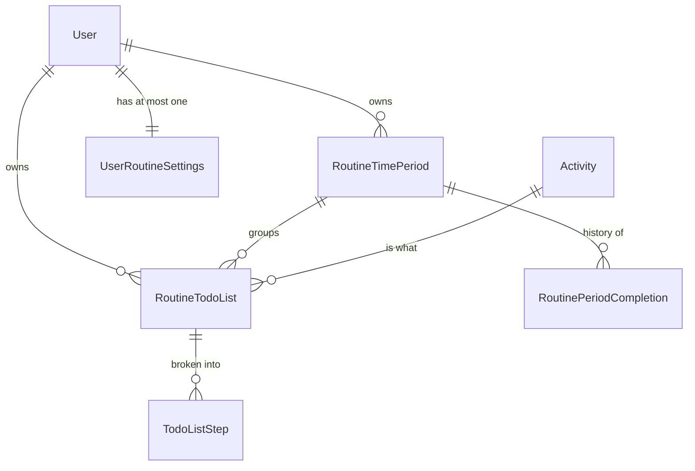

# AdhdTimeOrganizer.Routines — Domain Map

Model, rules and the navigation index. `summary.md` is the orientation; open only what you need.

> **Paths below are folder paths.** The namespaces still carry a `todoList` segment the folders no
> longer have — trust the path column, not the namespace.

## Model

`User` and `Activity` are Core's; `BaseTodoListItem` and `TodoListStep` are TodoLists'. None of them
carries an inverse collection back into this slice.

Not shown, because it is **not in this project**: `PlannerTask` (Planning) has no navigation to
`RoutineTodoList` — the completion fan-out is entirely event-based, through Core's
`RoutineTodoListIsDoneChangedEvent`, handled host-side.

## Entities — `domain/model/entity/`

| Type | Notes |
|---|---|
| `RoutineTimePeriod` | `BaseEntityWithUser` + `IEntityWithIsHidden` + `IBaseTextColorEntity`. `LengthInDays` / `ResetAnchorDay` drive `RoutineResetService.ComputeNextReset`. Two unique indexes: `(UserId, Text)` and `(UserId, LengthInDays)`. Carries `Streak` / `BestStreak` / `StreakThreshold` / `StreakGraceDays` / `StreakGraceUntil`, `HistoryDepth`, the freeze budget (`FreezeBudget` / `FreezesRemaining` / `FreezeBudgetResetsAt`), the opt-in `ReminderLeadDays`, and the two notification idempotency marks `EndingSoonNotifiedFor` / `GraceNotifiedFor`. |
| `RoutineTodoList` | Derives from TodoLists' `BaseTodoListItem` — the one real outbound edge (see `summary.md`). Adds `TimePeriodId`, `LastResetDate`, its own `Streak` / `BestStreak` / `LastCompletedAt`, and the scheduling hints `SuggestedDays` / `SuggestedDayOfMonth`. |
| `RoutinePeriodCompletion` | Plain `BaseEntity` (no `UserId` — scoped transitively through `TimePeriodId`). One row per elapsed period: `PeriodStart` / `PeriodEnd` / `CompletedCount` / `TotalCount`, plus `IsFrozen` / `FrozenAt` (paired by a CHECK). Unique on `(TimePeriodId, PeriodStart)`. |
| `UserRoutineSettings` | `BaseEntityWithUser`, at most one row per user (`IsOneWithOneUser`, unique on `UserId`). Holds `RoutineReviewDismissedForWeekStart` — the week-start the user last dismissed the weekly "fresh start" review card for. **Stored, never interpreted:** which week that *is* depends on the caller's `FirstDayOfWeek` and device time zone, so no job and no query here compares it against "now". The row exists so the dismissal follows the user to a second device. |

## Enums — `domain/model/enum/`

| Type | Members | Note |
|---|---|---|
| `StreakOutcome` | `Extended` · `OnGrace` · `Broken` · `NotEvaluated` | What a reset did to the streak. Deliberately a portal enum, **not** Contracts' `RoutineStreakOutcome` — that one is a persisted notification payload contract (old rows deserialize against it); this one is free to follow the streak rules. `RoutinePeriodNotificationService` maps between them. |
| `StreakFreezeRejection` | `None` · `NoBudget` · `AlreadyFrozen` · `NotAMiss` | Why `Apply` refused. These are domain rules, not request validation — whether a period counts as missed depends on its own `StreakThreshold`, and affordability on a lazily-refilled budget. Neither is knowable from the request body. |

## Business rules

**Reset and streak scoring.** When `now` passes `ComputeNextReset(period)`, the list overload of
`TryReset` scores the period: `CompletedCount / TotalCount` against `StreakThreshold` (a percentage).
Met → `Extended`, streak increments. Missed with `StreakGraceDays > 0` → `OnGrace`, streak held and
`StreakGraceUntil` opened. Missed with no grace → `Broken`, streak zeroed. **No items at all →
`NotEvaluated`**, streak untouched: completion says nothing about a routine with nothing in it. Either
way a `RoutinePeriodCompletion` row is written and the items un-tick.

**Grace.** `CheckGrace` must run before `TryReset` on *every* access — a lapsed window breaks the
streak, and if only the reset job checked it, a streak would survive indefinitely as long as nobody's
period rolled over.

**Freezes.** Budget refills to `FreezeBudget` at midnight UTC on the first of the next calendar month,
**lazily** — whoever reads or spends it calls `RefreshFreezeBudget` first; there is no job.
`FreezeBudget` is capped by a CHECK at `RoutineStreakFreezeService.MaxFreezeBudget`, because a budget
as large as the history depth would make the streak meaningless; `0` disables freezes for a period
without hiding the feature. Spending one marks the covered completion row `IsFrozen` and re-walks the
whole history: a frozen period is *skipped*, so the run carries across it without extending. `Streak` /
`BestStreak` are only ever raised.

**Nudges.** `ReminderLeadDays` is opt-in per period, not per user — "remind me about my weekly chores"
and "remind me about my yearly review" are not the same decision. It gates the ending-soon nudge only;
the end-of-period summary and the grace warning fire on their own conditions and are muted through the
notification preference matrix instead. `EvaluateEndingSoon` returns null once `now` reaches the reset
itself: from there the reset job owns the period, and "3 days left" racing the reset would be worse
than silence.

**Time.** Everything is UTC end to end. The sweeps do no zone conversion — two identical UTC periods
owned by users in different zones must produce identical results.

## Glossary

| Term | Meaning | Code |
|---|---|---|
| Time period | The recurring window a routine repeats on | `RoutineTimePeriod` |
| Anchor day | Which weekday / day-of-month the reset snaps to; `0` = rolling (no snap) | `ResetAnchorDay` |
| Threshold | % of items that must be done for the period to count as met | `StreakThreshold` |
| Grace | Time-based leniency: finish late, keep the run | `StreakGraceDays` / `StreakGraceUntil` |
| Streak freeze | Budgeted leniency: skip a period outright, keep the run | `FreezeBudget` / `FreezesRemaining` |
| Nudge | The mid-period "n of m done" notification | `EvaluateEndingSoon` / `RoutinePeriodEndingSoonPayload` |
| Review card | The weekly "fresh start" prompt the user can dismiss | `RoutineReviewDismissedForWeekStart` |

## Invariants

| # | Invariant | Enforced by |
|---|---|---|
| 1 | No reference to the host or to Planning | csproj — build error |
| 2 | `Routines → TodoLists` is the only outbound slice edge, and it is structural (inheritance), not a filter | csproj + convention. Don't try to invert it through the seam pattern; that pattern is for "does this activity belong to you", not shared base types |
| 3 | Per-user scoping is the DbContext's job, via the global filter on `IEntityWithUser` — not the endpoints (`ApplyUserScoping` is a no-op virtual) | `AppDbContext` query filter. **App-enforced only** for `RoutinePeriodCompletion`, which has no `UserId` and is reachable only through its period |
| 4 | `(UserId, Text)` and `(UserId, LengthInDays)` are each unique on a period | **DB** — two unique indexes |
| 5 | `(TimePeriodId, PeriodStart)` is unique — one completion row per elapsed period | **DB** — unique index |
| 6 | `IsFrozen` and `FrozenAt` are written together | **DB** — `ck_routine_period_completion_frozen_at_matches_is_frozen` |
| 7 | Ranges: anchor day, length, non-negative streaks, threshold, grace, history depth, reminder lead, budget `0..MaxFreezeBudget`, remaining `0..budget` | **DB** — nine CHECKs on `RoutineTimePeriod`, mirrored by `RoutineTimePeriodValidator` for a 400 instead of a 500 |
| 8 | Both seam sources are resolved by string key | **Nothing** — a rename without updating both sides is silent. `SeamWiringTests` is the only guard |
| 9 | The freeze budget is refilled by whoever reads it, not by a job | **App-enforced by convention only** — forgetting it is silent |
| 10 | Class names are table names | `BaseEntityConfigure`. Renaming a type is a migration; moving it is not |

## Navigation index

### Endpoints — `application/endpoint/`

| Name | Kind | Responsibility | Path |
|---|---|---|---|
| `GetRoutineSettingsEndpoint` | Endpoint | `GET /routine/settings`. Does **not** create a row on read (unlike Planning's equivalent) — every field defaults to null, so a read-created row would hold nothing, and this is the module's most common read | `routineSettings/GetRoutineSettingsEndpoint.cs` |
| `UpdateRoutineSettingsEndpoint` | Endpoint | `PUT /routine/settings`. Upserts the single row — this is what creates it | `routineSettings/UpdateRoutineSettingsEndpoint.cs` |
| `CreateRoutineTimePeriodEndpoint` | `BaseCreateEndpoint` | Create a period | `routineTimePeriod/command/CreateRoutineTimePeriodEndpoint.cs` |
| `UpdateRoutineTimePeriodEndpoint` | `BaseUpdateEndpoint` | Update a period (an anchor/length edit re-derives the next reset, and correctly earns a fresh nudge) | `routineTimePeriod/command/UpdateRoutineTimePeriodEndpoint.cs` |
| `DeleteRoutineTimePeriodEndpoint` | `BaseDeleteEndpoint` | Delete a period; completions cascade | `routineTimePeriod/command/DeleteRoutineTimePeriodEndpoint.cs` |
| `ToggleIsHiddenRoutineTimePeriodEndpoint` | `BaseToggleIsHiddenEndpoint` | Hide a period — hidden periods are skipped by the nudge sweep | `routineTimePeriod/command/ToggleIsHiddenRoutineTimePeriodEndpoint.cs` |
| `SpendStreakFreezeRoutineTimePeriodEndpoint` | Endpoint | Spend a freeze on a missed period. ⚠ Routes to **`POST /routine-todo-list/time-period/{timePeriodId}/streak-freeze`**, not under `/routine-time-period` like its folder neighbours — that is the shipped frontend contract, don't "correct" it. Returns the whole `RoutineTimePeriodResponse` via the shared `From(...)`, so it can't drift from the grouped read | `routineTimePeriod/command/SpendStreakFreezeRoutineTimePeriodEndpoint.cs` |
| `GetAllRoutineTimePeriodEndpoint` | `BaseGetAllEndpoint` | List periods | `routineTimePeriod/query/GetAllRoutineTimePeriodEndpoint.cs` |
| `GetByIdRoutineTimePeriodEndpoint` | `BaseGetByIdEndpoint` | One period | `routineTimePeriod/query/GetByIdRoutineTimePeriodEndpoint.cs` |
| `GetSelectOptionsRoutineTimePeriodEndpoint` | `BaseGetSelectOptionsEndpoint` | Period picker | `routineTimePeriod/query/GetSelectOptionsRoutineTimePeriodEndpoint.cs` |
| `GetCompletionHistoryRoutineTimePeriodEndpoint` | Endpoint | `GET /routine-time-period/{id}/completion-history`. Caps to the newest `HistoryDepth` rows, then renders oldest-first | `routineTimePeriod/query/GetCompletionHistoryRoutineTimePeriodEndpoint.cs` |
| `CreateRoutineTodoListEndpoint` | `BaseCreateEndpoint` | Create a routine item (+ its steps) | `routineTodoList/command/CreateRoutineTodoListEndpoint.cs` |
| `UpdateRoutineTodoListEndpoint` | `BaseUpdateEndpoint` | Update a routine item | `routineTodoList/command/UpdateRoutineTodoListEndpoint.cs` |
| `DeleteRoutineTodoListEndpoint` | `BaseDeleteEndpoint` | Delete a routine item | `routineTodoList/command/DeleteRoutineTodoListEndpoint.cs` |
| `RoutineToggleIsDoneTodoListEndpoint` | `BaseToggleIsDoneTodoListEndpoint` | Tick/untick; runs the list `TryReset` path and updates the item streak | `routineTodoList/command/RoutineToggleIsDoneTodoListEndpoint.cs` |
| `ToggleStepIsDoneRoutineTodoListEndpoint` | `BaseToggleStepIsDoneEndpoint` | Tick a step; uses the **single-item** `TryReset` (no streak scoring — see `summary.md`) | `routineTodoList/command/ToggleStepIsDoneRoutineTodoListEndpoint.cs` |
| `ChangeDisplayOrderRoutineTodoListEndpoint` | `BaseChangeDisplayOrderTodoListEndpoint` | Reorder within a period (`GroupFilterExpression => TimePeriodId`) | `routineTodoList/command/ChangeDisplayOrderRoutineTodoListEndpoint.cs` |
| `GetAllGroupedRoutineTodoListEndpoint` | Endpoint | `GET /routine-todo-list/grouped-by-time-period` — the main screen. **Reset-on-read**: refreshes the freeze budget, checks grace and applies `TryReset` before projecting | `routineTodoList/query/GetAllGroupedRoutineTodoListEndpoint.cs` |
| `GetAllRoutineTodoListEndpoint` · `GetByIdRoutineTodoListEndpoint` | `BaseGetAll` / `BaseGetById` | Flat reads | `routineTodoList/query/` |
| `CreateStepRoutineTodoListEndpoint` · `UpdateStepRoutineTodoListEndpoint` · `DeleteStepRoutineTodoListEndpoint` | `Base*StepEndpoint<RoutineTodoList>` | Step CRUD, all three from TodoLists' base family | `routineTodoList/steps/` |

### Domain services — `domain/service/`

Both are static and pure: they mutate what they are handed and persist nothing, so the work shares the
transaction that read the period.

| Name | Kind | Responsibility | Path |
|---|---|---|---|
| `RoutineResetService.ComputeNextReset` | Static fn | Next reset instant from length + anchor. Also feeds `RoutineTimePeriodResponse.NextResetAt` | `RoutineResetService.cs` |
| `RoutineResetService.CheckGrace` | Static fn | Breaks a lapsed streak grace window. Call before `TryReset` on **every** read/write site | `RoutineResetService.cs` |
| `RoutineResetService.TryReset(period, item, now)` | Static fn | Single-item overload — step toggle only. Does **not** advance `LastResetAt`, write a completion, or score the streak | `RoutineResetService.cs` |
| `RoutineResetService.TryReset(period, items, now)` | Static fn | List overload — the reset job, the grouped read, the bulk toggle. Advances the streak, returns the `RoutinePeriodCompletion` + `StreakOutcome`, clears `EndingSoonNotifiedFor` | `RoutineResetService.cs` |
| `RoutineResetService.EvaluateEndingSoon` / `ShouldWarnGraceExpiring` | Static fn | The two nudge conditions — nudge job only | `RoutineResetService.cs` |
| `RoutineResetService.UpdateItemStreak` | Static fn | Item-level streak after a completing toggle | `RoutineResetService.cs` |
| `RoutineStreakFreezeService.RefreshFreezeBudget` | Static fn | Lazy monthly refill. **Nothing else refills the budget** — there is no job | `RoutineStreakFreezeService.cs` |
| `RoutineStreakFreezeService.Apply` | Static fn | Spend a freeze; returns `StreakFreezeRejection` — anything but `None` means nothing was written | `RoutineStreakFreezeService.cs` |
| `RoutineStreakFreezeService.RecomputeStreak` | Static fn | Walks the **complete** history oldest-first — a trimmed list under-counts the run | `RoutineStreakFreezeService.cs` |
| `RoutineStreakFreezeService.IsSuccess` / `NextBudgetReset` | Static fn | Threshold test and the next window boundary | `RoutineStreakFreezeService.cs` |

### Notifications — `application/service/`, `domain/serviceContract/`

| Name | Kind | Responsibility | Path |
|---|---|---|---|
| `IRoutinePeriodNotificationService` | Contract | The three routine notifications. `NotifyEndingSoonAsync` returns `bool` — **that return is the idempotency marker's gate**: the caller marks only when something actually went out | `domain/serviceContract/IRoutinePeriodNotificationService.cs` |
| `RoutinePeriodNotificationService` | Service | Maps the three events onto `Sydowwe.Framework.Contracts.notification` payloads (`RoutinePeriodEndedPayload`, `RoutinePeriodEndingSoonPayload`, `RoutineStreakGraceExpiringPayload`). Every method is best-effort — catches and logs, never throws — because a notification failure must never roll back a reset that already committed. Does not consult preferences; the Notifications module owns that | `application/service/RoutinePeriodNotificationService.cs` |

### Jobs and scheduling — `infrastructure/jobs/`, `infrastructure/scheduling/`

Both handlers are keyed `IScheduledJobHandler` implementations
(`Sydowwe.Framework.Contracts.scheduling`), **not Quartz `IJob`s** — this slice references no Quartz.
They are picked up by the `IScopedService` marker scan like any other service, take the scoped
`DbContext` directly (the dispatcher opens a scope per fire) and run unauthenticated.
`DisallowConcurrent = true` is requested on the *registration*, not as a class attribute.

| Name | Kind | Responsibility | Path |
|---|---|---|---|
| `RoutineTodoListResetJobHandler` | Job (`Routines.TodoListReset`) | 02:00 UTC daily. Sweeps every period: `CheckGrace` → `RefreshFreezeBudget` → `TryReset`; persists completions, then notifies **after** the commit | `infrastructure/jobs/RoutineTodoListResetJobHandler.cs` |
| `RoutinePeriodNudgeJobHandler` | Job (`Routines.PeriodNudge`) | 09:00 UTC daily — deliberately not alongside the reset, because this one is addressed to a person. Skips hidden periods. Sequential per period, and each period's failure is caught so it can't lose earlier markers or skip later periods | `infrastructure/jobs/RoutinePeriodNudgeJobHandler.cs` |
| `RoutinesScheduledJobsRegistrar` | `IHostedService` | Pushes both schedules through `IScheduler` on **every** boot (idempotent upsert by `JobKey`; the Scheduler's RAM job store drops triggers on restart). Registers each independently so one bad cadence can't keep the other off the schedule, and swallows failures so a scheduling problem never blocks startup | `infrastructure/scheduling/RoutinesScheduledJobsRegistrar.cs` |

### Seams — `application/seam/`

| Name | Kind | Responsibility | Path |
|---|---|---|---|
| `RoutineTodoListActivityMembershipSource` | `IActivityMembershipSource` | "This activity is on a routine to-do list", faceted by `TimePeriodId`. Applies no user scoping — the query is composed into the caller's | `RoutineTodoListActivityMembershipSource.cs` |
| `RoutineTodoListActivityReferenceSource` | `IActivityReferenceSource` | Exposes and repoints `RoutineTodoList.ActivityId` for activity merge/delete. Streaks carry across a merge untouched | `RoutineTodoListActivityReferenceSource.cs` |

### Persistence — `infrastructure/persistence/`

| Name | Kind | Responsibility | Path |
|---|---|---|---|
| `RoutineTimePeriodConfiguration` | EF config | Nine CHECK constraints (anchor-day range, length range, non-negative streaks, threshold/grace/history-depth/reminder-lead ranges, and the two freeze ones) plus the two unique indexes | `configuration/RoutineTimePeriodConfiguration.cs` |
| `RoutineToDoListConfiguration` | EF config | `BaseTodoListConfigure()` (TodoLists) + `IsManyWithOneUser()` / `IsManyWithOneActivity()` (Core) + the `SuggestedDays` array conversion | `configuration/RoutineToDoListConfiguration.cs` |
| `RoutinePeriodCompletionConfiguration` | EF config | Cascade FK to `RoutineTimePeriod`; unique `(TimePeriodId, PeriodStart)`; the `IsFrozen`/`FrozenAt` pairing CHECK | `configuration/RoutinePeriodCompletionConfiguration.cs` |
| `UserRoutineSettingsConfiguration` | EF config | `BaseEntityConfigure()` + `IsOneWithOneUser<UserRoutineSettings>()` — the unique `user_id` index is what makes "one row per user" a constraint rather than a convention | `configuration/UserRoutineSettingsConfiguration.cs` |
| `RoutineTodoListExtensions` | Extensions | The `DbSet<RoutineTodoList>` overload of `GetNextDisplayOrder`, grouped by `TimePeriodId`. The generic version stays in TodoLists — naming `RoutineTodoList` there would have inverted the one-way edge | `extensions/RoutineTodoListExtensions.cs` |
| `RoutineTimePeriodSeeder` | Seeder (200, per-user default) | Subclasses `BasePerUserDefaultSeeder<RoutineTimePeriod>`. `Collides` checks **both** unique indexes — either rejects a row | `seeder/userDefault/RoutineTimePeriodSeeder.cs` |
| `RoutineTodoListSeeder` | Seeder (200, per-user dev) | Dev fixture. **Only dev seeders truncate.** | `seeder/dev/RoutineTodoListSeeder.cs` |

### DTOs and validators — `application/dto/`, `application/validator/`

Requests in `dto/request/`, responses in `dto/response/`, two filters in `dto/filter/`. Mapping lives
on the DTOs (`ICreateRequest` / `IUpdateRequest` / `IProjectionResponse`), not a mapper generic.
`PeriodCompletionRecord` sits with them rather than in the host, because both its consumers
(`GetCompletionHistoryRoutineTimePeriodEndpoint`, `RoutineTimePeriodResponse`) are here.

Five validators. `RoutineTimePeriodValidator` mirrors the DB CHECKs so a bad range is a 400 rather
than a 500. The two to-do list validators each carry a DB-backed cross-field rule — `SuggestedDays` /
`SuggestedDayOfMonth` must match the target period's `LengthInDays` bucket, which means a query, which
is why it is a `CustomAsync` rule and not a `RuleFor` chain. `SpendStreakFreezeValidator` only checks
that `PeriodStart` parses (a full ISO instant is accepted, not just a date); every real freeze rule is
a domain rule in `StreakFreezeRejection`.
