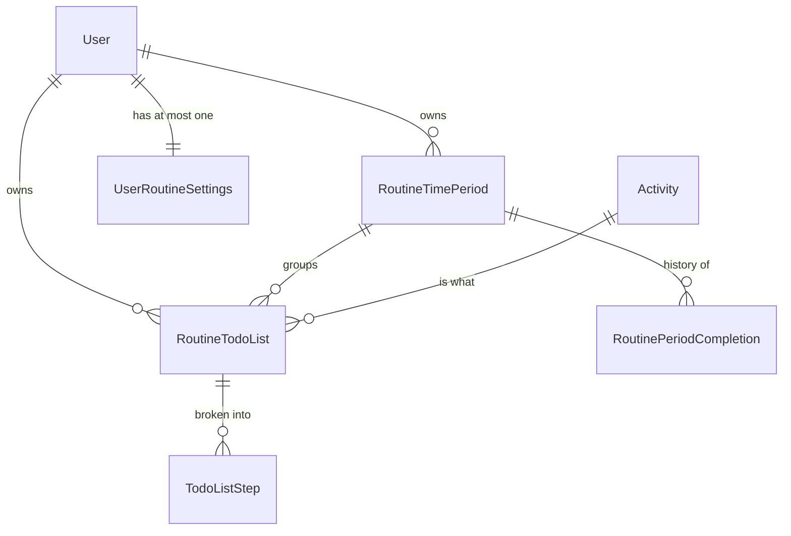

# AdhdTimeOrganizer.Routines — Domain Map

Model, rules and the navigation index. `summary.md` is the orientation; open only what you need.

> **Paths below are folder paths.** The namespaces still carry a `todoList` segment the folders no
> longer have — trust the path column, not the namespace.

## Model

`User` and `Activity` are Core's; `BaseTodoListItem` and `TodoListStep` are TodoLists'. None of them
carries an inverse collection back into this slice.

Not shown, because it is **not in this project**: `PlannerTask` (Planning) has no navigation to
`RoutineTodoList` — the completion fan-out is entirely event-based, through Core's
`RoutineTodoListIsDoneChangedEvent`, handled host-side.

## Entities — `domain/model/entity/`

| Type | Notes |
|---|---|
| `RoutineTimePeriod` | `BaseEntityWithUser` + `IEntityWithIsHidden` + `IBaseTextColorEntity`. `LengthInDays` / `ResetAnchorDay` drive `RoutineResetService.ComputeNextReset`. Two unique indexes: `(UserId, Text)` and `(UserId, LengthInDays)`. Carries `Streak` / `BestStreak` / `StreakThreshold` / `StreakGraceDays` / `StreakGraceUntil`, `HistoryDepth`, the freeze budget (`FreezeBudget` / `FreezesRemaining` / `FreezeBudgetResetsAt`), the opt-in `ReminderLeadDays`, and the two notification idempotency marks `EndingSoonNotifiedFor` / `GraceNotifiedFor`. |
| `RoutineTodoList` | Derives from TodoLists' `BaseTodoListItem` — the one real outbound edge (see `summary.md`). Adds `TimePeriodId`, `LastResetDate`, its own `Streak` / `BestStreak` / `LastCompletedAt`, the scored-this-cycle mark `BestStreakBeforeScore` (null = not scored; otherwise the pre-score record an un-tick restores), and the scheduling hints `SuggestedDays` / `SuggestedDayOfMonth`. |
| `RoutinePeriodCompletion` | Plain `BaseEntity` (no `UserId` — scoped transitively through `TimePeriodId`). One row per elapsed period: `PeriodStart` / `PeriodEnd` / `CompletedCount` / `TotalCount`, plus `IsFrozen` / `FrozenAt` (paired by a CHECK). Unique on `(TimePeriodId, PeriodStart)`. Append-only, and the only routines entity outside the `BaseTableEntity` convention — it keeps its own `CreatedAt` and its table is the plural `routine_period_completions`; see the Persistence row below. |
| `UserRoutineSettings` | `BaseEntityWithUser`, at most one row per user (`IsOneWithOneUser`, unique on `UserId`). Holds `RoutineReviewDismissedForWeekStart` — the week-start the user last dismissed the weekly "fresh start" review card for. **Stored, never interpreted:** which week that *is* depends on the caller's `FirstDayOfWeek` and device time zone, so no job and no query here compares it against "now". The row exists so the dismissal follows the user to a second device. |

## Enums — `domain/model/enum/`

| Type | Members | Note |
|---|---|---|
| `StreakOutcome` | `Extended` · `OnGrace` · `Broken` · `NotEvaluated` | What a reset did to the streak. Deliberately a portal enum, **not** Contracts' `RoutineStreakOutcome` — that one is a persisted notification payload contract (old rows deserialize against it); this one is free to follow the streak rules. `RoutinePeriodNotificationService` maps between them. |
| `StreakFreezeRejection` | `None` · `NoBudget` · `AlreadyFrozen` · `NotAMiss` | Why `Apply` refused. These are domain rules, not request validation — whether a period counts as missed depends on its own `StreakThreshold`, and affordability on a lazily-refilled budget. Neither is knowable from the request body. |

## Business rules

**Reset and streak scoring.** When `now` passes `ComputeNextReset(period)`, the list overload of
`TryReset` scores the period: `CompletedCount / TotalCount` against `StreakThreshold` (a percentage).
Met → `Extended`, streak increments. Missed with `StreakGraceDays > 0` → `OnGrace`, streak held and
`StreakGraceUntil` opened. Missed with no grace → `Broken`, streak zeroed. **No items at all →
`NotEvaluated`**, streak untouched: completion says nothing about a routine with nothing in it. Either
way a `RoutinePeriodCompletion` row is written and the items un-tick.

**The item's own streak is simpler, and settled per item.** No threshold, no grace, no freeze (there is
no item-level history to re-derive from): an item that reaches the boundary undone missed the cycle and
its `Streak` zeroes (`BestStreak` stands); one that reaches it done keeps what its tick earned. Both
`TryReset` overloads do this through one `OpenNewCycle` helper — the single-item overload included, because
the verdict needs nothing but the item and deferring it would let a tick landing before the list overload
runs score a cycle the item had in fact missed. The mark `BestStreakBeforeScore` clears there too.

**A tick scores once per cycle, and an un-tick inside that cycle is a full undo (ask B9).** The scoring
toggle sets `BestStreakBeforeScore` to the record as it stood, then increments; a later un-tick with the
mark still set decrements, restores that record, and clears the mark. So un-tick/re-tick is net zero
and an accidental click costs nothing once undone — but a score whose cycle has closed is beyond reach,
because the reset cleared its mark. `LastCompletedAt` moves on every completing toggle and is never
walked back: it records the tick, not the score.

`ComputeNextReset` is derived from `LastResetAt` alone — its `now` argument does not move the answer,
and **the instant it returns is allowed to be in the past**: being in the past is exactly what makes a
period due, which is what every caller's `now < nextReset` gate reads. One `TryReset` closes one cycle,
so dormancy is caught up by `TryResetCatchUp`, which loops it until the period is current. All three
reset sites (the nightly job, the grouped read, the bulk toggle) call the catch-up, never the single
`TryReset` — a site that calls `TryReset` directly resolves one cycle per request and leaves a period
that has been away for a month a month stale. The catch-up writes a completion row per closed cycle
(capped at `HistoryDepth` — older rows would fall straight off the heatmap) but hands back one
`Latest` result, so a dormancy costs the user one notification rather than one per missed cycle.

**Completion is server-owned.** `IsDone`, `DoneCount` and `DisplayOrder` reach
`UpdateRoutineTodoListRequest` on its inherited base but are deliberately not mapped, so the item edit
cannot write them. Completion belongs to the toggle endpoint: it is the path that reconciles `IsDone`,
`DoneCount` and every step together, advances the item streak, and publishes
`RoutineTodoListIsDoneChangedEvent` — the only channel by which Planning learns a routine was completed.
A second way in would leave the paired planner task stale for good and say nothing, since cross-slice
handlers log and swallow. `DoneCount` is re-derived from the client's `TotalCount` instead (clamped, so
lowering the total cannot leave a count above it and trip the CHECK). `DisplayOrder` is per-period, so
the update re-derives it exactly when the edit moves the item to another period, and otherwise leaves
what the reorder endpoint decided alone. Steps are reconciled by id rather than rebuilt: `TodoListStep.Id`
is `ValueGeneratedNever()`, so rebuilding mints a fresh `Guid` per step on every save and the three step
routes that take one in the path 404 against steps the user can still see.

**Grace.** `CheckGrace` must run before `TryReset` **and before `Apply`** — i.e. on *every* access, read
or write. A lapsed window breaks the streak, and if only the reset job checked it, a streak would
survive indefinitely as long as nobody's period rolled over. `Apply` is named explicitly because
skipping it there is worse than serving a stale number: `Apply` clears the window only when the frozen
entry is the newest one, so freezing an *older* miss against a lapsed window leaves it standing,
`RecomputeStreak` raises the streak back, the response shows it restored — and the next read zeroes it.
The user would spend a budgeted resource and watch it evaporate on the following page load.

The flat period reads sit on the framework projection bases, which serve `Projection` straight and can
run neither this nor the freeze refill; `RoutineTimePeriodReadRefresher`, called from their
`PostProcess` hooks, is what puts both back. Both mutations are **persisted**, not just projected.

**Freezes.** Budget refills to `FreezeBudget` at midnight UTC on the first of the next calendar month,
**lazily** — whoever reads or spends it calls `RefreshFreezeBudget` first; there is no job.
`FreezeBudget` is capped by a CHECK at `RoutineStreakFreezeService.MaxFreezeBudget`, because a budget
as large as the history depth would make the streak meaningless; `0` disables freezes for a period
without hiding the feature. Spending one marks the covered completion row `IsFrozen` and re-walks the
whole history: a frozen period is *skipped*, so the run carries across it without extending. `Streak` /
`BestStreak` are only ever raised.

**Away cycles (FO1).** A missed cycle at least half of whose days are away days — Core's
`DayTypeExtensions.IsAway`: `Vacation` or `SickDay`, never `Special` — is *excused* (`RoutineAwayRule`):
`StreakOutcome.Excused`, `RoutinePeriodCompletion.IsExcused`, the run carried exactly like a freeze but free,
no grace window opened, undone items keep their streaks, and no end-of-period summary. A met cycle is never
excused. Every reset site pre-reads the away days through `IRoutineAwayDaysReader` (Planning's
`ICalendarDayLookup.GetAwayDatesAsync` underneath) — the job, the grouped read, both toggles and the host's
`PlannerTaskIsDoneChangedEventHandler`. **Retroactively**, Planning publishes Core's
`CalendarDayTypesChangedEvent` from both day-type writes and from F4-02's stretch of time away (create, resize,
delete), and `CalendarDayTypesChangedEventHandler` excuses
the closed cycles that now qualify, clears the grace window if the newest one did, and re-walks the streak.
Excusal is one-way (un-marking a day never un-excuses), and item streaks cannot come back retroactively. The
cycle's days are UTC boundary dates, the away days user-local; the majority rule absorbs the off-by-one.
An excused cycle is in the heatmap but not in `TotalPeriodsElapsed`. On a user-local away today, J2 sends no
nudge or grace warning and J3 no digest, all **unmarked** (J2's away check fails open).

**Nudges.** `ReminderLeadDays` is opt-in per period, not per user — "remind me about my weekly chores"
and "remind me about my yearly review" are not the same decision. It gates the ending-soon nudge only;
the end-of-period summary and the grace warning fire on their own conditions and are muted through the
notification preference matrix instead. `EvaluateEndingSoon` returns null once `now` reaches the reset
itself: from there the reset job owns the period, and "3 days left" racing the reset would be worse
than silence.

**Suggested-today digest (B4).** Once per user per day, at the user's morning, one notification names
the items suggested for their today and not done yet. "Suggested" is `RoutineSuggestedDay.IsSuggestedOn`:
weekly (`1 < LengthInDays ≤ 14`) by `SuggestedDays` weekday, monthly+ (`> 14`) by `SuggestedDayOfMonth`
clamped to the month's last day, daily never — by period length, not by the fields. The client ships the
same rule (`routineSuggestedDay.ts`); change both or neither. Hidden periods never contribute, an item
ticked in the still-open cycle is done, a tick from a cycle whose reset is due is not. A missed day is
never mentioned again. Nothing qualifies → nothing sent, nothing marked.

**Time.** Periods, resets and the two nudge *windows* are UTC end to end: whether a nudge is due, what
it says (days left) and which reset its mark names are identical for two identical UTC periods owned by
users in different zones. **Delivery is the user's**: the nudge sweep runs every 15 minutes and sends a
due window at the first `Calendar.WakeUpTime` + 60 min (the user's `DefaultWakeUpTime` + 60 min without a day row, FO10) in
`User.Timezone` that falls inside it — or at the window's opening if none does, so a wake-up shift can
never swallow a grace warning. It also reads the zone to decide whether the user's own today is an away
day. **The suggested-today digest goes further**: "today" itself is the date in `User.Timezone` and
"morning" is that day's wake-up, because a weekday named in UTC is the wrong weekday for most of the world.

## Glossary

| Term | Meaning | Code |
|---|---|---|
| Time period | The recurring window a routine repeats on | `RoutineTimePeriod` |
| Anchor day | Which weekday / day-of-month the reset snaps to; `0` = rolling (no snap) | `ResetAnchorDay` |
| Threshold | % of items that must be done for the period to count as met | `StreakThreshold` |
| Grace | Time-based leniency: finish late, keep the run | `StreakGraceDays` / `StreakGraceUntil` |
| Streak freeze | Budgeted leniency: skip a period outright, keep the run | `FreezeBudget` / `FreezesRemaining` |
| Excused cycle | A miss while the user was away for at least half the cycle: carried like a freeze, free, automatic | `RoutinePeriodCompletion.IsExcused`, `RoutineAwayRule` |
| Nudge | The mid-period "n of m done" notification | `EvaluateEndingSoon` / `RoutinePeriodEndingSoonPayload` |
| Suggested day | The day a weekly/monthly item is meant for | `SuggestedDays` / `SuggestedDayOfMonth`, `RoutineSuggestedDay` |
| Suggested-today digest | The morning "these are today's" notification, one per user per day — only for users with the host's morning briefing off (`User.MorningBriefingEnabled`), which otherwise counts these items itself | `RoutineSuggestedTodayJobHandler` / `RoutineSuggestedTodayPayload`; the shared rule is `RoutineSuggestedDay.IsOpenSuggestionOn` |
| Review card | The weekly "fresh start" prompt the user can dismiss | `RoutineReviewDismissedForWeekStart` |

## Invariants

| # | Invariant | Enforced by |
|---|---|---|
| 1 | No reference to the host or to Planning | csproj — build error |
| 2 | `Routines → TodoLists` is the only outbound slice edge, and it is structural (inheritance), not a filter | csproj + convention. Don't try to invert it through the seam pattern; that pattern is for "does this activity belong to you", not shared base types |
| 3 | Per-user scoping is the DbContext's job, via the global filter on `IEntityWithUser` — not the endpoints (`ApplyUserScoping` is a no-op virtual) | `AppDbContext` query filter. **App-enforced only** for `RoutinePeriodCompletion`, which has no `UserId` and is reachable only through its period |
| 4 | `(UserId, Text)` and `(UserId, LengthInDays)` are each unique on a period | **DB** — two unique indexes |
| 5 | `(TimePeriodId, PeriodStart)` is unique — one completion row per elapsed period | **DB** — unique index |
| 6 | `IsFrozen` and `FrozenAt` are written together | **DB** — `ck_routine_period_completion_frozen_at_matches_is_frozen` |
| 6a | A completion is never both frozen and excused | **DB** — `ck_routine_period_completion_not_frozen_and_excused`; `Apply` answers `NotAMiss` on an excused row |
| 7 | Ranges: anchor day, length, non-negative streaks, threshold, grace, history depth, reminder lead, budget `0..MaxFreezeBudget`, remaining `0..budget` | **DB** — nine CHECKs on `RoutineTimePeriod`, mirrored by `RoutineTimePeriodValidator` for a 400 instead of a 500 |
| 8 | Both seam sources are resolved by string key | **Nothing** — a rename without updating both sides is silent. `SeamWiringTests` is the only guard |
| 9 | The freeze budget is refilled by whoever reads it, not by a job — *every* surface that shows or spends `FreezesRemaining`, today: the grouped read, the nightly reset job, `Apply`, and the four flat reads through `RoutineTimePeriodReadRefresher` | **App-enforced by convention only** — forgetting it is silent. `RoutineFlatPeriodReadTests` guards the projection-base surfaces |
| 10 | Class names are table names | `BaseEntityConfigure`. Renaming a type is a migration; moving it is not |
| 11 | A routine item may only name a `TimePeriodId` the caller owns | **App-enforced only** — `RoutineTodoListPeriodRules`, from both write validators. The FK proves the period exists, not whose it is, and the row is stamped with the caller's own `UserId`, so the global filter never sees a mismatch. The reset job then runs with the filter inert and counts the foreign item inside the victim's period |
| 12 | `(UserId, TimePeriodId, ActivityId)` is unique — one routine per activity per period | **DB** — unique index on `RoutineTodoList` |
| 13 | An activity merge therefore leaves **at most one routine per period** on the survivor: the survivor's own routine wins, or — where it has none in that period — the oldest merged one is repointed, and the rest are deleted along with their streaks. Across *different* periods everything is repointed and nothing is folded | **App-enforced** — `RoutineTodoListActivityReferenceSource.RepointAsync`. Not silent, but the failure mode is the whole six-slice merge rolling back on the index in 12, not the routine part. `ActivityMergeTests.Merge_TwoRoutinesInTheSamePeriod_ResolvesTheCollision` and its different-periods control are the guards |

## Navigation index

### Endpoints — `application/endpoint/`

| Name | Kind | Responsibility | Path |
|---|---|---|---|
| `GetRoutineSettingsEndpoint` | Endpoint | `GET /routine/settings`. Does **not** create a row on read (unlike Planning's equivalent) — every field defaults to null, so a read-created row would hold nothing, and this is the module's most common read | `routineSettings/GetRoutineSettingsEndpoint.cs` |
| `UpdateRoutineSettingsEndpoint` | Endpoint | `PUT /routine/settings`. Upserts the single row — this is what creates it | `routineSettings/UpdateRoutineSettingsEndpoint.cs` |
| `CreateRoutineTimePeriodEndpoint` | `BaseCreateEndpoint` | Create a period | `routineTimePeriod/command/CreateRoutineTimePeriodEndpoint.cs` |
| `UpdateRoutineTimePeriodEndpoint` | `BaseUpdateEndpoint` | Update a period (an anchor/length edit re-derives the next reset, and correctly earns a fresh nudge) | `routineTimePeriod/command/UpdateRoutineTimePeriodEndpoint.cs` |
| `DeleteRoutineTimePeriodEndpoint` | `BaseDeleteEndpoint` | Delete a period; completions cascade, items `Restrict` — a period with items is a 409 | `routineTimePeriod/command/DeleteRoutineTimePeriodEndpoint.cs` |
| `ToggleIsHiddenRoutineTimePeriodEndpoint` | `BaseToggleIsHiddenEndpoint` | Hide a period — hidden periods are skipped by the nudge sweep | `routineTimePeriod/command/ToggleIsHiddenRoutineTimePeriodEndpoint.cs` |
| `SpendStreakFreezeRoutineTimePeriodEndpoint` | Endpoint | Spend a freeze on a missed period. ⚠ Routes to **`POST /routine-todo-list/time-period/{timePeriodId}/streak-freeze`**, not under `/routine-time-period` like its folder neighbours — that is the shipped frontend contract, don't "correct" it. Returns the whole `RoutineTimePeriodResponse` via the shared `From(...)`, so it can't drift from the grouped read. Runs `CheckGrace` **before** `Apply` — see the Grace rule | `routineTimePeriod/command/SpendStreakFreezeRoutineTimePeriodEndpoint.cs` |
| `GetAllRoutineTimePeriodEndpoint` | `BaseGetAllEndpoint` | List periods. Overrides `PostProcessItemsAsync` to re-derive through `RoutineTimePeriodReadRefresher` — the base serves `Projection` straight, which has no `NextResetAt`, no history and neither lazy refresh | `routineTimePeriod/query/GetAllRoutineTimePeriodEndpoint.cs` |
| `GetByIdRoutineTimePeriodEndpoint` | `BaseGetByIdEndpoint` | One period. Same re-derivation, via `PostProcessAsync` | `routineTimePeriod/query/GetByIdRoutineTimePeriodEndpoint.cs` |
| `GetSelectOptionsRoutineTimePeriodEndpoint` | `BaseGetSelectOptionsEndpoint` | Period picker | `routineTimePeriod/query/GetSelectOptionsRoutineTimePeriodEndpoint.cs` |
| `GetCompletionHistoryRoutineTimePeriodEndpoint` | Endpoint | `GET /routine-time-period/{id}/completion-history`. Caps to the newest `HistoryDepth` rows, then renders oldest-first | `routineTimePeriod/query/GetCompletionHistoryRoutineTimePeriodEndpoint.cs` |
| `CreateRoutineTodoListEndpoint` | `BaseCreateEndpoint` | Create a routine item (+ its steps) | `routineTodoList/command/CreateRoutineTodoListEndpoint.cs` |
| `UpdateRoutineTodoListEndpoint` | `BaseUpdateEndpoint` | Update a routine item | `routineTodoList/command/UpdateRoutineTodoListEndpoint.cs` |
| `DeleteRoutineTodoListEndpoint` | `BaseDeleteEndpoint` | Delete a routine item | `routineTodoList/command/DeleteRoutineTodoListEndpoint.cs` |
| `RoutineToggleIsDoneTodoListEndpoint` | `BaseToggleIsDoneTodoListEndpoint` | Tick/untick; runs the list `TryReset` path and updates the item streak | `routineTodoList/command/RoutineToggleIsDoneTodoListEndpoint.cs` |
| `ToggleStepIsDoneRoutineTodoListEndpoint` | `BaseToggleStepIsDoneEndpoint` | Tick a step; uses the **single-item** `TryReset` (no streak scoring — see `summary.md`) | `routineTodoList/command/ToggleStepIsDoneRoutineTodoListEndpoint.cs` |
| `ChangeDisplayOrderRoutineTodoListEndpoint` | `BaseChangeDisplayOrderTodoListEndpoint` | Reorder within a period (`GroupFilterExpression => TimePeriodId`) | `routineTodoList/command/ChangeDisplayOrderRoutineTodoListEndpoint.cs` |
| `GetAllGroupedRoutineTodoListEndpoint` | Endpoint | `GET /routine-todo-list/grouped-by-time-period` — the main screen. **Reset-on-read**: refreshes the freeze budget, checks grace and applies `TryReset` before projecting | `routineTodoList/query/GetAllGroupedRoutineTodoListEndpoint.cs` |
| `GetAllRoutineTodoListEndpoint` · `GetByIdRoutineTodoListEndpoint` | `BaseGetAll` / `BaseGetById` | Flat reads. Both swap the item's **nested** period for a refreshed one through `RoutineTimePeriodReadRefresher`, for the same reason as the two above, then fill `TypicalSeconds` like the grouped read | `routineTodoList/query/` |
| `CreateStepRoutineTodoListEndpoint` · `UpdateStepRoutineTodoListEndpoint` · `DeleteStepRoutineTodoListEndpoint` | `Base*StepEndpoint<RoutineTodoList>` | Step CRUD, all three from TodoLists' base family | `routineTodoList/steps/` |

### Domain services — `domain/service/`

Both are static and pure: they mutate what they are handed and persist nothing, so the work shares the
transaction that read the period.

| Name | Kind | Responsibility | Path |
|---|---|---|---|
| `RoutineResetService.ComputeNextReset` | Static fn | The boundary closing the cycle `LastResetAt` opened, from length + anchor. Derived from `LastResetAt`, **not** from `now` — the instant may be in the past, and that is what "due" means. Also feeds `RoutineTimePeriodResponse.NextResetAt` | `RoutineResetService.cs` |
| `RoutineResetService.CheckGrace` | Static fn | Breaks a lapsed streak grace window. Call before `TryReset` **and before `Apply`**, on **every** read/write site | `RoutineResetService.cs` |
| `RoutineResetService.TryReset(period, item, now)` | Static fn | Single-item overload — step toggle only. Does **not** advance `LastResetAt`, write a completion, or score the *period* streak; it does settle the item's own (undone at the boundary → `Streak = 0`) and clear its scored mark | `RoutineResetService.cs` |
| `RoutineResetService.TryReset(period, items, now)` | Static fn | List overload. Closes **one** cycle: advances the period streak, settles each item's own, returns the `RoutinePeriodCompletion` + `StreakOutcome`, clears `EndingSoonNotifiedFor`. Call it directly only when one cycle is what you mean | `RoutineResetService.cs` |
| `RoutineResetService.TryResetCatchUp(period, items, now)` | Static fn | What the reset job, the grouped read and the bulk toggle actually call. Loops the list overload until the period is current (capped at 1200 cycles), returns the newest `HistoryDepth` completions plus one `Latest` result to notify on. A grace window opened by one closed cycle is checked against the *next* boundary, not against `now` | `RoutineResetService.cs` |
| `RoutineResetService.EvaluateEndingSoon` / `ShouldWarnGraceExpiring` | Static fn | The two nudge conditions — nudge job only | `RoutineResetService.cs` |
| `RoutineResetService.UpdateItemStreak` | Static fn | Item-level streak after a toggle in either direction; call once `IsDone` is settled. Increments **once per cycle, not once per toggle** — a re-tick, or a repeated `ForceValue = true` at an already-complete counted item, moves `LastCompletedAt` and nothing else — and an un-tick inside the cycle the score belongs to gives the point and any record it set back. The guard is the item's own `BestStreakBeforeScore` mark, so the two host event handlers that toggle an item without loading its period are covered too | `RoutineResetService.cs` |
| `RoutineStreakFreezeService.RefreshFreezeBudget` | Static fn | Lazy monthly refill. **Nothing else refills the budget** — there is no job | `RoutineStreakFreezeService.cs` |
| `RoutineStreakFreezeService.Apply` | Static fn | Spend a freeze; returns `StreakFreezeRejection` — anything but `None` means nothing was written. Refuses a `TotalCount == 0` entry as `NotAMiss`: `RecomputeStreak` skips item-less periods outright, so the run already carries across one for free. Caller must have run `CheckGrace` first. `DescribeBreak` is its pure "what if" twin (same miss rule, same walk), used for the broken-streak notification | `RoutineStreakFreezeService.cs` |
| `RoutineStreakFreezeService.RecomputeStreak` | Static fn | Walks the **complete** history oldest-first — a trimmed list under-counts the run | `RoutineStreakFreezeService.cs` |
| `RoutineStreakFreezeService.IsSuccess` / `NextBudgetReset` | Static fn | Threshold test and the next window boundary | `RoutineStreakFreezeService.cs` |
| `RoutineItemTypicalDuration` | Static fn | F2-06. `CyclesOf` cuts a period's cycles at its ledger's real reset instants plus `LastResetAt`; `For` sums an item's recordings per cycle and takes the median of the newest `SampleCycles` (10) timed ones, read back `LookbackCycles` (60) ledger rows, through `EstimateFitRule`. The open cycle counts only if the item is done in it | `RoutineItemTypicalDuration.cs` |
| `RoutineSuggestedDay.IsSuggestedOn` | Static fn | Whether an item is suggested for a given (user-local) date — the server half of the client's `routineSuggestedDay.ts`. Decides daily-vs-weekly-vs-monthly by `LengthInDays`, and ignores the field that doesn't belong to that length | `RoutineSuggestedDay.cs` |

### Notifications — `application/service/`, `domain/serviceContract/`

| Name | Kind | Responsibility | Path |
|---|---|---|---|
| `IRoutinePeriodNotificationService` | Contract | The four routine notifications. `NotifyEndingSoonAsync`, `NotifyGraceExpiringAsync` and `NotifySuggestedTodayAsync` return `bool` — **that return is the idempotency marker's gate**: the caller marks only when something actually went out | `domain/serviceContract/IRoutinePeriodNotificationService.cs` |
| `RoutineItemTypicalDurationFiller` | Static fn | Overlays `TypicalSeconds` / `SampleCount` on rendered items in two queries (the periods' ledger, then the recordings through Core's `IRoutineItemLoggedTimeSource`). Called by the grouped read and both flat reads | `application/service/RoutineItemTypicalDurationFiller.cs` |
| `RoutineTimePeriodReadRefresher` | Static fn | `CheckGrace` + `RefreshFreezeBudget` (persisted) then render through `RoutineTimePeriodResponse.From`, for the four reads that sit on the framework projection bases. Deliberately does **not** reset — a reset needs the period's items, which a flat read never loads | `application/service/RoutineTimePeriodReadRefresher.cs` |
| `RoutinePeriodNotificationService` | Service | Maps the four events onto `Sydowwe.Framework.Contracts.notification` payloads (`RoutinePeriodEndedPayload`, `RoutinePeriodEndingSoonPayload`, `RoutineStreakGraceExpiringPayload`, `RoutineSuggestedTodayPayload`). Every method is best-effort — catches and logs, never throws — because a notification failure must never roll back a reset that already committed. Does not consult preferences; the Notifications module owns that. On a `Broken` reset it reads the period's full completion history (after the caller's commit, so the miss is the newest row) and fills `LostStreak` / `FreezesRemaining` / `CanFreeze` via `RoutineStreakFreezeService.DescribeBreak` — the body offers a freeze only when `Apply` would succeed now and raise the streak; a failed read falls back to the plain "broken" sentence | `application/service/RoutinePeriodNotificationService.cs` |

### Jobs and scheduling — `infrastructure/jobs/`, `infrastructure/scheduling/`

All three handlers are keyed `IScheduledJobHandler` implementations
(`Sydowwe.Framework.Contracts.scheduling`), **not Quartz `IJob`s** — this slice references no Quartz.
They are picked up by the `IScopedService` marker scan like any other service, take the scoped
`DbContext` directly (the dispatcher opens a scope per fire) and run unauthenticated.
`DisallowConcurrent = true` is requested on the *registration*, not as a class attribute.

| Name | Kind | Responsibility | Path |
|---|---|---|---|
| `RoutineTodoListResetJobHandler` | Job (`Routines.TodoListReset`) | 02:00 UTC daily. Sweeps every period: `CheckGrace` → `RefreshFreezeBudget` → `TryResetCatchUp`; persists completions (one save per period), then notifies **after** the commit. Walks the table a page of users at a time (`RoutineSweepPaging`) | `infrastructure/jobs/RoutineTodoListResetJobHandler.cs` |
| `RoutinePeriodNudgeJobHandler` | Job (`Routines.PeriodNudge`) | Every 15 min — addressed to a person, so each due window goes out at the first wake-up + 60 min in the user's zone inside it (`DeliverAt`); the window math and marks stay UTC. A SQL pre-filter (`Candidates`) loads only periods whose window could be open and unmarked. Skips hidden periods. Sequential per period, and each period's failure is caught so it can't lose earlier markers or skip later periods. Paged by user (`RoutineSweepPaging`), committing the markers per page; the candidate filter (incl. `NOT is_hidden`, indexed) is on both of its queries | `infrastructure/jobs/RoutinePeriodNudgeJobHandler.cs` |
| `RoutineSuggestedTodayJobHandler` | Job (`Routines.SuggestedToday`) | Every 15 minutes, because each user's morning is a different UTC instant; sends each user **one** digest per local day once `Calendar.WakeUpTime` (via Core's `ICalendarDayLookup`) or, without a day row, the user's `DefaultWakeUpTime` (FO10) has passed in `User.Timezone` (via `IUserTimeZoneReader`, bulk per page). Composed at send time. Marks `SuggestedTodayNotifiedFor` on **all** the user's periods with one `ExecuteUpdate` right after a successful send — never tracked, never per page, so it can't lose a row_version race and a period created later that day is covered. Reads are `AsNoTracking`; pages by user through `RoutineSweepPaging` | `infrastructure/jobs/RoutineSuggestedTodayJobHandler.cs` |
| `RoutineSweepPaging` | Helper (internal) | All three sweeps' user paging: the distinct user ids, ordered, in pages of `UserPageSize` (100). By user rather than by row — the page is also the commit and change-tracker-release unit, so one user's periods must never straddle two of them | `infrastructure/jobs/RoutineSweepPaging.cs` |
| `RoutinesScheduledJobsRegistrar` | `IHostedService` | Pushes all three schedules through `IScheduler` on **every** boot (idempotent upsert by `JobKey`; the Scheduler's RAM job store drops triggers on restart). Registers each independently so one bad cadence can't keep the others off the schedule, and swallows failures so a scheduling problem never blocks startup | `infrastructure/scheduling/RoutinesScheduledJobsRegistrar.cs` |

### Seams — `application/seam/`

| Name | Kind | Responsibility | Path |
|---|---|---|---|
| `RoutineTodoListActivityMembershipSource` | `IActivityMembershipSource` | "This activity is on a routine to-do list", faceted by `TimePeriodId`. Applies no user scoping — the query is composed into the caller's | `RoutineTodoListActivityMembershipSource.cs` |
| `RoutineTodoListActivityReferenceSource` | `IActivityReferenceSource` | Exposes and repoints `RoutineTodoList.ActivityId` for activity merge/delete. Streaks carry across a merge untouched, except where two routines collide in one period — see invariant 13 | `RoutineTodoListActivityReferenceSource.cs` |
| `RoutineTodoListOwnedReferenceVerifier` | `IUserOwnedReferenceVerifier` | "Is this `RoutineTodoList` id the caller's?", for slices that store the id on their own rows. Filters on the supplied user id, not the ambient filter | `RoutineTodoListOwnedReferenceVerifier.cs` |

### Persistence — `infrastructure/persistence/`

| Name | Kind | Responsibility | Path |
|---|---|---|---|
| `RoutineTimePeriodConfiguration` | EF config | Nine CHECK constraints (anchor-day range, length range, non-negative streaks, threshold/grace/history-depth/reminder-lead ranges, and the two freeze ones), the two unique indexes, and the partial `ix_routine_time_period_user_id_visible` (`user_id` `WHERE NOT is_hidden`) that the paged nudge sweep reads on | `configuration/RoutineTimePeriodConfiguration.cs` |
| `RoutineToDoListConfiguration` | EF config | `BaseTodoListConfigure()` (TodoLists) + `IsManyWithOneUser()` / `IsManyWithOneActivity()` (Core) + the `SuggestedDays` array conversion | `configuration/RoutineToDoListConfiguration.cs` |
| `RoutinePeriodCompletionConfiguration` | EF config | Cascade FK to `RoutineTimePeriod`; unique `(TimePeriodId, PeriodStart)`; the `IsFrozen`/`FrozenAt` pairing CHECK. **The one config here that does not call `BaseEntityConfigure()`** — it can't: that helper is constrained to `IBaseTableEntity` and the entity is a plain `BaseEntity`. So the key is hand-rolled and the table is `routine_period_completions` (**plural**, from the DbSet name rather than the class name), has **no `row_version`**, and uses an identity `Id` instead of `serial`. Deliberate and declined as a rename — a new `BaseEntityConfigure` convention silently skips this table | `configuration/RoutinePeriodCompletionConfiguration.cs` |
| `UserRoutineSettingsConfiguration` | EF config | `BaseEntityConfigure()` + `IsOneWithOneUser<UserRoutineSettings>()` — the unique `user_id` index is what makes "one row per user" a constraint rather than a convention | `configuration/UserRoutineSettingsConfiguration.cs` |
| `RoutineTodoListExtensions` | Extensions | The `DbSet<RoutineTodoList>` overload of `GetNextDisplayOrder`, grouped by `TimePeriodId`. The generic version stays in TodoLists — naming `RoutineTodoList` there would have inverted the one-way edge | `extensions/RoutineTodoListExtensions.cs` |
| `RoutineTimePeriodSeeder` | Seeder (200, per-user default) | Subclasses `BasePerUserDefaultSeeder<RoutineTimePeriod>`. `Collides` checks **both** unique indexes — either rejects a row | `seeder/userDefault/RoutineTimePeriodSeeder.cs` |
| `RoutineTodoListSeeder` | Seeder (200, per-user dev) | Dev fixture. **Only dev seeders truncate.** | `seeder/dev/RoutineTodoListSeeder.cs` |

### DTOs and validators — `application/dto/`, `application/validator/`

Requests in `dto/request/`, responses in `dto/response/`. There is no `dto/filter/` — the module has no
grid or filter endpoint, and the two unreferenced filter records that used to sit there were deleted
(`CQ-10`); if a grid is added, reintroduce them **without** a settable `UserId`, since scoping is the
DbContext's job (invariant 3). Mapping lives
on the DTOs (`ICreateRequest` / `IUpdateRequest` / `IProjectionResponse`), not a mapper generic.
`PeriodCompletionRecord` sits with them rather than in the host, because both its consumers
(`GetCompletionHistoryRoutineTimePeriodEndpoint`, `RoutineTimePeriodResponse`) are here.

`RoutineTimePeriodResponse` carries four members `Projection` cannot produce, all set in `From`:
`NextResetAt`, `CompletionHistory`, and the two totals over that history — `TotalPeriodsElapsed` (the
rows in the `HistoryDepth` window) and `TotalPeriodsCompleted` (of those, the ones `IsSuccess` passes; a
frozen cycle is not one). They are counted over the **window**, not the whole ledger, so the consistency
figure the client derives from them describes the heatmap it sits beside. The SPA had declared both names
and defaulted them to 0 since before the ledger existed, gating its review card, consistency figure and
personal-bests panel on `totalPeriodsElapsed > 0` — so until `From` set them, those three surfaces could
not render for any account, and no row assertion noticed.

Five validators. `RoutineTimePeriodValidator` mirrors the DB CHECKs so a bad range is a 400 rather
than a 500. The two to-do list validators each carry a DB-backed cross-field rule, which means a
query, which is why it is a `CustomAsync` rule and not a `RuleFor` chain. Both delegate it to
`RoutineTodoListPeriodRules.ApplyAsync`, which does two things in one round-trip: it resolves the
target period **as the caller's** — invariant 11, and the only place that is checked — and then
applies the `SuggestedDays` / `SuggestedDayOfMonth` bucket the period's `LengthInDays` decides. A
period that does not resolve is a `TimePeriodId` failure with the same message whether it is missing
or someone else's. The helper takes an `IServiceScopeFactory` and an `IHttpContextAccessor` rather
than a `DbContext` and the principal, because FastEndpoints validators are singletons; the explicit
`UserId` comparison is what decides, so it does not depend on the fresh scope's `ScopeUserId`.
`SpendStreakFreezeValidator` only checks
that `PeriodStart` parses (a full ISO instant is accepted, not just a date); every real freeze rule is
a domain rule in `StreakFreezeRejection`.
