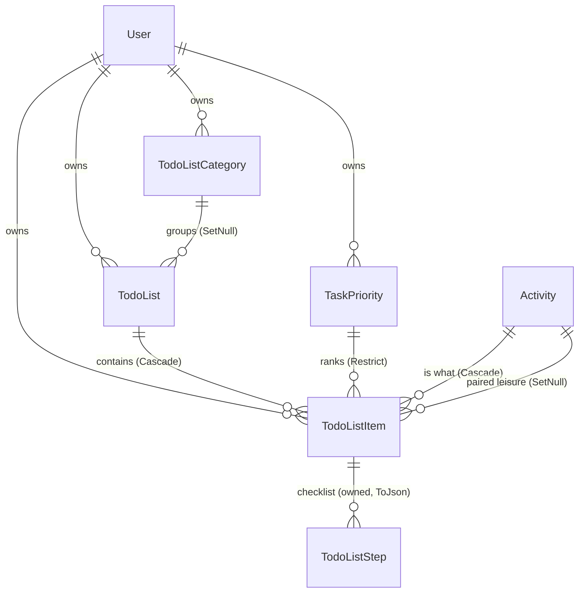

# AdhdTimeOrganizer.TodoLists — Domain Map

Navigation index. Open only what you need; `summary.md` is the orientation.

## Model

`User` and `Activity` are Core's. Neither carries an inverse collection back into this slice — that
is what keeps Core free of a reference to it.

Not shown, because they are **not in this project**: `RoutineTodoList` and `RoutinePeriodCompletion`
also derive from `BaseTodoListItem` and hang off `RoutineTimePeriod`, but they belong to
`AdhdTimeOrganizer.Routines`, which references this project for the bases. `PlannerTask` points at
`TodoListItem` from the Planning side only.

## Entities — `domain/model/entity/`

Files are flat in that folder; the namespace is `AdhdTimeOrganizer.TodoLists.domain.model.entity.todoList`.

| Type | Notes |
|---|---|
| `BaseTodoListItem` | The shared base (`BaseEntityWithIsDone`, `IEntityWithDoneAndTotalCount`): `DisplayOrder`, `DoneCount` / `TotalCount`, `Note`, `SuggestedTime`, the `TodoListStep` collection. **Routines derives from this**, which is why it lives here and not in Core. `SetDone` snaps `IsDone`, `DoneCount` and every step together, and only rewrites `DoneCount` when `TotalCount.HasValue` — deliberate. |
| `TodoList` | Grouped by an optional `TodoListCategory`. **No computed `ItemCount` / `CompletedCount` on the entity** — those two numbers exist only on `TodoListResponse`, where one grouped subquery over `todo_list_item` computes both (`PERF-3`). The entity-level copies were unmapped properties that loaded the whole collection per list to answer them. |
| `TodoListItem` | `BaseTodoListItem` + `TaskPriorityId` (required), `TodoListId` (optional), `ActivityId`, `DueDate` / `DueTime`, `PairedLeisureActivityId`, `CompletedTimestamp`. **No `PlannerTask` navigation** — the relationship is owned from Planning. **No navigation for the paired activity either** — reads carry the bare id. `CompletedTimestamp` is written **only** by `TodoListItemCompletionInterceptor`, never by hand. |
| `TodoListCategory` | Per-user lookup, unique on `(UserId, Name)`. |
| `TodoListStep` | The checklist sub-items. **Not an entity** — an owned type serialised `ToJson` into the parent's row, keyed by a client-supplied `Guid` (`ValueGeneratedNever`). There is no steps table. That `Guid` is a **stable public key**: three routes take it in the path (`PATCH …/steps/{stepId}/toggle`, `PUT …/steps/{stepId}`, `DELETE …/steps/{stepId}`), so it must survive an edit of the parent — which is why both PUTs reconcile the collection through `StepRequestExtensions.ReconcileStepsFrom` instead of rebuilding it from fresh instances. |
| `TaskPriority` | Per-user lookup; unique key is `(user_id, priority)`, **not** `Text`. Matters for `Collides` in its seeder and for any reorder. |

## Configuration — `infrastructure/`

| File | Covers |
|---|---|
| `persistence/configuration/TodoListConfiguration.cs` | Unique `(UserId, Name)`; items cascade from the list. |
| `persistence/configuration/TodoListItemConfiguration.cs` | The FK family, `SuggestedTime`'s converter, and four indexes — see *Invariants*. |
| `persistence/configuration/TodoListCategoryConfiguration.cs` | Unique `(UserId, Name)`; lists **SetNull** on category delete. |
| `persistence/configuration/TaskPriorityConfiguration.cs` | Unique `(UserId, Priority)` + a sort index on `Priority`. Moved here from `configuration/activityPlanning/` — the folder was lying about which domain owns it. The `TaskPriority → TodoListItem` relationship is declared **once**, from the dependent side, not here. |
| `persistence/TodoListEntityConfigurationExtensions.cs` | `BaseTodoListConfigure<TEntity>()` — the three check constraints, `DisplayOrder` / `IsDone` / `Note`, and the `OwnsMany(Steps).ToJson()` mapping. Applied by the Routines configurations too. |
| `persistence/TodoListExtensions.cs` | `GetNextDisplayOrder<TEntity>` (generic), `GetNextDisplayOrder(DbSet<TodoListItem>, …, taskPriorityId)`, `GetDisplayOrderById`, `GetGroupIdById`. All take an explicit `userId` as defence-in-depth beside the global filter. The `DbSet<RoutineTodoList>` overload is in Routines. |
| `settings/TodoListSettings.cs` | `MaxItems`, `DisplayOrderGap`, `DashboardHorizonDays` (how far ahead `GetDashboardTodoListItemEndpoint` looks, in whole days of the **user's** calendar; defaulted to 3 on the record so a host that omits the key still gets a window); `DisplayOrderStart` is **derived** (`MaxItems * DisplayOrderGap`), not configured. **`MaxItems` is a multiplier, not a cap** — nothing enforces it as a limit on how many items a group may hold; it only sets how far above zero `DisplayOrderStart` begins, i.e. how many items fit before the descending gaps cross zero. Bound in `Program.cs`; consumed by the reorder/move endpoints and the dev seeder. |
| `persistence/interceptor/TodoListItemCompletionInterceptor.cs` | The sole writer of `TodoListItem.CompletedTimestamp`. Overrides both the sync and async save paths. Registered host-side in `Program.cs`'s `AddInterceptors` call — the class lives here because it names `TodoListItem`, but nothing in this slice wires it up. Fires only on a genuine `IsDone` transition; `ExecuteUpdateAsync` bypasses it. |

Everything general (`BaseEntityConfigure`, `BaseNameTextEntityConfigure`, `NullableIntTimeConverter`, …)
comes from `Sydowwe.Framework`; the `IsManyWithOneUser` / `IsManyWithOneActivity` helpers come from Core.

## Navigation index

### Cross-slice seams — `application/seam/`

| Name | Kind | Responsibility | Path |
|---|---|---|---|
| `TodoListActivityMembershipSource` | Seam impl (keyed) | "This activity is on a to-do list", faceted by `TaskPriorityId`. Composed into the caller's query, so it does no user scoping of its own | `application/seam/TodoListActivityMembershipSource.cs` |
| `TodoListActivityReferenceSource` | Seam impl (keyed) | Counts + repoints both activity columns on an activity merge, including the self-pairing collapse and the `(UserId, ActivityId, TodoListId)` row collapse | `application/seam/TodoListActivityReferenceSource.cs` |
| `TodoListItemOwnedReferenceVerifier` | Seam impl (keyed) | "Is this `TodoListItem` id the caller's?", so a slice writing `TodoListItemId` can refuse a stranger's. Filters on the supplied user id, **not** the ambient filter | `application/seam/TodoListItemOwnedReferenceVerifier.cs` |

### FO3 rules — `application/service/`

| Name | Kind | Responsibility | Path |
|---|---|---|---|
| `TodoListItemPostponeRule` | Rule (static, pure) | Is this due-date move a postponement? The item was open and is pushed later, and its **first** due date (`FirstDueDate`, else the date it moves from) is before the user's today. Records `PostponeCount` and, once, `FirstDueDate`. Setting, clearing or pulling a date earlier is never one. The planner's twin is `PlannerTaskPostponeRule` | `application/service/TodoListItemPostponeRule.cs` |
| `TodoListItemPlanHelp` | Rule (static, pure) | Stuck = 3+ failed attempts and none completed: the planner's (`PlanHistory`, through `ITodoListItemPlanSource`) plus the item's own `PostponeCount`. Answers the kind of help, **never the count** | `application/service/TodoListItemPlanHelp.cs` |
| `TodoListItemPlannedSlotFiller` | Helper (static) | Overlays `NextPlannedSlot` and `PlanHelp` on projected items. Reads the item's postpone count off `TodoListItemResponse.PostponeCount`, which is projected but `[JsonIgnore]` | `application/service/TodoListItemPlannedSlotFiller.cs` |

The undo of a bulk reschedule restores the dates with the PUT, which moves them **earlier**, so it does not take
the postponement back. Accepted: the count is never shown and only tips which help is offered.

### Shared endpoint bases — `application/endpoint/`

Subclassed by both this slice and Routines. This is the only reason a base sits in a slice rather
than in Framework: each is typed on `BaseTodoListItem`.

| Name | Kind | Responsibility | Path |
|---|---|---|---|
| `BaseToggleIsDoneTodoListEndpoint<T>` | Endpoint base | `PATCH /{entity}/toggle-is-done`. Owns `IsDoneLogic` — the step-counted tick/untick state machine — with `FetchAndPrepare` / `AfterItemToggled` / `AfterSave` / `PublishEvent` hooks. **The batch is all-or-nothing**: every requested id must resolve, or the whole request is a 404 and nothing is toggled | `application/endpoint/BaseToggleIsDoneTodoListEndpoint.cs` |
| `BaseToggleStepIsDoneEndpoint<T>` | Endpoint base | `PATCH /{entity}/{itemId}/steps/{stepId}/toggle`. Toggles one step and reconciles the parent's `IsDone` / `DoneCount`; `BeforeToggle` lets Routines reset an expired period first, and `OnItemDoneChanged` fires when the step flipped the parent's `IsDone` in either direction — Routines moves the item streak there. It reads as dead in this project alone; it is not | `application/endpoint/BaseToggleStepIsDoneEndpoint.cs` |
| `BaseChangeDisplayOrderTodoListEndpoint<T>` | Endpoint base | `PATCH /{entity}/change-display-order`. Midpoint reordering between two siblings, transactional, with a rebalance-and-retry when the gap closes. `GroupFilterExpression` is the subclass's grouping column | `application/endpoint/BaseChangeDisplayOrderTodoListEndpoint.cs` |
| `BaseCreateStepEndpoint<T>` | Endpoint base | Append a checklist step | `application/endpoint/steps/BaseCreateStepEndpoint.cs` |
| `BaseUpdateStepEndpoint<T>` | Endpoint base | Edit a step's fields | `application/endpoint/steps/BaseUpdateStepEndpoint.cs` |
| `BaseDeleteStepEndpoint<T>` | Endpoint base | Remove a step | `application/endpoint/steps/BaseDeleteStepEndpoint.cs` |

### `TodoListItem` — `application/endpoint/todoListItem/`

| Name | Kind | Responsibility | Path |
|---|---|---|---|
| `CreateTodoListItemEndpoint` | Endpoint | Create | `…/todoListItem/command/CreateTodoListItemEndpoint.cs` |
| `UpdateTodoListItemEndpoint` | Endpoint | Full update (the frontend round-trips the whole item, pairing included). Pushing an overdue `DueDate` later is recorded through `TodoListItemPostponeRule` (FO3) | `…/todoListItem/command/UpdateTodoListItemEndpoint.cs` |
| `RescheduleOverdueTodoListItemEndpoint` | Endpoint | `POST …/reschedule-overdue { listId?, days }` — every open item whose due date is before the **user's** today gets today + `days` (0–365), in one save, each through `TodoListItemPostponeRule`. `listId` null means every list; a stranger's list moves nothing. Answers the new date and the moved ids, so the client's undo restores exactly those. The renegotiation banner's call (FO3 phase 2) | `…/todoListItem/command/RescheduleOverdueTodoListItemEndpoint.cs` |
| `DeleteTodoListItemEndpoint` | Endpoint | Delete | `…/todoListItem/command/DeleteTodoListItemEndpoint.cs` |
| `MoveTodoListItemEndpoint` | Endpoint | `PATCH …/{id}/move` — verifies the destination list in `BeforeMapping`, moves, recomputes `DisplayOrder` in `AfterMapping`. Everything else, including the 409 on the unique index, comes from `BasePatchEndpoint` | `…/todoListItem/command/MoveTodoListItemEndpoint.cs` |
| `ChangePriorityTodoListItemEndpoint` | Endpoint | `PATCH …/{id}/priority` — same three-hook shape. **`DisplayOrder` is grouped by `TaskPriorityId`, so the two columns move together**: changing the rank re-orders the item into the destination group | `…/todoListItem/command/ChangePriorityTodoListItemEndpoint.cs` |
| `ChangeDisplayOrderTodoListItemEndpoint` | Endpoint | Reorder within a priority bucket | `…/todoListItem/command/ChangeDisplayOrderTodoListItemEndpoint.cs` |
| `ToggleIsDoneTodoListItemEndpoint` | Endpoint | Tick / untick; publishes the Core completion event | `…/todoListItem/command/ToggleIsDoneTodoListItemEndpoint.cs` |
| `ToggleStepIsDoneTodoListItemEndpoint` | Endpoint | Tick / untick one checklist step | `…/todoListItem/command/ToggleStepIsDoneTodoListItemEndpoint.cs` |
| `GetAllTodoListItemEndpoint` | Endpoint | `GET /todo-list-item?todoListId=` — the to-do view's list read. **`TodoListId` is required** (`GetAllTodoListItemValidator`): the unfiltered call is a 400, not every item the caller owns (`PERF-1`). Ordered by `DisplayOrder`; the list id is not ownership-checked because the query is scoped to the caller's items, so a foreign id is an empty page | `…/todoListItem/query/GetAllTodoListItemEndpoint.cs` |
| `GetByIdTodoListItemEndpoint` | Endpoint | Single read | `…/todoListItem/query/GetByIdTodoListItemEndpoint.cs` |
| `GetDashboardTodoListItemEndpoint` | Endpoint | `GET …/dashboard-widget` — open items due within `TodoListSettings.DashboardHorizonDays` (3) days, by due date; the window closes on **the user's own date**, resolved via `IUserTimeZoneResolver` | `…/todoListItem/query/GetDashboardTodoListItemEndpoint.cs` |
| `GetDailyRecapTodoListItemEndpoint` | Endpoint | `GET …/daily-recap` — items completed on a day + per-item logged time, pairing, completion instant and derived `rewardTaken`, via `ITodoListItemLoggedTimeSource`. Half-open day range in the **user's** zone; explicit `UserId` filter | `…/todoListItem/query/GetDailyRecapTodoListItemEndpoint.cs` |
| `CreateStepTodoListItemEndpoint` | Endpoint | Checklist step create (subclasses the base) | `…/todoListItem/steps/CreateStepTodoListItemEndpoint.cs` |
| `UpdateStepTodoListItemEndpoint` | Endpoint | Checklist step update | `…/todoListItem/steps/UpdateStepTodoListItemEndpoint.cs` |
| `DeleteStepTodoListItemEndpoint` | Endpoint | Checklist step delete | `…/todoListItem/steps/DeleteStepTodoListItemEndpoint.cs` |

### `TodoList` — `application/endpoint/todoList/`

| Name | Kind | Responsibility | Path |
|---|---|---|---|
| `CreateTodoListEndpoint` · `UpdateTodoListEndpoint` · `DeleteTodoListEndpoint` | Endpoints | CRUD off the Framework bases | `…/todoList/command/` |
| `GetByIdTodoListEndpoint` | Endpoint | Single read | `…/todoList/query/GetByIdTodoListEndpoint.cs` |
| `FilterSortTodoListEndpoint` | Endpoint | Name contains + category filter; `CategoryId == -1` is the sentinel for *uncategorised* | `…/todoList/query/FilterSortTodoListEndpoint.cs` |
| `GetSelectOptionsTodoListEndpoint` | Endpoint | Picker options | `…/todoList/query/GetSelectOptionsTodoListEndpoint.cs` |

### `TodoListCategory` — `application/endpoint/todoListCategory/`

| Name | Kind | Responsibility | Path |
|---|---|---|---|
| `CreateTodoListCategoryEndpoint` · `UpdateTodoListCategoryEndpoint` · `DeleteTodoListCategoryEndpoint` | Endpoints | CRUD. Delete **SetNulls** the lists, it does not remove them | `…/todoListCategory/command/` |
| `GetByIdTodoListCategoryEndpoint` | Endpoint | Single read | `…/todoListCategory/query/GetByIdTodoListCategoryEndpoint.cs` |
| `GetFilterSortTodoListCategoryEndpoint` | Endpoint | `POST /todo-list-category/filter-sort` | `…/todoListCategory/query/GetFilterSortTodoListCategoryEndpoint.cs` |
| `GetSelectOptionsTodoListCategoryEndpoint` | Endpoint | Picker options | `…/todoListCategory/query/GetSelectOptionsTodoListCategoryEndpoint.cs` |

### `TaskPriority` — `application/endpoint/taskPriority/`

| Name | Kind | Responsibility | Path |
|---|---|---|---|
| `CreateTaskPriorityEndpoint` · `UpdateTaskPriorityEndpoint` · `DeleteTaskPriorityEndpoint` | Endpoints | CRUD. **No dedicated reorder route** — rank changes go through PUT, one row at a time | `…/taskPriority/command/` |
| `GetAllTaskPriorityEndpoint` · `GetByIdTaskPriorityEndpoint` · `GetSelectOptionsTaskPriorityEndpoint` · `GridTaskPriorityEndpoint` | Endpoints | Reads: list, single, picker options, admin-style grid | `…/taskPriority/query/` |

### DTOs and validators

DTOs sit under `application/dto/` — `request/` (with `request/base/`, `request/step/`,
`request/taskPriority/`), `response/`, and three `filter/` requests. Mapping lives on the DTOs
(`ICreateRequest` / `IUpdateRequest` / `IProjectionResponse`), not a mapper generic. Validators are
the 11 files under `application/validator/`.

### Seeding — `infrastructure/persistence/seeder/`

Band **100–199**; the contract is
`AdhdTimeOrganizer.Core/infrastructure/persistence/seeder/SeederOrderBands.md`.

| Name | Kind | Responsibility | Path |
|---|---|---|---|
| `TaskPrioritySeeder` | Per-user default seeder (Order 100) | The four default ranks — Today / This week / This month / This year. `Collides` keys on `Priority`, not `Text`. **Does not truncate** | `…/seeder/userDefault/TaskPrioritySeeder.cs` |
| `TodoListItemSeeder` | Per-user **dev** seeder (Order 100) | Fixture items across the three near-term priorities, with steps and due dates. Only dev seeders truncate. | `…/seeder/dev/TodoListItemSeeder.cs` |

## Invariants

Which of these the database actually enforces, and which are only app-level:

1. **No reference to `AdhdTimeOrganizer`, and none to another slice.** *Compile-enforced* — the
   csproj has neither. Wanting `AppDbContext` means wanting `DbContext`.
2. **Nothing here may name a Routines or Planning type.** Both edges point inward. The same goes for
   History: the daily recap reads logged time through Core's `ITodoListItemLoggedTimeSource` rather
   than touching `ActivityHistory`. *Compile-enforced*, and pinned from the other side by the route
   smoke tests.
3. **Per-user scoping is two rules, not one**, and the second is the one that gets forgotten:

   *(a) Reads* are the DbContext's job, via the named global filter on `IEntityWithUser` — not the
   endpoints (`ApplyUserScoping` is a no-op virtual). *DB-enforced at query time* as long as these
   entities stay `IEntityWithUser`. It is the **floor, not the ceiling**: the seams and
   `TodoListExtensions` pass an explicit `userId` on top of it, because a filter can be lifted with
   `IgnoreQueryFilters` and a query composed under one is then unscoped with no diff to show for it.

   *(b) Every caller-supplied FK id on a **write** must be verified explicitly.* The filter does not
   apply to writes at all: copying a raw `long` out of a request into an FK column satisfies the
   constraint whoever owns the target row, and the row lands stamped with the caller's own `UserId`,
   so nothing downstream can tell. The verification is Core's `CallerVisibleReferenceExtensions`
   (`AllVisibleAsync` / `AllActivitiesVisibleAsync`), wrapped with its 404 answer by the slice's
   `TodoListReferenceOwnershipExtensions` — **404, never 403**, because a 403 confirms the id exists
   and makes another account's ids enumerable. It hangs off `BeforeMapping`, on `BaseCreateEndpoint`,
   `BaseUpdateEndpoint` and — since `CQ-7` — `BasePatchEndpoint` too.
   All four write paths are covered: create (`TodoListId`, `TaskPriorityId`,
   `PairedLeisureActivityId`), update (`TaskPriorityId`, `PairedLeisureActivityId` — it carries no
   `TodoListId`), change-priority (`PriorityId`) and move (`DestinationListId`); `ActivityId` on
   create and update goes through `ActivityIdOwnershipExtensions`. Pinned by
   `TodoListReferencedIdOwnershipTests`.
   On the *read* side the reorder base now matches its own helpers:
   `BaseChangeDisplayOrderTodoListEndpoint` loads the moved item with an explicit
   `x.UserId == userId`, as `GetDisplayOrderById` and
   `GetGroupIdById` already did for every sibling in the same request. The remaining entries relying
   on the filter alone are the toggle endpoints and the four `GetById*` reads.
4. **`TodoListItem` is unique on `(UserId, ActivityId, TodoListId)`** — one item per activity per
   list. *DB-enforced* (unique index); surfaces as a 409 through the base endpoints' exception
   mapping. **This is also the key an activity merge has to collapse onto** (`CQ-1`): two items on one
   list, one per merged activity, is the ordinary shape of a duplicate, and repointing both would
   otherwise trip the index and roll the whole merge back.
   `TodoListActivityReferenceSource` keeps one item per `(UserId, TodoListId)` — the survivor's own
   pre-existing item where there is one, else the lowest id — and deletes the rest, still counting them
   as repointed. Null `TodoListId` never collides (Postgres indexes nulls as distinct). Pinned by three
   cases in `ActivityMergeTests`.
5. **`TaskPriority` is unique on `(UserId, Priority)`.** *DB-enforced*, checked immediately rather
   than deferred — so a rank swap needs a temporary unused value.
6. **`TodoListCategory` and `TodoList` are each unique on `(UserId, Name)`.** *DB-enforced.*
7. **`DoneCount` bounds:** `>= 0`, `TotalCount` between 2 and 99, `DoneCount <= TotalCount`.
   *DB-enforced (check constraints) — with one hole*: all three are `IS NULL OR …`, so `DoneCount`
   set alongside a NULL `TotalCount` passes. The API reaches that hole routinely but only at
   `DoneCount = 0` (create-with-steps, and adding a step to any item), which is inert because the
   state machine keys off `TotalCount`; a **non-zero** `DoneCount` with no `TotalCount` still needs a
   direct EF write. See the gotcha in `summary.md`.
8. **`DisplayOrder` is owned by the server, and specifically by the reorder endpoints.** *App-enforced
   only* — nothing in the database stops two siblings sharing an order. Neither PUT can carry one
   (`BaseUpdateTodoListRequest` does not have the field), so the only writers are the create path's
   `GetNextDisplayOrder`, `BaseChangeDisplayOrderTodoListEndpoint`, and `UpdateRoutineTodoListEndpoint`
   re-deriving it when an edit moves an item to another period. Likewise `DoneCount`: not on either
   PUT, derived in `AfterMapping` from `TotalCount` and `IsDone`.
9. **`CompletedTimestamp` is stamped from the ChangeTracker, not at the call sites.** *App-enforced
   only, by an interceptor registered in the host.* There are four places that write `IsDone` and a
   fifth is always one feature away; a site that forgot to stamp would break nothing visible — the
   item would just never appear in a daily recap. Anything bypassing the ChangeTracker —
   `ExecuteUpdateAsync` in particular — bypasses the stamp.
10. **Delete behaviour is deliberate per FK:** owning `Activity` → **Cascade** (the item goes);
    `PairedLeisureActivityId` → **SetNull** (the task is unpaired, not deleted); `TodoList` →
    **Cascade**; `TaskPriority` → **Restrict** (409 while items reference it); `TodoListCategory` →
    **SetNull**. *DB-enforced*, and pinned by `ActivityForeignKeyInventoryTests` and
    `TodoListDeleteBehaviorTests`.
11. **A to-do item is never paired with its own activity.** *App-enforced* — rejected by the create
    and update validators, and collapsed to null by the merge repoint.
12. **The shared bases stay in this project.** Routines depends on them from here; moving them to
    Core would grow the thing that is supposed to shrink. *Convention only.*
13. **Class names are table names, in the `todo` schema.** Renaming a type here is a migration;
    moving it is not — but see the pinned FK constraint name in `summary.md` for the one case where
    *ordering* changed a name.

## Business rules

**The step-counted done model.** An item is either a plain checkbox (`TotalCount` null — `IsDone`
flips, all steps follow) or **step-counted** (`TotalCount` set — it takes `TotalCount` ticks to
finish). `IsDoneLogic` in `BaseToggleIsDoneTodoListEndpoint` is the state machine:

| Call | Item state | Effect |
|---|---|---|
| no `ForceValue` | not done | `DoneCount++`; `IsDone` (and `DoneCount` clamped) at `DoneCount >= TotalCount` |
| no `ForceValue` | done | `DoneCount = 0`, `IsDone = false` — a full reset, not a step back |
| `ForceValue = true` | any | `DoneCount++` — it does **not** jump straight to done |
| `ForceValue = false` | done | `DoneCount = TotalCount - 1`, `IsDone = false` |
| `ForceValue = false` | not done | `DoneCount--` (floored at 0) |

Every branch then snaps all steps to the parent's `IsDone`. The consequence worth knowing: reaching
"fully done" always takes `TotalCount` calls, whichever flag you pass.

**Checklist steps and `TotalCount` are independent tracks.** Adding or deleting a step never touches
`TotalCount` — there is no floor, no ceiling, and creating a 100th step succeeds even though
`TotalCount` is capped at 99. `BaseToggleStepIsDoneEndpoint` is where the two meet: ticking the last
open step increments `DoneCount` (or completes a non-counted item), and unticking any step on a fully
complete item reopens it and steps `DoneCount` back by one.

**Display order is a sparse midpoint list, descending.** New items get
`min(DisplayOrder) - DisplayOrderGap`, or `DisplayOrderStart` on an empty group. A reorder takes the
midpoint between the two siblings; when the gap closes the whole group is rebalanced and the midpoint
is retried **once** — a second failure is a 409, not another rebalance, because the rebalance does
nothing at all when the following item's group id cannot be read and the retry would otherwise recurse
forever. Reordering into an empty list yields `DisplayOrderStart`, the same value creation uses. The
grouping column differs per subclass — `TaskPriorityId` for to-do items, `TimePeriodId` for routine
ones.

**Temptation bundling is intentionally unvalidated beyond the FK.** The picker is populated from
backlog profiles, but what is stored is the plain `Activity` id, and nothing checks that the paired
activity *has* a backlog profile — this slice cannot see `AdhdTimeOrganizer.ActivityProfiles`.
Restricting the choice to leisure activities is the picker's job. The one rule that *is* enforced is
that an item may not be paired with its own activity.

**The daily recap attributes time by item, never by activity.** Time comes from
`ActivityHistory.TodoListItemId`, stamped when the user accepts the save-to-history prompt.
Widening the match to the item's activity looks like it can only find more rows, and in fact
double-counts whenever two items share an activity. A completed item with no recording appears at
zero seconds; declining the prompt is an ordinary outcome, not a gap.

**The daily recap is the source of "earned today" for temptation bundling.** Each row carries
`itemId`, `pairedLeisureActivityId`, `completedTimestamp` and a derived `rewardTaken`, and the home
screen's reward strip is built from it. `rewardTaken` is **derived, never recorded**: true once a
recording of the paired activity starts at or after the item's completion and before the user's day
ends. Two accepted imprecisions: a reward still running has no recording yet and reads `false`, and
one recording satisfies every item paired to that activity that was done before it started. There is
deliberately no claim row and no tally of taken or declined rewards. Reopening an item un-earns it —
the interceptor clears `CompletedTimestamp`, so the row leaves the recap.

**The recap's day is the user's day**, resolved through `IUserTimeZoneResolver`, and all three reads
(completions, logged time, reward starts) use the same `[from, to)` instants. It used to be a UTC day,
which put anything done in the first hours after local midnight into the previous day's recap for
every user east of Greenwich.

## Glossary

| Term | Meaning | Code |
|---|---|---|
| Priority | The user's own rank/bucket for a task — the to-do view's columns | `TaskPriority` (`Text` + `Priority` int) |
| Step | A checklist line inside one task; stored as JSON in the task's row, not its own table | `TodoListStep` |
| Step-counted item | A task that takes N ticks to finish rather than one | `TotalCount` / `DoneCount` |
| Temptation bundling | Pairing a task with a leisure activity to make starting it easier | `TodoListItem.PairedLeisureActivityId` |
| Daily recap | "What did I finish today, and how long did it take" | `GetDailyRecapTodoListItemEndpoint` |
| Display order | Sparse descending sort key with gaps, so a reorder is one row's update | `BaseTodoListItem.DisplayOrder`, `TodoListSettings.DisplayOrderGap` |
| "Other" / uncategorized | Synthetic category id `-1` for lists with no category. Not a row anywhere: `GetFilterSortTodoListCategoryEndpoint` appends it to its list when the user has uncategorized lists (and the name filter does not exclude it), and `FilterSortTodoListEndpoint` reads it back as `CategoryId is null` | `TodoListCategoryResponse.UncategorizedId` / `.Uncategorized` — both ends use the constant, never a literal |
