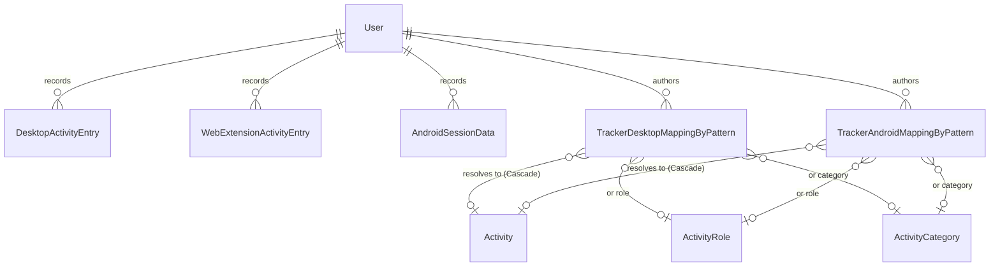

# AdhdTimeOrganizer.Tracking — Domain Map

Navigation index. Read `summary.md` first; open only the rows you need.

⚠ **Paths below are folders; namespaces still say `activityTracking`.** The two drifted apart during
the split. Go by the paths.

## Model

The three ledgers hold **no FK to `Activity`**: a raw entry is what was seen, and the mapping that
interprets it is editable after the fact. Resolution happens at ingest (desktop) or at read time, never
by storing the verdict on the entry.

## Entities

| Entity | Table | Notes | Path |
|---|---|---|---|
| `DesktopActivityEntry` | `desktop_activity_entry` | Per-heartbeat desktop window. **RANGE-partitioned** on `RecordDate`. `ExecutablePath` is an `EncryptedColumn`; `WindowTitle` deliberately is not. | `domain/model/entity/desktop/` |
| `WebExtensionActivityEntry` | `web_extension_activity_entry` | Per-minute browser window. **RANGE-partitioned** on `RecordDate`; `RecordDate` derives from `WindowStart` in the initializer so the two cannot diverge. `WindowStart` must be minute-aligned — the timeline endpoint stitches windows by `WindowStart == previous.EndedAt`. Its hand-written query filter also bounds `RecordDate >= AppDbContext.CurrentPartitionDate` (`today.AddYears(-2)`) — a **retention floor, not a partition bound**: the web-extension dashboards cannot read rows older than two years even while the ledger still holds them, so `AllTime` is narrower here than on the other two sources. | `domain/model/entity/` |
| `AndroidSessionData` | `android_session_data` | Per-session android usage, deduplicated on sync by the unique `(UserId, DeviceId, PackageName, SessionStartUtc)`. The only ledger storing real sessions rather than windows, and the only one that is not RANGE-partitioned — its retention purge ages on `SessionStartUtc`. | `domain/model/entity/` |
| `TrackerDesktopMappingByPattern` | `tracker_desktop_mapping_by_pattern` | Pattern → `Activity`/`Role`/`Category`, or `IsIgnored`. Matched in-memory by `MatchesPattern`. **Many** patterns to one activity; `activity_id` is `Cascade` with a pinned constraint name. The unique key is the pattern: `(UserId, ProcessName, ProductName, WindowTitle)`, `NULLS NOT DISTINCT`. | `domain/model/entity/desktop/` |
| `TrackerAndroidMappingByPattern` | `tracker_android_mapping_by_pattern` | Android equivalent; unique on `(UserId, PackageName, AppLabel)`. | `domain/model/entity/android/` |

Two enums: `TrackerMappingTypeEnum` (`domain/model/enum/`) — the mapping's target shape, a filter-side
convenience over the check constraint below, and **shared by both mapping tables** (it was
`TrackerDesktopMappingTypeEnum` until CQ-15, which is correct by value on the android grid and misleading
by name) — and `BaselineType` (`application/dto/enum/`), the dashboards' comparison window (`Last7Days` /
`Last30Days` / `SameWeekday` / `AllTime`). On both grid filters it is **optional**: null means every
target shape, and an undefined value is a 400 from the grid validators' `IsInEnum` rather than the switch's
throw.

## Invariants

- **Exactly one target group per mapping row** — `IsIgnored = true`, *or* `ActivityId`, *or*
  `RoleId`/`CategoryId` (both allowed together). *DB-enforced*
  (`CK_Tracker*MappingByPattern_TargetRequired`), and mirrored in one copy by
  `MappingTargetRules.AddMappingTargetRules` on **all four** mapping validators so the failure is a 400
  naming the rule rather than a `23514` the user sees as a 500.
- **`IsIgnored` is `true` or `NULL`, never `false`.** *DB-enforced* (`…_IsIgnoredOnlyTrue`), same shared
  rule.
- **A mapping's `ActivityId` / `RoleId` / `CategoryId` is the author's own.** *App-enforced* on all four
  mapping write endpoints (`MappingTargetOwnershipExtensions.EnsureOwnsMappingTargetsAsync` from
  `BeforeMapping`, over Core's `IReferencedIdOwnershipService`), a 404 per offending field. The FK
  enforces existence only, and a mapping is a standing rule — an unchecked id would attribute time to
  another account's activity on every matching heartbeat, invisibly, because read-back is filtered.
  Update is the more dangerous half and the one that only got the guard with CQ-10: it can aim a rule
  that is *already* matching the user's traffic at a stranger's activity, without creating anything.
- **An update to a mapping is a full replace, target included.** *Type-enforced* — both update DTOs carry
  `IsIgnored`/`ActivityId`/`RoleId`/`CategoryId` and write all four, so a member left out of the body
  clears its column. Until CQ-10 they carried none of them and a rule could not be re-pointed through the
  API at all; deleting and recreating one is not a workaround, because losing a mapping silently stops
  every future heartbeat matching that pattern from being attributed.
- **A pattern column implies its match type** (`process_name IS NULL OR process_name_match_type IS NOT
  NULL`, and the same for product name / window title / package name / app label). *DB-enforced*.
- **One pattern per user.** *DB-enforced*, unique with `NULLS NOT DISTINCT` so two NULL process names
  count as equal — and *pre-checked* by `MappingPatternUniquenessExtensions` on all four write endpoints,
  which answers the ordinary case with the same 409 the index would while naming the pattern the caller
  already has (CQ-11). The update side excludes the row under edit, or every edit that leaves the pattern
  alone would collide with itself.
- **The most specific matching mapping wins a desktop entry.** *App-enforced* — the heartbeat orders the
  user's active rules by the number of pattern columns they constrain, then by id, and takes the first
  match. Nothing ordered the list before CQ-16, so "ignore GitHub everywhere except in Chrome" resolved
  to whatever order an unordered read returned. Ordering does not resolve two equally specific rules that
  genuinely overlap; it makes the winner stable and explicable.
- **One android session per `(user, device, package, start)`.** *DB-enforced* — this is what makes the
  sync endpoint's re-send idempotent. The endpoint keys off the same tuple *within* a batch as well as
  against the stored rows, so a phone that repeats a session inside one payload gets it counted as a
  duplicate rather than taking the whole sync down on the index (CQ-7).
- **The two android session instants are read as UTC.** *App-enforced* — `AndroidSyncEndpoint` parses them
  with `AdjustToUniversal | AssumeUniversal`, so an offset a client chose to send is **converted**, not
  relabelled. A naked instant is read as UTC, which is what the field names promise (CQ-6).
- **An android session is at most 24h long, is not in the future, and is not older than the retention
  horizon.** *App-enforced at the ingest boundary only* (`AndroidSyncValidator` bounds the stated
  `DurationSeconds` and the batch size, a 400; `AndroidSyncEndpoint` bounds the span the two instant
  strings actually describe and drops the offending session with a warning, the way it already drops
  unparseable and duration-mismatched ones). The length bound is load-bearing rather than cosmetic:
  `UnifiedActivityLoader.SliceIntoMinutes` allocates one `SourceMinute` per minute of a session, so one
  stored decade-long row would take out every unified dashboard for that user while the android
  dashboards render it as one ordinary session. The loader clamps to a day's worth of minutes as well,
  for rows written before this rule.
- **An ingest payload carries a bounded number of items.** *App-enforced at the ingest boundary* — see
  `TrackingIngestLimits`, one cap per route (android sessions per sync, desktop entries per window,
  web-extension activities per heartbeat). All three ledgers are append-only, so an unbounded payload is
  an unbounded permanent write.
- **`RecordDate == DateOnly.FromDateTime(WindowStart)`.** *Type-enforced* — the setter is private and
  the value derives in `WindowStart`'s initializer.
- **A web-extension `WindowStart` is minute-aligned.** *App-enforced at the ingest boundary only*
  (`WebExtensionHeartbeatValidator`, a 400). Not enforced by the type, on purpose: EF would run a
  throwing setter while materializing rows written before the rule existed.
- **Both partitioned tables have a composite PK `(Id, RecordDate)` and a non-concurrency
  `row_version`.** *DB-enforced* — Postgres requires the partition key in the PK, and a partitioned
  table cannot return `xmin` in a `RETURNING` clause.
- **An attribution write and its raw entries commit together.** *App-enforced* — the sink mutates the
  context and must not call `SaveChanges`; the heartbeat's single save is the transaction.
- **One desktop entry per `(user, window, process, window title)`; one web-extension entry per
  `(user, window, domain)`.** *DB-enforced*, and both endpoints key off the same tuple in memory before
  they write (CQ-5, CQ-8). The desktop heartbeat **sums the seconds** of entries that collide — one
  application's two windows on two monitors, since `ActiveMonitor` is not in the index — and the
  web-extension one keeps the **last** running total for a repeated domain. Both also skip what the
  window already holds, so an agent re-posting a window it did commit gets a 200 with those entries
  ignored and their seconds attributed once, not twice.
- **A unique-index collision on an ingest route is a 409, never a 500.** *App-enforced* —
  `IngestBatchSaveExtensions.TrySaveIngestBatchAsync` wraps all three saves, giving `23505` the same
  status the CRUD bases' `DbUtils.HandleException` already gives it (CQ-11). The three clients are
  unattended and retry, so a 500 on a batch that can never succeed is a loop rather than an error.

## EF configurations

`infrastructure/persistence/configuration/` (with `desktop/` and `android/` subfolders) — all five.
Three of them
(`DesktopActivityEntryConfiguration`, `WebExtensionActivityEntryConfiguration`,
`AndroidSessionDataConfiguration`) came from the host's `configuration/activityHistory/` folder, which
never matched their domain.

Applied by `AppDbContext.ApplyHostConfigurations` via
`ApplyConfigurationsFromAssembly(typeof(DesktopActivityEntryConfiguration).Assembly)`.

## Endpoints — `application/endpoint/`

One folder per source — `desktop/`, `webExtension/`, `android/`, `unified/` — each split into
`command/` and `query/`; the desktop dashboards sit one level deeper in `desktop/query/dashboard/`.

Routes come from the five groups, all five classes in the single file
`application/endpointGroups/ActivityTrackingDesktopSettingsIgnoredProcessGroup.cs` (the file name has
outlived its contents), so the literal in `Post(...)` is often only the tail. Check the group before
assuming a path.

| Area | Route prefix | Endpoints |
|---|---|---|
| Desktop ingest | `/activity-tracking/desktop` | `DesktopActivityHeartbeatEndpoint` (`/heartbeat`) — ⚠ ingest only, see `summary.md` |
| Desktop dashboards | `/activity-tracking/desktop` | pie-chart, stacked-bars, summary-cards, timeline, focus-metrics, process-details, distinct-processes, `gird` |
| Desktop mappings | `/activity-tracking/desktop/settings` | create / update / delete / `gird`, plus `fetch-categories-and-roles-by-pattern`. Update is a **full replace including the target** (see Invariants) |
| Web-extension ingest | `/activity-tracking/web-extension` | `WebExtensionDataHeartbeatEndpoint` (`/heartbeat`) |
| Web-extension dashboards | `/activity-tracking/web-extension` | pie-chart, stacked-bars, summary-cards, timeline, focus-metrics, domain-details |
| Android ingest | `/activity-tracking/android` | `AndroidSyncEndpoint` (`/sync`) |
| Android dashboards | `/activity-tracking/android` | pie-chart, stacked-bars, summary-cards, timeline, focus-metrics, `gird` |
| Android mappings | `/activity-tracking/android/settings` | create / update / delete / `gird`; update as above |
| Unified dashboards | `/activity-tracking/unified` | sources, pie-chart, summary-cards, stacked-bars, timeline, focus-metrics — see **The unified dashboards** below |

**Request shape (all twenty-one dashboards; the six unified ones add `sources` and nothing else):**
`DateRangeAndTimeRangeDto`
(`application/dto/request/DateRangeAndTimeRangeDto.cs`) — an inclusive `dateFrom`/`dateTo` day span
plus `from`/`to`, which are a **time-of-day window repeated on each day of the span**, not the ends of
the range. It resolves through `domain/helper/DailyWindowSet.cs`, which also lays out the stacked-bars
bands. Read the span continuously instead and every endpoint still returns a well-formed 200 with
silently inflated totals — `TrackingDashboardDateRangeTests` is the guard, and it asserts on the
numbers. The two timelines take the span members for uniformity and reject anything but a single day.
The two details endpoints take an instant envelope plus the optional
`windowStartMinutes`/`windowEndMinutes` pair that carries the same daily window across.

**There is one request class per dashboard, not one per source.** `PieChartRequest`,
`SummaryCardsRequest`, `StackedBarsRequest`, `BaseTimelineRequest` and `FocusMetricsRequest` are each
bound by all three sources; the unified routes add `sources` on top. Android used to carry its own copy
of the stacked-bars and timeline requests, differing only in `MinSeconds` being a `long` — a naming
accident rather than a distinction, since nothing about a bucket width is source-specific. **The
response shapes are a different matter and stay separate**: each source carries a different secondary
detail list (`pages` / `windowTitles` / none) with a matching distinct count, and android has no
background concept at all, so a shared response would have to ship a structurally-always-zero
`backgroundSeconds` and a `details` list meaning URLs on one source and window titles on another.

**Every dashboard item also carries a `key`/`label` pair** (`application/dto/response/IDashboardItem.cs`)
beside its own `domain` / `processName` / `packageName` fields — additive, computed, and the same two
names on all three sources, so a client hashes one field for colour and prints one field for display
instead of six across three sources. `label` is never blank; it falls back to `key`.
`TrackingDashboardItemIdentityTests` is the guard, and the fallback is the half that regresses silently.
Not to be confused with the unified dashboards' single `label`, where one identity string across sources
is the whole point — see below.

**The four `focus-metrics` dashboards** (`application/endpoint/BaseFocusMetricsEndpoint.cs` — generic
over the request only because the merged one carries `sources`) add
`baseline` (nullable — no comparison at all is a request the client makes deliberately) and
`focusGapSeconds`, the block-tolerance the client owns and sends. They are the only dashboards
besides the timelines that need *sessions* rather than sums, and the only ones that accept a span
while doing so. Two rules are load-bearing and neither is visible in a 200:

- **Sessions are built one day-window at a time**, so a block cannot span two days and the excluded
  night is not a gap candidate. `FocusMetricsCalculator` documents every definition; they are contract,
  not implementation choices.
- **The baseline scales the same way `summary-cards`' does** — mean day over the lookback × the span's
  `DayCount` for the count, per-day means for the maxima, unscaled for the median. The two sit on one
  screen and must not disagree about what "compared to last 7 days" means.

**Session building lives in `domain/helper/TimelineSegmentBuilder.cs`, in one copy.** The web-extension
and desktop timelines each used to carry their own transcription of it; the focus-metrics dashboards
have to report on *the same* primary sessions the timeline draws, and a drifted second copy would make
the strip disagree with the chart above it while both endpoints' tests passed. Android needs none of
it — its ledger already stores real sessions.

## The unified dashboards — `application/endpoint/unified/query/`

Six endpoints under `/activity-tracking/unified` that answer over **all three ledgers at once**. They
bind the same span base as the fifteen per-source dashboards plus one field, `sources` — a non-empty
subset of `webExtension` / `desktop` / `android`.

**`sources` is a request field, not a client-side filter, and that is the whole reason these endpoints
exist.** An hour in a browser is credited to the extension while the desktop agent is also selected;
deselect the extension and that hour has to come *back* to the desktop agent as `Google Chrome`. A
client filtering a pre-merged payload can only hide a lane — it cannot give the time back.

| File | Role |
|---|---|
| `domain/helper/unified/TrackingSource.cs` | the three sources; **the enum's numeric order is level 2 of the overlap rule**, and the wire names, spelled out rather than left to the enum serializer |
| `domain/helper/unified/UnifiedMinuteMerger.cs` | the overlap rule, in one copy — read this before touching any of the six |
| `domain/helper/unified/UnifiedLabelResolver.cs` | the single identity string, and the cross-source join |
| `domain/helper/unified/SecondsAllocator.cs` | largest-remainder rounding, so the parts keep adding up |
| `application/service/unified/UnifiedActivityLoader.cs` | flattens the three ledgers onto one minute grid |
| `application/service/unified/UnifiedLedger.cs` | the one rounded ledger every merged figure is read off |
| `application/service/unified/UnifiedSpan.cs` | one request's load + merge + ledger, plus the exclusive-minute partition |

**Three things about it are contract rather than implementation, and none of them shows in a 200:**

- **The rule has two levels and the order matters.** Foreground beats background whatever the rank;
  only within one activity class does `webExtension > desktop > android` decide. Level 1 exists because
  level 2 alone credits a desktop browser window on a second monitor over the phone actually in the
  user's hands.
- **Losing is partial.** A source keeps whatever share of a minute the winners did not claim, which is
  what makes browser time the extension could not see survive as `Google Chrome`. Suppressing the
  browser process wholesale while the extension is selected is the tempting shortcut and it is wrong.
- **Everything is read off one rounded ledger.** The source chips, the pie's totals and the cards are
  all sums of the same rows, so `sum of countedSeconds == totals.totalSeconds` and
  `countedSeconds + displacedSeconds ==` that source's own dashboard hold by construction. Both are
  printed on one screen for the user to check.

`focus-metrics` is a **fifth** route beside the three per-source ones, not a replacement, and shares
`BaseFocusMetricsEndpoint<TRequest>` with them — which is generic only because the merged request
carries `sources`. Its sessions are keyed on the unified label, and that single decision settles both
questions the merge raises: a change of label is a switch whatever source either side came from, and
the same label from two sources is a device change rather than a switch.

**Auth:** the three ingest endpoints carry `[AllowExtensionClients]` **and**
`Policies(PortalAuthorizationPolicies.ActivityTracking)`. Everything else is an ordinary web endpoint
and is therefore denied to extension clients by the `Program.cs` configurator's default.

## Navigation index — everything that is not an endpoint

| Name | Kind | Responsibility | Path |
|---|---|---|---|
| `DailyWindowSet` | Domain helper | Turns a day span + time-of-day window into the per-day windows every dashboard reads, and lays out the stacked-bars bands | `domain/helper/DailyWindowSet.cs` |
| `TimelineSegmentBuilder` | Domain helper | Stitches windows into sessions — **one copy**, shared by the timelines and the focus-metrics dashboards so the strip cannot disagree with the chart | `domain/helper/TimelineSegmentBuilder.cs` |
| `FocusMetricsCalculator` | Domain helper | The four fragmentation measures and their definitions, computed inside one day-window and rolled up | `domain/helper/FocusMetricsCalculator.cs` |
| `TrackingSource` | Domain helper | The three sources; the enum's numeric order **is** level 2 of the overlap rule, and the wire names are spelled out | `domain/helper/unified/TrackingSource.cs` |
| `UnifiedMinuteMerger` | Domain helper | The overlap rule, in one copy — read before touching any of the six unified endpoints | `domain/helper/unified/UnifiedMinuteMerger.cs` |
| `UnifiedLabelResolver` | Domain helper | The single cross-source identity string, and the join it enables | `domain/helper/unified/UnifiedLabelResolver.cs` |
| `SecondsAllocator` | Domain helper | Largest-remainder rounding, so the parts keep adding up to the total | `domain/helper/unified/SecondsAllocator.cs` |
| `UnifiedActivityLoader` | Service | Flattens the three ledgers onto one minute grid | `application/service/unified/UnifiedActivityLoader.cs` |
| `UnifiedLedger` | Service | The one rounded ledger every merged figure is read off | `application/service/unified/UnifiedLedger.cs` |
| `UnifiedSpan` | Service | One request's load + merge + ledger, plus the exclusive-minute partition | `application/service/unified/UnifiedSpan.cs` |
| `TrackerMappingActivityReferenceSource` | Seam impl | Exposes both mapping tables' `ActivityId` to Core's merge/delete machinery; backs `usageCount`/`canDelete` on the activity grid | `application/seam/TrackerMappingActivityReferenceSource.cs` |
| `BaseFocusMetricsEndpoint<TRequest>` | Endpoint base | The four focus-metrics routes; generic over the request only because the merged one carries `sources` | `application/endpoint/BaseFocusMetricsEndpoint.cs` |
| `BaseSummaryCardsEndpoint<TRequest, TItem>` | Endpoint base | The three per-source summary-cards routes. **The baseline block lives here in one copy** — the lookback arithmetic, the per-day window applied to the lookback as well as the span, the weekday fold on the user's calendar, the `AllTime` floor at `MaxSpanDays` and the scaling to the span. Sources supply only their ledger read (into `SummaryRow`) and their DTO | `application/endpoint/BaseSummaryCardsEndpoint.cs` |
| `DashboardDateRangeRules` | Validator helper | The shared span rules (inclusive ends, the max-span cap) every dashboard validator composes | `application/validator/DashboardDateRangeRules.cs` |
| `BaseTimelineValidator` · `StackedBarsValidator` · `PieChartValidator` · `SummaryCards`/`FocusMetrics`/`TopDomains`/`DomainDetails` validators | Validators | **One per dashboard, not one per source** — all three sources bind the same request classes | `application/validator/` |
| `UnifiedDashboardValidators` | Validators | The `sources` rule on top of the shared span rules: non-empty, known members only | `application/validator/unified/UnifiedDashboardValidators.cs` |
| `DesktopActivityHeartbeatValidator` · `WebExtensionHeartbeatValidator` · `AndroidSyncValidator` | Validators | The ingest boundary — including the minute-alignment rule | `application/validator/{desktop,webExtension,android}/` |
| `TrackingIngestLimits` | Constants | Every bound the write paths put on an untrusted payload, in one place — batch sizes, the android session length, and the column widths the ingest and mapping validators enforce | `application/validator/TrackingIngestLimits.cs` |
| `MappingTargetOwnershipExtensions` | Endpoint helper | The activity/role/category ownership guard all four mapping write endpoints call from `BeforeMapping`, over the `IMappingTargetRequest` all four requests implement | `application/endpoint/extensions/` |
| `MappingPatternUniquenessExtensions` | Endpoint helper | The duplicate-pattern pre-check beside it — the same 409 the index gives, with the pattern named (CQ-11) | `application/endpoint/extensions/` |
| `IMappingTargetRequest` · `MappingTargetRules` | DTO contract + validator rules | The mapping target group, and its two shape rules in one copy across the four mapping validators | `application/dto/request/` · `application/validator/` |
| `IngestBatchSaveExtensions` | Endpoint helper | The save all three ingest routes end on — a `23505` becomes a 409 rather than a 500 an unattended client re-posts forever | `application/endpoint/extensions/` |
| `PurgeExpiredActivityTrackingEntriesJobHandler` | Scheduled job | The retention purge (see Infrastructure below) | `infrastructure/jobs/` |

## Seams (all declared in `AdhdTimeOrganizer.Core`)

| File | Role |
|---|---|
| `Core/application/seam/IActivityTimeAttributionSink.cs` | "record N seconds against this activity" — implemented by History's `ActivityHistoryTimeAttributionSink` |
| `Core/application/event/ActivityTimeRecordedEvent.cs` | day totals per activity — handled by the host's `ActivityTimeRecordedEventHandler` |
| `Core/application/seam/IActivityReferenceSource.cs` | this slice's `application/seam/TrackerMappingActivityReferenceSource` — backs `usageCount`/`canDelete` on the activity grid, and repoints both mapping tables on `POST /activity/merge` |

## Infrastructure

| Concern | File |
|---|---|
| Retention purge (GDPR Art. 5(1)(e)) | `infrastructure/jobs/PurgeExpiredActivityTrackingEntriesJobHandler.cs` — a keyed `IScheduledJobHandler` (**not** a Quartz `IJob`; this slice references no Quartz). `ExecuteDeleteAsync` with `IgnoreQueryFilters`, so it purges every user's rows. All three ledgers: `desktop_activity_entry` / `web_extension_activity_entry` on `RecordDate` (partition-pruned), `android_session_data` on `SessionStartUtc` (unpartitioned, so a real sweep) |
| Its 03:30-daily schedule | `infrastructure/scheduling/TrackingScheduledJobsRegistrar.cs` — pushed to the Scheduler module on every boot through `IScheduler` (the RAM job store drops triggers on restart) |
| Retention policy | `infrastructure/persistence/retention/ActivityTrackingRetentionOptions.cs` — bound in `Program.cs` |
| Dev fixture | `infrastructure/persistence/seeder/dev/WebExtensionDataSeeder.cs` — truncates, so it is a dev seeder, not a default one |

## Host-side pieces that belong to this slice's behaviour

Open these when changing tracking, even though they are not in this project:

| What | Where |
|---|---|
| FastEndpoints assembly list | `AdhdTimeOrganizer/Program.cs` (`o.Assemblies`) |
| DI marker scan list | `AdhdTimeOrganizer/config/dependencyInjection/ModuleServiceExtensions.cs` (`ModuleAssemblies`) |
| Configuration scan | `AdhdTimeOrganizer/infrastructure/persistence/AppDbContext.cs` (`ApplyHostConfigurations`) |
| `WebExtensionActivityEntry` scoping exclusion + combined filter | `AppDbContext.UserScopingExcludedTypes` and `OnModelCreating` |
| Partition DDL generator | `Program.cs` **and** `config/AppCommandDbContextFactory.cs` |
| `ActivityTracking` policy definition | `config/IdentityServiceExtensions.cs` |
| `ActivityTracking` role grant | `infrastructure/extService/user/auth/ExtensionRoleClaimsProvider.cs` |
| Completion automation | `application/eventHandler/ActivityTimeRecordedEventHandler.cs` |
| Hosted registrar that schedules the purge | `Program.cs` (`AddHostedService<TrackingScheduledJobsRegistrar>()`) — dropping it builds fine and the purge silently never fires |

⚠ The policy name, the role name, and the `AutoTagOverride("ActivityTracking")` Swagger tag in
`application/endpointGroups/` are **three different constants that happen to share one string**.
Renaming one renames none of the others.

## Tests

All of them live in `AdhdTimeOrganizer.IntegrationTests` — this slice has no test project of its own.
The inventory, what each suite pins, and the standing caveats are in **`testing.md`**.
